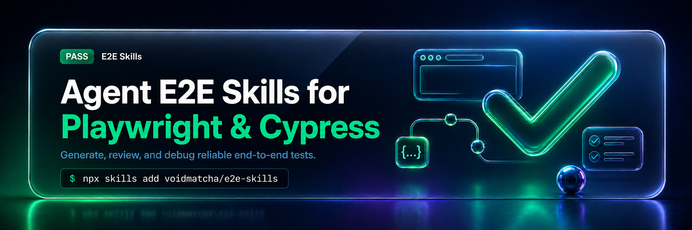
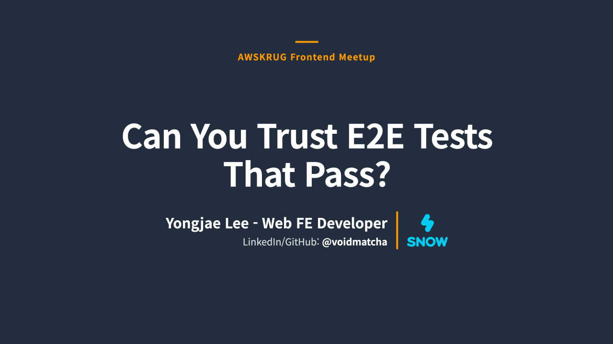

<div align="center">
  
</div>

<h1 align="center">E2E Skills</h1>

<p align="center">
  <a href="https://github.com/voidmatcha/e2e-skills"></a>
  <a href="https://claude.com/product/claude-code"></a>
  <a href="https://github.com/openai/codex"></a>
  <a href="https://playwright.dev"></a>
  <a href="#merged-upstream-fixes"></a>
  <a href="https://github.com/vercel-labs/skills#supported-agents"></a>
  <a href="https://www.skills.sh/voidmatcha/e2e-skills"></a>
  <a href="https://www.kimi.ai/resources/software-testing-skills"></a>
  <a href="./LICENSE"></a>
</p>

<p align="center">
<a href="README.md">English</a> | <a href="README.ko.md">한국어</a> | <strong>日本語</strong> | <a href="README.zh-cn.md">简体中文</a>
</p>

<!-- README-CANONICAL-REVISION: sha256=d75286aed92d41bb0f80cf58885c60c249f596a4cc424fda547efda6d212603f; bytes=exact-README.md-UTF-8; translation-quality=not-attested -->

`e2e-skills` は、Claude Code、Codex などの対応 AI コーディング agent で使える、Playwright と Cypress の E2E テスト向けオープンソース skill 集です。3 つの skill で Playwright テストの生成、既存の Playwright/Cypress テストや PR のレビュー、そして製品コードを変えずに失敗中のテストを修正します。

**E2E テストは成功しています。では、機能は正しく動いていますか？** 人気の React リポジトリ 200 件のうち 34 件で、名前に書かれた機能が壊れていても成功し得るテストが見つかりました。[範囲と限界](#evidence-and-limits) · [データ](https://huggingface.co/datasets/voidmatcha/e2e-skills-benchmarks/blob/770f2de79848c65b80116219ce2d03747a3ae370/raw/oss-prevalence-and-reviewer-20261106/oss-cases/summary.md)

`e2e-skills` は、テストが名前どおりの動作を実際に検証しているかを確認する手助けをします。まず[インストールして試す](#install-and-try-it)から始めてください。無料のメモを追加し、skill をインストールして、30 秒のスキャンを実行します。

<p align="center">
  <a href="https://www.kimi.ai/resources/software-testing-skills">
    
  </a>
  <br />
  <sub><a href="https://www.kimi.ai/resources/software-testing-skills">Kimi 公式サイトの「AI Software Testing Skills for Smarter QA Automation」で紹介されています。</a></sub>
</p>

`e2e-reviewer` はコードスキャナーで問題候補を探し、テストと周辺コードを読んで実際の問題か判断します。[実験的なランタイム検証](#experimental-runtime-proof-opt-in)は、明示的に依頼した場合にのみ利用できます。

| 必要なこと | スキル | 結果 |
| --- | --- | --- |
| 新しい Playwright カバレッジを生成 | [`playwright-test-generator`](skills/playwright-test-generator/SKILL.md) | 実際の画面を観察して書いたテストと、スキャナー確認および実行結果 |
| Playwright/Cypress テストまたは PR/diff 変更をレビュー | [`e2e-reviewer`](skills/e2e-reviewer/SKILL.md) | 重要度別の問題、判断根拠、修正案。変更では新規・悪化・既存の問題を区別 |
| 失敗中の Playwright/Cypress テストをデバッグして修正 | [`e2e-debugger`](skills/e2e-debugger/SKILL.md) | 根拠付きで原因を FLAKY、APP-REGRESSION、TEST-DEFECT-FIXED、ENV、UNCLEAR のいずれかに分類。安全なテストファイルの修正のみで製品コードは変えない |
| 決定論的なローカルスキャンを実行 | `e2e-skills scan` | 対象プロジェクトの package をインストールせずに見つけた問題候補 |

P0/P1/P2 はレビューの重要度です。P0 は機能が壊れても成功する問題、P1 は信頼性や診断の問題、P2 は保守性の改善です。

**テスト生成:** インストール後、テストするローカルプロジェクトを agent に伝えてください。必要な設定を確認し、不足する準備があれば案内します。

https://github.com/user-attachments/assets/4457b99a-f6f4-4023-94d3-cbf3a48387d6

<p align="center">
  <sub>リファクタリングで POST /api/like の呼び出しが消えます。画面には Liked と表示されるため UI だけを確認する Playwright テストは成功したままですが、リクエストを確認するテストは POST が送信されないため失敗します。examples/optimistic-like-demo の実行可能な例から録画しました。<br /><a href="docs/assets/demo.mp4">MP4</a> または <a href="docs/assets/demo.gif">GIF</a> をダウンロードするか、<a href="examples/optimistic-like-demo/README.md">自分で実行してみてください</a>。</sub>
</p>

<a id="merged-upstream-fixes"></a>

## アップストリームにマージされた修正

`e2e-reviewer` が見つけた問題の修正は **15 件のマージ済み upstream PR** につながりました。以下の表から各パッチを確認できます。

以下のリポジトリの GitHub stars は合計 **496,650** です。2026-10-20 の GitHub API スナップショットに基づきます。

| リポジトリ | GitHub Stars | PR | 修正したパターン |
| --- | ---: | --- | --- |
| Storybook | ★91.3k | [storybookjs/storybook#34141](https://github.com/storybookjs/storybook/pull/34141) | Playwright 操作の `await` 漏れと可視性チェックの戻り値の未検証 |
| code-server | ★79.7k | [coder/code-server#7845](https://github.com/coder/code-server/pull/7845) | Focused test leak、matcher-less `expect`、discarded visibility read |
| Strapi | ★73.3k | [strapi/strapi#26630](https://github.com/strapi/strapi/pull/26630) | Discarded navigation/state checks |
| Ghost | ★55.6k | [TryGhost/Ghost#28712](https://github.com/TryGhost/Ghost/pull/28712) | Promise-valued disabled-state assertion |
| Cal.com | ★49.2k | [calcom/cal.diy#28486](https://github.com/calcom/cal.diy/pull/28486) | E2E flow の weak assertion patterns |
| Bruno | ★47.7k | [usebruno/bruno#8317](https://github.com/usebruno/bruno/pull/8317) | Assertion と wait reliability fixes |
| Qwik | ★22.1k | [QwikDev/qwik#8777](https://github.com/QwikDev/qwik/pull/8777) | Locator/handle existence checks |
| SvelteKit | ★20.9k | [sveltejs/kit#16068](https://github.com/sveltejs/kit/pull/16068) | Floating Playwright assertions |
| Element Web | ★13.6k | [element-hq/element-web#32801](https://github.com/element-hq/element-web/pull/32801) | Locator null-check style assertions |
| FiftyOne | ★11.2k | [voxel51/fiftyone#7851](https://github.com/voxel51/fiftyone/pull/7851) | Locator-defined check を visible duplicate-name error assertion に置き換え |
| Carbon Design System | ★9.6k | [carbon-design-system/carbon#22564](https://github.com/carbon-design-system/carbon/pull/22564) | Locator truthiness を web-first assertions に置き換え |
| Rancher Desktop | ★7.4k | [rancher-sandbox/rancher-desktop#10557](https://github.com/rancher-sandbox/rancher-desktop/pull/10557) | `not.toBeNull()` locator checks を visible WSL integration-name assertions に置き換え |
| Apache Zeppelin | ★6.7k | [apache/zeppelin#5180](https://github.com/apache/zeppelin/pull/5180) | 常に真の assertion と、暗黙にスキップされるガード付きチェック |
| MUI X | ★5.9k | [mui/mui-x#22982](https://github.com/mui/mui-x/pull/22982) | UI handle checks を state assertions に置き換え |
| module-federation/core | ★2.7k | [module-federation/core#4826](https://github.com/module-federation/core/pull/4826) | Cypress spec 内の redundant blanket `uncaught:exception` suppression |

## false-green テストを見る

**false-green** は、確認したい動作が壊れてもテストが成功する状態です。以下の修正では、Locator オブジェクトの存在ではなく、実際の画面にメッセージが表示されるかを確認します。

```diff
- expect(page.getByText('Welcome back')).toBeDefined()
+ await expect(page.getByText('Welcome back')).toBeVisible()
```

<details>
<summary>完全な例と scanner 出力</summary>

この Playwright テストはもっともらしく見えますが、証明しているのは `Locator` オブジェクトが作られたことだけです。

```typescript
import { expect, test } from '@playwright/test';

test('shows the welcome message', async ({ page }) => {
  await page.goto('/dashboard');
  expect(page.getByText('Welcome back')).toBeDefined();
  expect(page.locator('.user-badge')).not.toBeNull();
});
```

同梱スキャナーは、プロジェクト設定なしで false-green assertion を検出します。以下はテキストレポートです（`--format text` を付けない場合、同じ結果を JSON で出力します）。

```console
$ npx --yes --package=@voidmatcha/e2e-skills-scanner@3.8.0 e2e-skills scan tests/ --format text
Node source scan (canonical report view)
Status: COMPLETE; confirmed P0: 2, P0 candidates: 0, unresolved locations: 0.
Next:
  - Fix 2 confirmed P0 finding(s) ([P0][CONFIRMED] below).
Terms: https://github.com/voidmatcha/e2e-skills/blob/main/docs/scanner-cli.md#glossary

Coverage: BOUNDED; discovery: COMPLETE.
Semantic review: no LLM-triage candidates or source-linked analysis tasks; compatibility contract: DEVELOPMENT.
Review obligations: 0 unresolved location(s) covered by reviewing a retained candidate.
Unresolved analysis: 0 location(s) in 0 file(s), not findings; 0 of them are source-linked review tasks; execution status unchanged.
Project configuration: UNAVAILABLE; declared settings only, runner selection unchanged.
Configuration files: 0; unresolved configuration observations: 1.
Project ESLint effective rule states: NOT EXECUTED; static declarations do not establish active rules.

[P0][CONFIRMED] #4f Static finding (2 hits)
  "login.spec.ts":5: #4f
  "login.spec.ts":6: #4f

AST-origin total: 2 hit(s); retained findings, not ast-grep execution.

Summary: 2 total hit(s), 2 P0, 0 P1/P2 heuristic, 0 LLM-triage, 0 P0 candidate; 2 AST-origin hit(s), canonical retained findings.
```

この実行は P0 指摘を報告するため、`e2e-skills scan` は exit 1 で終了します。

**実行可能な例:** [React optimistic-write の証明](examples/react-optimistic-write/README.md) は、optimistic UI には画面に見える状態だけでなく、リクエストと永続化の証明も必要な理由を示します。

</details>

## 発表資料

<table align="center">
<tr>
<td align="center" valign="top" width="50%">
<a href="https://voidmatcha.art/talks/awskrug-e2e-2026-en"></a>
<p><b>成功する E2E テストを信頼できますか？</b><br />AWSKRUG Frontend Meetup</p>
<p><a href="https://voidmatcha.art/talks/awskrug-e2e-2026-en">発表資料を見る（英語）</a></p>
</td>
<td align="center" valign="top" width="50%">
<a href="https://voidmatcha.art/talks/react-day-berlin-2026-en"></a>
<p><b>Green Isn’t Proof</b><br />React Day Berlin 2026</p>
<p><a href="https://voidmatcha.art/talks/react-day-berlin-2026-en">発表資料を見る（英語）</a></p>
</td>
</tr>
</table>

<a id="install-and-try-it"></a>

## インストールして試す

### 1. 無料のメモを追加する

[メモの本文](docs/test-authoring-memo.md#the-memo)をプロジェクトの `AGENTS.md`（Codex）または `CLAUDE.md`（Claude Code）へコピーします。既存の指示は残してください。プロジェクトのディレクトリから CLI で追加することもできます（Node.js 22+ が必要）。`CLAUDE.md` には `--host claude`、プレビューには `--dry-run` を使います。このコマンドは skill をインストールせず、メモだけを書き込みます：

```bash
npx --yes --package=@voidmatcha/e2e-skills-scanner@3.8.0 e2e-skills guidance --host codex --project . --memo
```

### 2. skill をインストールする

このコマンド 1 つで、Claude Code と Codex を含むすべての[対応エージェント](https://github.com/vercel-labs/skills#supported-agents)に 3 つのスキルをグローバルにインストールします。CLI のバージョンは固定されています。1 つのエージェントだけにインストールする場合は `npx --yes skills@1.5.21 add voidmatcha/e2e-skills --skill '*' -g -a <agent>` を使ってください（例: `-a claude-code`、`-a codex`）。新しいエージェントのセッションを開始し、スキル一覧（Claude Code なら `/skills`）に `e2e-reviewer`、`e2e-debugger`、`playwright-test-generator` が表示されることを確認してください。

```bash
npx --yes skills@1.5.21 add voidmatcha/e2e-skills -g --all
```

レビューとデバッグはすぐに使えます。テスト生成には Playwright 公式のテストエージェントと `playwright-test` MCP サーバーも必要で、プロジェクトごとに一度 `npx playwright init-agents` で設定します。[一度だけ行うプロジェクト設定](#test-generation-one-time-project-setup)を参照してください。

### 3. テストをスキャンする

一般的なテストディレクトリなら、静的スキャンは約 30 秒で終わります（Node.js 22+ が必要）：

```bash
npx --yes --package=@voidmatcha/e2e-skills-scanner@3.8.0 e2e-skills scan tests/ --format text --fail-on p0 --allow-incomplete
```

終了コード 0 をクリーンな結果と判断する前に、[スキャン結果と CI オプション](#standalone-scanner)を確認してください。

### 使ってみる

エージェントに普段の言葉で依頼します。

```text
Review my Playwright tests in tests/e2e with e2e-reviewer.
If useful, offer an assertion mutation or app-fault probe as a follow-up.
```

```text
Generate Playwright E2E coverage for apps/web/e2e.
```

```text
This test is failing, fix it.
```

レビューと失敗テストの修正はすぐに動作します。テスト生成には、下記の一度だけ行うプロジェクト設定が必要です。

<a id="test-generation-one-time-project-setup"></a>

### テスト生成: 一度だけ行うプロジェクト設定

`playwright-test-generator` は `playwright-test` MCP サーバーを通じて Playwright 公式のテストエージェントを使います。初回の使用時にこのエージェントがなければ、生成を止めて、Playwright プロジェクトのルートで実行するコマンドを 1 つ案内します。このコマンドをスキル自身が実行することはありません。

```bash
npx --no-install playwright init-agents --loop=claude   # Claude Code
npx --no-install playwright init-agents --loop=codex    # Codex
```

`--no-install` はプロジェクトにインストール済みの Playwright を使います。このコマンドはエージェント定義、MCP 設定、seed ファイルを書き込む場合があります。[インストールガイド](docs/installation.md#manual-generator-setup)で影響を確認してください。その後エージェントを再起動し、プロジェクトの `playwright-test` MCP サーバーを承認します。Codex では、信頼済みプロジェクトの `.codex/config.toml` にセッション全体で使えるエントリーも必要です（[設定手順](docs/installation.md#codex)）。セッションに `generator_write_test` ツールが表示されれば生成を始められます。

指示ファイルの配置、任意のメモ、その測定結果と限界については、[テスト作成メモ](docs/test-authoring-memo.md)と[インストールガイド](docs/installation.md#optional-memo-and-failure-policy)を参照してください。

### その他のインストール方法とトラブルシューティング

skills CLI の代わりに、同じ 3 つのスキルをプラグインとしてインストールすることもできます。どちらか一方だけを使ってください。プラグインのスキルには名前空間が付くため、両方を入れるとすべてのスキルが 2 回読み込まれます。

```text
/plugin marketplace add voidmatcha/e2e-skills
/plugin install e2e-skills@voidmatcha
```

```text
codex plugin marketplace add voidmatcha/e2e-skills
codex plugin add e2e-skills@voidmatcha
```

1 つ目は Claude Code 用、2 つ目は Codex 用です。テスト生成には、引き続き上記のプロジェクト設定が必要です。

スキルが表示されない、または生成の準備が整わない場合は、インストール済みスキル、公式エージェント、MCP 設定を調べる読み取り専用の診断を実行してください。

```bash
npx --yes --package=@voidmatcha/e2e-skills-scanner@3.8.0 e2e-skills doctor --host claude --project /path/to/playwright-project
```

Codex では `--host codex` を使ってください。前提条件、プロジェクト設定まで行うインストーラー、手動設定については[インストールガイド](docs/installation.md)を参照してください。

## 対応環境

<details>
<summary>対応環境と実行条件を見る</summary>

実際のアプリケーションと E2E suite を補完するために使ってください。レビューと失敗テストの修正は Playwright/Cypress、生成は Playwright のみを対象とします。

同梱のシェルスクリプトは、`/bin/bash` と、ランチャーが要求する固定のシステム実行ファイルパスを使う一般的な macOS/Linux 構成を対象としています。Windows ユーザーには互換性のある WSL ディストリビューションと、WSL ファイルシステム内のプロジェクトが必要で、ネイティブ Windows はサポートしていません。NixOS や、Nix・pyenv・Conda・nvm だけで導入したツールは、すべてが自動検出されるわけではありません。信頼できるツールが見つからない場合は、該当の操作が停止します。環境の `PATH` を探索してこの境界を回避しないでください。スキルのリソースは、推測したホームディレクトリではなく、プラグインキャッシュやカスタムインストールを含め、ホストが実際に提供するスキルの場所から解決してください。

生成には、承認済みの loopback origin と、書き込み用に隔離されたテストデータが必要です。[生成時の安全ルール](skills/playwright-test-generator/SKILL.md)と[信頼の境界](SECURITY.md)を参照してください。

バージョン履歴は [CHANGELOG.md](CHANGELOG.md)にまとめています。

</details>

## 生成したテストがバグを検出するか確認する

公式 Playwright エージェントがテストを生成した後、スキルはスキャンを行い、承認済みのコマンドで新しい spec のみ実行します。スキップや未完了の確認は報告します。スキャンだけでは動作の網羅性を証明できません。意味的なレビューは `e2e-reviewer` に依頼し、特定の動作については[ランタイム検証](#experimental-runtime-proof-opt-in)を明示的に依頼してください。[生成のゲートと修正回数の上限](skills/playwright-test-generator/references/execution-and-report.md)と任意の[失敗時のポリシー](docs/test-failure-policy.md)も参照してください。

<a id="evidence-and-limits"></a>

## 根拠と限界

発生率：Claude のソースレビューでは 34/200 件のリポジトリ（17.0%、95% CI 12.4–22.8%）が該当し、Claude と Codex が同じ箇所を確認したリポジトリは 32/200 件でした。数値には [timeout の再監査による訂正](CHANGELOG.md#swallowed-wait-re-audit)を反映しています。リンク先の HF スナップショットには訂正前の数値が残っています。[範囲と方法](https://huggingface.co/datasets/voidmatcha/e2e-skills-benchmarks/blob/770f2de79848c65b80116219ce2d03747a3ae370/raw/oss-prevalence-and-reviewer-20261106/oss-cases/summary.md) · [結果](https://huggingface.co/datasets/voidmatcha/e2e-skills-benchmarks/blob/770f2de79848c65b80116219ce2d03747a3ae370/raw/oss-prevalence-and-reviewer-20261106/oss-cases/CODEX-EXPANDED-REPORT.md)

メモと healer：用意した regression 16 件の実験では、アプリコードの変更は 136 語の memo で 10/16 件、memo v5 で 0/16 件でした。Claude と Codex を別々に測定し、両方で同じ結果でした。測定時の構成では、プロジェクトの指示ファイルにメモが必要です。[実験条件と限界](https://huggingface.co/datasets/voidmatcha/e2e-skills-benchmarks/blob/5ba1d3e97f9dd810cf03ebc3b01dca54b12b4c6f/raw/evidence-20261106b/healer-memo-v5/tab2-results/memov5-heal-20261106.md) 開発用データでの結果であり、ホールドアウト評価ではありません。[失敗時のメモを使った別の開発段階の追試](docs/test-authoring-memo.md#failure-handling)も参照してください。

レビュー費用：Claude `claude-sonnet-5-5`、high effort の記録では 1 リポジトリ約 $1–2（追加サンプルの範囲：$0.58–1.96）でした。[費用表](https://huggingface.co/datasets/voidmatcha/e2e-skills-benchmarks/blob/770f2de79848c65b80116219ce2d03747a3ae370/raw/oss-prevalence-and-reviewer-20261106/reviewer-cost-table.md)

これらは記載した条件での観測です。ソース判定は実行による証明ではなく、無作為標本でもありません。レビュー結果はモデルとプロジェクトに依存します。[データと範囲](https://huggingface.co/datasets/voidmatcha/e2e-skills-benchmarks/tree/770f2de79848c65b80116219ce2d03747a3ae370/raw/oss-prevalence-and-reviewer-20261106)

<details>
<summary>ベンチマークの測定範囲とモデル別の結果</summary>

[3.0.0 の検証記録](https://huggingface.co/datasets/voidmatcha/e2e-skills-benchmarks/blob/2992d57564bb5b0d7eae0650a64f392481211d41/snapshots/git-93afd3b105b869b15589634c88676230c7d92254/benchmarks/release-readiness-v1/README.md)は、インストール、スキャナーの動作、安全ルール、一部の Playwright/Cypress 実行を対象とし、保存した根拠と各結果の適用範囲を示しています。

レビュアーの開発段階の結果はモデルによって異なり、スキャナーの効果や未見のプロジェクトでの精度を示しません。モデル別の結果と限界は[ベンチマーク状況](benchmarks/STATUS.md)を参照してください。

プロトコル、入力資料、要約、実行時の生データを含む過去のベンチマーク全体の固定 snapshot は[根拠 manifest](benchmarks/external-evidence.json)で固定され、[Hugging Face データセット](https://huggingface.co/datasets/voidmatcha/e2e-skills-benchmarks)から取得できます。

</details>

## E2E レビューカタログ

カタログには、24 個の安定した Playwright/Cypress test smells が含まれます。代表的な false-green には、Locator truthiness、assertion の欠落、握りつぶされたエラー、focused tests、認証の欠落、network proof のない optimistic UI checks があります。[分類体系と根拠の詳細](docs/e2e-test-smells.md) を参照してください。

一部のパターンには、テストだけでなくアプリケーションコードが必要です。`#22` optimistic UI では、書き込みを約束するテストまたは受け入れ条件と、関連するアプリケーションコードが必要で、spec だけからリクエストの欠如を推測しません。

<details>
<summary>重要度別の全 24 パターン</summary>

### 検出対象の 24 パターン: 重要度別

#### P0: 必ず修正 (壊れていても静かに通る)

機能が壊れていてもテストが通ります。実質的な検証がありません。

| # | パターン | 修正前 | 修正後 |
|---|---------|--------|-------|
| 1 | **Name-assertion mismatch** | 名前は "status" と言っているのに `toBeVisible()` しか確認していない | `status` の内容に対する assertion を追加するか、実際の check に合わせて rename する |
| 2 | **Missing Then** | Cancel 操作とテキスト復元は検証している。でも input はまだ visible? | restored state と dismissed state の両方を検証する |
| 3 | **Error swallowing** | spec 内の `try/catch`、POM 内の `.catch(() => {})` | error で fail させる。POM methods から silent catch を取り除く |
| 3b | **Cypress `uncaught:exception` suppression** | `cy.on('uncaught:exception', () => false)` がアプリケーションエラーを一律に握りつぶす。再 throw しない `fail` handler は失敗したテストも通してしまう | handler を特定の known errors に限定し、unknown errors は re-throw する。`fail` handler は `throw error` で終える |
| 4 | **Vacuous or retry-weakening assertion** (P0/P1) | P0: invariant predicates と Locator truthiness。P1: weak attachment proof、one-shot values/URL、zero-timeout retry/deadline hazards、証明されていない absence、空の可能性があるコレクションの assertion loop、promised accessible name を省いた ARIA snapshots | 意味のある境界と web-first auto-retrying assertions を使う。同じ locator の根拠、または正確な selector/fixture mapping と関連状態の positive assertion で absence を裏付け、シナリオを維持し、assertion loop の前にコレクションが空でないことを証明し、promised accessible names を load-bearing に保つ |
| 5 | **Bypass patterns** (5a P0, 5b P1) | `if (await el.isVisible()) { expect(...) }`; comment なしの `{ force: true }` | 常に assert する。env checks は `beforeEach` に移し、force:true には `// JUSTIFIED:` を追加する |
| 7 | **Focused test leak** | `test.only(...)` が commit され、CI は 1 件だけ実行して残りを静かに skip する | `.only` を削除する。local focus には `--grep` または `--spec` を使う |
| 8 | **Missing assertion** | 捨てられた locator/boolean が scenario 唯一の verification になっている。`expect(x).toBeVisible;` は matcher を呼び出していない | `await expect(locator).toBeVisible()` を追加する。independent verification/failure evidence がすでにある場合は 8a/8b を skip する |
| 12 | **Missing auth setup** | login/`storageState`/auth fixture がなく、protected-route テスト仕様が汎用的なアサーションで login/wrong surface にも一致して通る | `beforeEach` login を追加する、`storageState` を設定する、または auth fixture を使う。通常の認証起因の失敗を P0 に分類しない |

#### P1: 修正推奨 (診断が悪い / CI 時間を浪費)

テストは動きますが、開発者を誤解させたり、CI 時間を浪費したり、将来の regression を招いたりします。

| # | パターン | 修正前 | 修正後 |
|---|---------|--------|-------|
| 6 | **Raw DOM queries** | `evaluate()` 内の `document.querySelector` | フレームワークの locator/query APIs (`locator` / `cy.get`) を使う |
| 9 | **Hard-coded sleep** | `waitForTimeout(2000)` / `cy.wait(2000)` / `waitForLoadState('networkidle')` | フレームワークの auto-wait に任せ、condition-based waits を使う |
| 10 | **Flaky test patterns** | comment なしの `items.nth(2)`; `test.describe.serial()`; scope されていない accessible-name substring (10c); Cypress async callbacks、assigned `cy` commands、continued action chains (10d–10f) | stable/scoped locators と self-contained tests を使う。Cypress work は command chain 内に保ち、Chainables を values として代入せず、actions 後は re-query する |
| 13 | **Inconsistent POM usage** | Raw actions bypass a source-established same-page POM boundary; existence alone is insufficient | Reuse the proven boundary; do not invent a wrapper merely because a POM exists |
| 14 | **Hardcoded credentials** | test code 内の `loginPage.login('demo-admin', '<literal-password>')` | `process.env.TEST_USER`、Playwright config secrets、または test data fixtures を使う |
| 15 | **Missing `await` on `expect()`** | Async Locator/Page web-first matcher Promise が sequenced も observed もされず、rejection が後から悪い attribution で表面化しがち | matcher Promise を `await` または return する。sync value matchers は除外 |
| 16 | **Missing `await` on action** | Actionability、action ordering、navigation が後続処理と race し、rejection が後から悪い attribution で表面化しがち | action Promise を `await` または return する |
| 17 | **Discouraged direct Page selector API** | Selector-based `page.click`、`page.fill`、関連 Page actions は Locator layer を skip する | composition、strictness、reuse、clearer failures のために Locator actions を使う |
| 18 | **`expect.soft()` overuse** | critical soft assertions が hard scenario gate の前に走り、broken prerequisite の後も dependent work が続く | primary state を先に hard-gate する。`soft` は independent details にだけ使う |
| 19 | **Module-level mutable state in test code** | test utility の column 0 にある `let seq = 0;` または mutate される `const cache = new Map()`: long-lived worker の tests 間で残り、parallel workers 間で衝突する | counter を削除する。`Date.now()` + `Math.random().toString(36).slice(2, 8)` から uniqueness を作るか、state を `test.beforeEach` に移す |
| 20 | **Unmocked real-backend writes** | Signup/checkout spec が controlled test boundary なしで shared or persistent state に到達する | write を stub するか、disposable container、rollback fixture、isolated tenant/database、または同等の controlled backend を証明する |
| 22 | **Optimistic UI without call proof** | Like-toggle test が `aria-pressed` flip を assert するだけ。UI は optimistic に更新されるため、POST を削除しても通る | UI assertion に、click 前に準備した `page.waitForRequest()` または route-hit flag を組み合わせる |

#### P2: 余裕があれば修正 (保守性 / 堅牢性)

弱いものの、誤りではありません。refactoring 時に対応します。

| # | パターン | 修正前 | 修正後 |
|---|---------|--------|-------|
| 11 | **YAGNI + Zombie Specs** | 一度も呼ばれない `clickEdit()`; unjustified empty wrapper class; 別 spec と丸ごと重複した spec; 理由のない skip | unused members と zombie specs を削除する。残す skip には理由を明記し、長期保留には再確認の目安を付ける。single-use helpers は meaningless indirection を明確に減らす場合だけ inline する |
| 21 | **Manually-captured session-file dependency** | manual capture script でしか生成されない `storageState: 'auth/member.json'`: CI にはなく、静かに期限切れになる | session を programmatically regenerate する (API-login helper または `setup` project)。manual files は programmatic fallback 付き cache としてのみ使う |
| 23 | **Fixture ignores render guards** | Liked-tab fixture が `liked: false` を seed し、card component がすべての item を `return null` する。empty UI が infra flake に見える | seed 前に item component の early returns/filters を読み、対象 view のすべての guard を通る fields を seed する |

</details>

## 失敗デバッグ

普段の言葉（"This test is failing, fix it."）で依頼すると、[`e2e-debugger`](skills/e2e-debugger/SKILL.md) を使えます。選んだテストを retry なしで 3 回再実行し、結果が混在すれば FLAKY と報告します。製品コードを変更せずにアプリの回帰の疑いを報告し、証明されたテストの欠陥だけをアサーションを弱めずに修正します。変更した spec にはスキャナーの確認と 3 回の再実行の成功が必要です。ルールと根拠は[失敗時のメモ](docs/test-authoring-memo.md#failure-handling)を参照してください。アサーションを弱めて成功させたテストには `e2e-reviewer` を使ってください。

<a id="experimental-runtime-proof-opt-in"></a>

## 実験的なランタイム検証（明示的な依頼が必要）

`e2e-reviewer` は静的レビューから始めます。明示的な依頼がなければランタイム検証を提案も実行もしません。たとえば、成功している特定のテストが保存処理の不具合を検出できるか依頼できます。実験的な手順では、使い捨てのコピーにアサーション変更や根拠のあるアプリの欠陥を準備できます。複数の検証をまとめて提案するのも明示的な依頼があった場合だけです。対象コードの実行には、信頼済みの checkout と正確なコマンドの承認が必要です。結果は選んだテストと欠陥だけに適用され、suite 全体には適用されません。実際のプロジェクトで実行に至れるか、静的レビューより有益かは未証明です。[実行手順](skills/e2e-reviewer/references/runtime-probes.md)と[リリースノート](CHANGELOG.md#experimental-reviewer-runtime-proof)を参照してください。

## ESLint plugin との違い

`eslint-plugin-playwright` と `eslint-plugin-cypress` は、テストコードのよくある誤りを検出するツールです。`e2e-skills` のスキャナーも、これらを任意の検査層として活用します。

このプロジェクトは `eslint-plugin-playwright` に `no-unnecessary-assertions` ルールを貢献しました（[mskelton/eslint-plugin-playwright#470](https://github.com/mskelton/eslint-plugin-playwright/pull/470)、マージ済み）。アプリの状態ではなく、Locator オブジェクトの存在だけを確認するアサーションを検出します。同名の Cypress ルールも貢献し、`eslint-plugin-cypress` 7.2.0 に入りました（[cypress-io/eslint-plugin-cypress#400](https://github.com/cypress-io/eslint-plugin-cypress/pull/400)、マージ済み）。`expect(cy.get('.badge')).to.exist` のように、キューに入った Cypress チェーンに外側から Chai アサーションをかけるコードを検出します。キュー内のコマンドは要素がなければ失敗するため、常に通るテストではなく、アサーションの明確さを扱うルールです。

プラグインの実行にはユーザーの明示的な許可が必要です。許可がなくても同梱の検査は実行できます。既存のプラグインルールに加え、次を提供します。

- プラグインルールを補完する独自のコード検査
- テストの意図と周辺コードを読む必要がある問題のレビュー

linter は直接的な Locator truthiness assertion や missing `await` を検出できます。しかし、「shows a duplicate-name error」という名前の test がその error を本当に確認しているか、protected-route test が authentication を忘れていないか、optimistic UI assertion が backend request の発生を証明しているかは判断できません。継続的な linting には plugin を使い、test trustworthiness には `e2e-reviewer` を使ってください。

## よくある質問

### 通るのに何もテストしていない Playwright/Cypress テストを見つけるには?

該当する spec directory を `e2e-reviewer` に渡してください。指摘を返す前に、決定論的候補と意味的なレビューを組み合わせます。

<details>
<summary>レビュー範囲と実行安全条件の詳細</summary>

<!-- README-I18N-CONTRACT:CORE-SAFETY:START -->
`e2e-reviewer` skill は、安定した ID と P0/P1/P2 severity を持つ 24 個すべての catalog patterns をレビューします。standalone の `e2e-skills scan` scanner が扱うのは、決定論的で機械的な subset のみです。scanner matches は候補であり、final findings ではありません。skill は verdict を報告する前に intent と surrounding code を確認します。

assertion mutation とアプリの fault probe は、repository を信頼し、environment と flags を含む exact command を承認した後にのみ target-controlled code を実行します。generator はレビュアーのスキャナーで確認した後、承認済みのプロジェクトのテストコマンドで、自身が書いた spec のみ実行します。

<!-- README-I18N-CONTRACT:CORE-SAFETY:END -->

</details>

### これは Playwright/Cypress のテスト実行を置き換えますか?

いいえ。このバンドルはテスト品質をレビューし、Playwright カバレッジを生成し、承認済みのテストコマンドで失敗中のテストを修正します。テスト runner ではありません。

<a id="scan-in-ci-without-installing"></a>

<a id="standalone-scanner"></a>

## スタンドアロンスキャナー

スキルをインストールせず、ローカルや CI でスキャナーを実行できます（Node.js 22+ が必要）。

```bash
npx --yes --package=@voidmatcha/e2e-skills-scanner@3.8.0 e2e-skills scan path/to/tests --format text
```

レビュアーには同じスキャナーを同梱しています。候補を報告しますが、テストを実行せず、意図した動作を証明するかも判断できません。TypeScript パーサーは同梱されており、同梱スキャナーはデフォルトではツールをダウンロードせず、プロジェクト設定も読み込みません。

`INCOMPLETE` は一部のコードを解析できなかったことを示し、テストの失敗を意味しません。通常は終了コード 2 です。`--allow-incomplete` を使っても、終了コード 0 はクリーンな結果を証明しません。残った候補には引き続き Phase 2 のレビューが必要で、`P0=0` でも解決済みにはなりません。JSON には `--format json`、非公開のテキストレポートには `--report-file <new-file>` を使います。

解析が未完了の場合、テキスト出力の **Why incomplete** に未解決の原因を件数、対象ファイル、確認のヒントとともにまとめます。JSON は完全な `execution.diagnostics` を保持し、`incompleteSummary`（`total` と `groups`）を追加します。ヒントは確認すべきコードを示すものであり、そのコードを検査済みとするものではありません。Action のジョブ概要にも同じ原因を表示しますが、表示件数には上限があります。

`--project-eslint --trust-project` でプロジェクトの ESLint を実行するには、checkout への明示的な信頼と正確なコマンドの承認が必要です。`--fail-on p0-candidate`、`--allow-incomplete`、`--trust-module`、終了コード、網羅性の限界、インストール時の問題は[スキャナーガイド](docs/scanner-cli.md)、信頼の境界は [SECURITY.md](SECURITY.md)を参照してください。

> **読み取り範囲。**
> <!-- README-I18N-CONTRACT:SCANNER-READ-SCOPE:START -->
> 同梱 checks は、requested path 配下の source を report します。Framework provenance resolution は、containing project 内の別の場所にある relative fixture/support imports も読む場合があります。
> <!-- README-I18N-CONTRACT:SCANNER-READ-SCOPE:END -->

<!-- README-CONTRACT:SCANNER-EXTENSIONS:START -->
同梱 checks は `.ts`, `.js`, `.tsx`, `.jsx`, `.mts`, `.mjs`, `.cts`, `.cjs` の source を読み取ります。
<!-- README-CONTRACT:SCANNER-EXTENSIONS:END -->

## GitHub Actions に静的スキャンを追加

既定では候補を job summary に表示し、確定した P0 がある場合に失敗します。対象プロジェクトは実行しません。[入力と動作](docs/github-action.md)。

```yaml
permissions:
  contents: read
jobs:
  e2e-review:
    runs-on: ubuntu-latest
    steps:
      - uses: actions/checkout@v4
        with:
          fetch-depth: 0
          persist-credentials: false
      - uses: actions/setup-node@v4
        with:
          node-version: '22'
      - uses: voidmatcha/e2e-skills@v3
        with:
          path: tests/
          fail-on: p0
          allow-incomplete: 'true'
          format: text
```

この Action は GitHub Marketplace にも [E2E Skills static scan](https://github.com/marketplace/actions/e2e-skills-static-scan) として公開しています。

## 詳細ドキュメント

- [AI が生成した Playwright/Cypress E2E テストをレビューする方法](docs/review-ai-generated-e2e-tests.md)
- [Playwright/Cypress E2E テストスメル 24 種](docs/e2e-test-smells.md)
- [ベンチマーク状況と否定的結果](benchmarks/STATUS.md)
- [任意のテスト作成メモ](docs/test-authoring-memo.md)と[根拠の記録](docs/benchmarks/test-authoring-memo-v1.md)
- [任意のテスト失敗ポリシー](docs/test-failure-policy.md)と[測定の要約](docs/benchmarks/test-failure-policy-v1.md)

<details>
<summary>その他の参考資料</summary>

- [ルールの自己監査](docs/rule-self-audit.md)
- [オープンソースの事例集](docs/case-studies.md)
- [過去のベンチマーク全体の固定 snapshot (Hugging Face データセット)](https://huggingface.co/datasets/voidmatcha/e2e-skills-benchmarks)
- [外部根拠台帳](docs/llm-generated-e2e-test-evidence.md)
- [フレームワークの対象範囲](docs/framework-scope.md)
- [ローカル E2E ルールブリッジと推奨 lint](docs/installation.md#optional-project-lint)
- [ロードマップ](docs/roadmap.md)

</details>

## コントリビューション

bug report、false-positive guard、新しい anti-pattern、翻訳を歓迎します。setup と verification requirements については [CONTRIBUTING.md](CONTRIBUTING.md) から始めてください。cross-agent maintenance contracts は [AGENTS.md](AGENTS.md) にあります。

## ライセンス

Apache-2.0 &copy; [voidmatcha](https://github.com/voidmatcha)。詳細は [LICENSE](LICENSE) を参照してください。

一部のベンチマーク記録には、Playwright 公式エージェント定義（Apache-2.0、Microsoft）の引用が含まれています。詳細は [NOTICE](NOTICE) を参照してください。Playwright は Microsoft Corporation の商標であり、このプロジェクトは Microsoft と提携しておらず、承認も受けていません。
