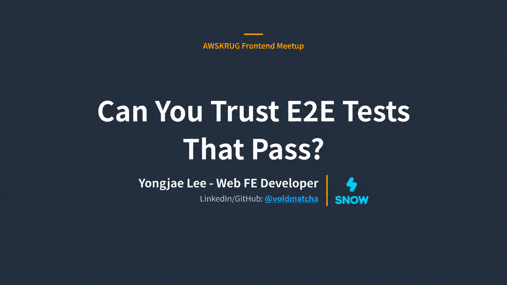

<div align="center">
  
</div>

<h1 align="center">E2E Skills</h1>

<p align="center">
  <a href="https://github.com/voidmatcha/e2e-skills"></a>
  <a href="https://claude.com/product/claude-code"></a>
  <a href="https://github.com/openai/codex"></a>
  <a href="https://playwright.dev"></a>
  <a href="#merged-upstream-fixes"></a>
  <a href="https://github.com/vercel-labs/skills#supported-agents"></a>
  <a href="https://www.skills.sh/voidmatcha/e2e-skills"></a>
  <a href="https://www.kimi.ai/resources/software-testing-skills"></a>
  <a href="./LICENSE"></a>
</p>

<p align="center">
<a href="README.md">English</a> | <a href="README.ko.md">한국어</a> | <strong>日本語</strong> | <a href="README.zh-cn.md">简体中文</a>
</p>

<!-- README-CANONICAL-REVISION: sha256=26104e841bf7647c2a3371d853d3bffeb251e28407b1bafde58c06e55364bc6a; bytes=exact-README.md-UTF-8; translation-quality=not-attested -->

`e2e-skills` は、AI コーディング agent が Playwright/Cypress の E2E テストを生成し、レビューし、失敗を診断するための 4 つの skill です。skill は agent が作業時に従う指示の集まりです。

<p align="center">
  <a href="https://www.kimi.ai/resources/software-testing-skills">
    
  </a>
  <br />
  <sub><a href="https://www.kimi.ai/resources/software-testing-skills">Kimi 公式サイトの「AI Software Testing Skills for Smarter QA Automation」で紹介されています。</a></sub>
</p>

テストが成功しても、製品の不具合を見逃すことがあります。`e2e-skills` は、テストが名前どおりの動作を実際に検証しているかを確認する手助けをします。

`e2e-reviewer` はコードスキャナーで候補を探し、テストと周辺コードを読んで実際の問題か判断します。必要なら、検証条件の変更やアプリのコピーへのバグ注入で、テストが反応するかを確認する方法も提案します。追加検証は依頼を受け、承認済みのローカル環境で実行します。

`e2e-reviewer` が見つけた問題の修正は [15 件のマージ済み upstream PR](#merged-upstream-fixes) につながりました。実際の修正例を以下に示します。

| 必要なこと | スキル | 結果 |
| --- | --- | --- |
| 新しい Playwright カバレッジを生成 | `playwright-test-generator` | 実際の画面を観察して書いたテストと、スキャナー確認および実行結果 |
| Playwright/Cypress テストまたは PR/diff 変更をレビュー | `e2e-reviewer` | 重要度別の問題、判断根拠、修正案。変更では新規・悪化・既存の問題を区別 |
| 失敗した Playwright 実行をデバッグ | `playwright-debugger` | 推定原因、判断根拠、具体的な修正案 |
| 失敗した Cypress 実行をデバッグ | `cypress-debugger` | 推定原因、判断根拠、具体的な修正案 |
| 決定論的なローカルスキャンを実行 | `skills/e2e-reviewer/scripts/scan.sh` | 対象プロジェクトの package をインストールせずに見つけた問題候補 |

P0/P1/P2 はレビューの重要度です。P0 は機能が壊れても成功する問題、P1 は信頼性や診断の問題、P2 は保守性の改善です。debugger の F1–F15 は、タイミング、selector、認証など 15 種類の失敗原因を示す分類コードです。

**テスト生成:** インストール後、テストするローカルプロジェクトを agent に伝えてください。必要な設定を確認し、不足する準備があれば案内します。

<a id="merged-upstream-fixes"></a>

## アップストリームにマージされた修正

`e2e-reviewer` が見つけた問題の修正は **15 件のマージ済み upstream PR** につながりました。以下の表から各パッチを確認できます。

以下のリポジトリの GitHub stars は合計 **496,650** です。2026-10-20 の GitHub API スナップショットに基づきます。

| リポジトリ | GitHub Stars | PR | 修正したパターン |
| --- | ---: | --- | --- |
| Storybook | ★91.3k | [storybookjs/storybook#34141](https://github.com/storybookjs/storybook/pull/34141) | Playwright assertions の missing `await` |
| code-server | ★79.7k | [coder/code-server#7845](https://github.com/coder/code-server/pull/7845) | Focused test leak、matcher-less `expect`、discarded visibility read |
| Strapi | ★73.3k | [strapi/strapi#26630](https://github.com/strapi/strapi/pull/26630) | Discarded navigation/state checks |
| Ghost | ★55.6k | [TryGhost/Ghost#28712](https://github.com/TryGhost/Ghost/pull/28712) | Promise-valued disabled-state assertion |
| Cal.com | ★49.2k | [calcom/cal.diy#28486](https://github.com/calcom/cal.diy/pull/28486) | E2E flow の weak assertion patterns |
| Bruno | ★47.7k | [usebruno/bruno#8317](https://github.com/usebruno/bruno/pull/8317) | Assertion と wait reliability fixes |
| Qwik | ★22.1k | [QwikDev/qwik#8777](https://github.com/QwikDev/qwik/pull/8777) | Locator/handle existence checks |
| SvelteKit | ★20.9k | [sveltejs/kit#16068](https://github.com/sveltejs/kit/pull/16068) | Floating Playwright assertions |
| Element Web | ★13.6k | [element-hq/element-web#32801](https://github.com/element-hq/element-web/pull/32801) | Locator null-check style assertions |
| FiftyOne | ★11.2k | [voxel51/fiftyone#7851](https://github.com/voxel51/fiftyone/pull/7851) | Locator-defined check を visible duplicate-name error assertion に置き換え |
| Carbon Design System | ★9.6k | [carbon-design-system/carbon#22564](https://github.com/carbon-design-system/carbon/pull/22564) | Locator truthiness を web-first assertions に置き換え |
| Rancher Desktop | ★7.4k | [rancher-sandbox/rancher-desktop#10557](https://github.com/rancher-sandbox/rancher-desktop/pull/10557) | `not.toBeNull()` locator checks を visible WSL integration-name assertions に置き換え |
| Apache Zeppelin | ★6.7k | [apache/zeppelin#5180](https://github.com/apache/zeppelin/pull/5180) | 常に真の assertion と、暗黙にスキップされるガード付きチェック |
| MUI X | ★5.9k | [mui/mui-x#22982](https://github.com/mui/mui-x/pull/22982) | UI handle checks を state assertions に置き換え |
| module-federation/core | ★2.7k | [module-federation/core#4826](https://github.com/module-federation/core/pull/4826) | Cypress spec 内の redundant blanket `uncaught:exception` suppression |

## false-green テストを見る

**false-green** は、確認したい動作が壊れてもテストが成功する状態です。以下の修正では、Locator オブジェクトの存在ではなく、実際の画面にメッセージが表示されるかを確認します。

```diff
- expect(page.getByText('Welcome back')).toBeDefined()
+ await expect(page.getByText('Welcome back')).toBeVisible()
```

<details>
<summary>完全な例と scanner 出力</summary>

この Playwright テストはもっともらしく見えますが、証明しているのは `Locator` オブジェクトが作られたことだけです。

```typescript
import { expect, test } from '@playwright/test';

test('shows the welcome message', async ({ page }) => {
  await page.goto('/dashboard');
  expect(page.getByText('Welcome back')).toBeDefined();
  expect(page.locator('.user-badge')).not.toBeNull();
});
```

同梱スキャナーは、プロジェクト設定なしで false-green assertion を検出します。以下は関連部分を抜粋した出力です。

```console
$ /bin/bash -p skills/e2e-reviewer/scripts/scan.sh tests/

[P0] #4f Locator always-true assertion (truthy/defined/not-null) (2 hits)
  .../tests/login.spec.ts:5:  expect(page.getByText('Welcome back')).toBeDefined();
  .../tests/login.spec.ts:6:  expect(page.locator('.user-badge')).not.toBeNull();

Summary: 2 total hit(s), 2 P0
```

この実行は P0 指摘を報告するため、`scan.sh` は exit 1 で終了します。

`eslint-plugin-playwright` も `no-unnecessary-assertions` でこの形を検出します。コミット時の lint が扱える問題を担当し、残りをスキャナーが補えるよう、このルールを有効にしてください。

**実行可能な例:** [React optimistic-write の証明](examples/react-optimistic-write/README.md) は、optimistic UI には画面に見える状態だけでなく、リクエストと永続化の証明も必要な理由を示します。

</details>

## 発表資料: 成功する E2E テストを信頼できますか？

問題の発見から lint ルール、スキャナー、mutation とアプリへの欠陥注入による検証、オープンソースの修正事例まで紹介します。表紙をクリックすると資料が開きます。

<p align="center">
<a href="https://docs.google.com/presentation/d/15EJEATNRDfUeaNwVCpKsUMg066u5TzFepI5j1z8dSJE/">
  
</a>
</p>

<p align="center">
  <a href="https://docs.google.com/presentation/d/15EJEATNRDfUeaNwVCpKsUMg066u5TzFepI5j1z8dSJE/">Google Slides で発表資料を読む</a>
</p>

## インストールして試す

### コーディング agent にインストールを依頼する（推奨）

テスト生成も使う場合は、Claude Code または Codex に次のプロンプトを入力し、使用する既存のローカル Playwright プロジェクトを伝えてください。

```text
Install https://github.com/voidmatcha/e2e-skills using its install.sh for my current host and Playwright project.
```

1. 既存のローカル Playwright プロジェクトを agent に伝えてください。インストーラーがスキル、専用 agent、公式 Playwright agent とプロジェクトの MCP 設定を準備します。
2. 使用するコーディング agent を再起動して MCP ツールを承認してください。agent がブラウザーを操作し、Playwright テストを書くためのツールです。
3. テスト生成を依頼してください。agent が準備状態を確認し、不足があれば案内します。

この方法で設定した後は、手動インストールを繰り返す必要はありません。[詳細ガイド](docs/installation.md)は、前提条件の確認、競合の解決、手動設定が必要な場合に参照してください。

**レビューや失敗分析だけを使う場合:** Playwright generator の設定なしで、スキルと専用 agent だけをインストールするよう依頼してください。公式 Playwright agent と `playwright-test` MCP は生成に必要であり、既存の Playwright/Cypress テストのレビューや失敗分析には不要です。

<details>
<summary>その他のインストール方法: skills.sh とプラグイン</summary>

### skills.sh でスキルをインストール

[skills.sh](https://skills.sh/voidmatcha/e2e-skills) が対応する全ホストに、4 つのスキルを 1 コマンドでインストールします。

```bash
npx --yes skills@1.5.21 add voidmatcha/e2e-skills -g --all
```

スキルのみのインストールです。専用エージェントと Playwright generator の設定は別途必要です。対象を 1 ホストに絞る場合は、`--all` を[対応一覧](https://github.com/vercel-labs/skills#supported-agents)の `-a <agent>` に置き換えてください。CLI のバージョンは固定されています。

### Claude Code

4 つのスキルと 2 つの専用エージェントを含むプラグインでもインストールできます。

```text
/plugin marketplace add voidmatcha/e2e-skills
/plugin install e2e-skills@voidmatcha
```

生成機能は上記の All-in-one インストールを使うか、[設定ガイド](docs/installation.md)に従って準備してください。

### Codex

プラグインマーケットプレイスからも 4 つのスキルをインストールできます。

```text
codex plugin marketplace add voidmatcha/e2e-skills
codex plugin add e2e-skills@voidmatcha
```

プラグインは 2 つの専用エージェントをインストールしません。専用エージェントも必要な場合は、この checkout から `bash scripts/dev/install-codex-agents.sh` を実行してください。レビューと失敗分析は専用エージェントなしでもインラインで動作します。

生成機能は上記の All-in-one インストールを使うか、[設定ガイド](docs/installation.md#codex)に従って準備してください。

</details>

### 最初のプロンプト

```text
Review my Playwright tests in tests/e2e with e2e-reviewer.
If useful, offer an assertion mutation or app-fault probe as a follow-up.
```

```text
Generate Playwright E2E coverage for apps/web/e2e.
```

```text
Debug the failed Playwright report in playwright-report/.
Debug the failed Cypress report in cypress/reports/.
```

## 対応環境

<details>
<summary>対応環境と実行条件を見る</summary>

実際のアプリケーションと E2E suite を補完するために使ってください。レビューと診断は Playwright/Cypress、生成は Playwright のみを対象とします。

同梱のシェルスクリプトとアーティファクトリーダーは、`/bin/bash` と、ランチャーが要求する固定のシステム実行ファイルパスを使う一般的な macOS/Linux 構成を対象としています。Windows ユーザーには互換性のある WSL ディストリビューションと、WSL ファイルシステム内のアーティファクトが必要で、ネイティブ Windows はサポートしていません。NixOS や、Nix・pyenv・Conda・nvm だけで導入したツールは、すべてが自動検出されるわけではありません。レビュアーのスキャナーは、検証済みの絶対パスによる `E2E_SMELL_*_BIN` の上書きに対応していますが、デバッガーのランチャーに同じ上書きがあるという意味ではありません。信頼できるツールが見つからない場合は、該当の操作が停止します。環境の `PATH` を探索してこの境界を回避しないでください。スキルのリソースは、推測したホームディレクトリではなく、プラグインキャッシュやカスタムインストールを含め、ホストが実際に提供するスキルの場所から解決してください。

generator は `thin-rules.md` と安全指示を公式 planner と generator に付けて委譲し、reviewer scanner と新しいテストを実行します。何もインストールせず、agent・MCP 設定を変更せず、CLI fallback や healer を使いません。設定がなければ手順を案内します。

生成には、ローカル開発で一般的な loopback アドレス（`localhost`、`127.0.0.1`、`::1`）を使います。読み取りを含む browser 操作の前に、frontend、API、database、環境全体が、名前を指定した破棄可能なスタックである必要があります。実行される navigation と request の宛先は承認済み origin の scheme・hostname・実効 port に一致する必要があり、別途承認した loopback API 宛先も許可します。それ以外や解決できない宛先は BLOCKED です。この確認は browser 全体の origin 隔離を提供しません。

立証された生成エラーに限り、親 agent は最大 2 回修正できます。必要な結果と期待値を維持し、書き込みを安全にリセットし、同じ承認済み実行方法で origin・scanner のゲートを繰り返します。製品の欠陥、原因不明、残った失敗は BLOCKED のままです。全手順は [generator 契約](skills/playwright-test-generator/SKILL.md)を参照してください。

debugger と probe の実行には、信頼するプロジェクトと、環境変数・flag を含む正確なコマンドの承認が必要です。レポートにはスキップした確認を記載します。mutation とアプリの fault probe は任意の追加作業であり、未実行の結果を測定済みとして報告しません。

バージョン履歴と以前の generator 手順は [CHANGELOG.md](CHANGELOG.md)にまとめています。

</details>

## 生成したテストがバグを検出するか確認する

生成は公式 Playwright agent が担当します。その後、generator skill は `e2e-reviewer` がインストールされていればスキャナーを実行し、最大 3 回で P0/P1 の検出項目を修正してからプロジェクトのテストを実行します。欠けた確認やスキップは未完了として報告します。生成したテストが意味のある検証になっているかのレビューは、`e2e-reviewer` に別途依頼してください。

まず通常の `e2e-reviewer` レビューで、テストが意図した動作を確認しているか調べます。実行による根拠が必要な問いが残れば、そのアサーションや動作だけに probe を追加できます。追加のトークンと実行時間をどこに使うかを選べます。mutation とアプリの fault probe を毎回のレビューで自動実行するわけではありません。

- **アサーション mutation:** テストのコピーで検証条件を反転し、実際に失敗するか確認します。アサーションが失敗できるかを調べる検証であり、元のテストがアプリのバグを検出する証明ではありません。
- **アプリへの欠陥注入:** アプリのコピーに特定のバグを入れ、変更していない既存テストが検出するか確認します。

例えば「保存機能が壊れたら、このテストが検出するか確認して」と依頼してください。reviewer がローカルプロジェクトを調べ、検証方法を提案します。実行には信頼できる準備済みローカル環境とコマンドの承認が必要です。結果は選択したアサーションやバグに限られ、すべてのバグを検出する証明にはなりません。

詳細は[実行手順と準備条件](skills/e2e-reviewer/references/runtime-probes.md)、[OSS 2 例の作業手順検証](benchmarks/release-readiness-v1/README.md#portable-integration)を参照してください。

## 根拠と限界

3.0.0 では、インストール、スキャナーの動作、実行時の安全ルール、および一部の Playwright/Cypress 検証実行を確認しました。[検証記録](benchmarks/release-readiness-v1/README.md)に、実行した手順、保存した根拠、各結果の適用範囲をまとめています。

[10月20日の検証](benchmarks/release-readiness-v1/README.md#october-20-successor)では、隔離環境へのインストール、Claude Code と Codex での公式 agent/MCP によるテストの生成と実行、および選定した Cypress の assertion mutation とアプリへの不具合注入を確認しました。generator の元の測定とその後の再実行は引き続き分けて報告しています。

<details>
<summary>ベンチマークの測定範囲とモデル別の結果</summary>

reviewer の結果はモデルによって異なります。同じ固定 snapshot と 36 件の公開開発事例を各 arm で 5 回反復した測定で、`gpt-6-sol` は [v22](benchmarks/reviewer-holdout-v22/README.md)、`gpt-6.1-sol` は [v24](benchmarks/reviewer-holdout-v24/README.md) に合格し、`gpt-6-luna` は [v23](benchmarks/reviewer-holdout-v23/README.md) で不合格でした。各実行とも 540 回の呼び出しを完了しました。ツールを無効にして与えた指示を評価した結果であり、スキャナーの効果や未見のプロジェクトでの精度を示すものではありません。モデル別のスコアと snapshot の適用範囲は[ベンチマーク状況](benchmarks/STATUS.md)を参照してください。

過去のスコアは各レポートで指定した snapshot に適用され、現在のすべての指示に自動的に適用されるものではありません。プロトコル、結果、否定的な結果、主張の範囲は[ベンチマーク状況](benchmarks/STATUS.md)に、動作の変更履歴は [CHANGELOG.md](CHANGELOG.md)に残しています。

過去の実行資料は[根拠 manifest](benchmarks/external-evidence.json)で固定され、[Hugging Face データセット](https://huggingface.co/datasets/voidmatcha/e2e-skills-benchmarks)から取得できます。過去のスコアを監査する前に `scripts/dev/fetch-benchmark-evidence.sh --dry-run` で復元計画を確認してください。

</details>

## E2E レビューカタログ

カタログには、24 個の安定した Playwright/Cypress test smells が含まれます。代表的な false-green には、Locator truthiness、assertion の欠落、握りつぶされたエラー、focused tests、認証の欠落、network proof のない optimistic UI checks があります。[分類体系と根拠の詳細](docs/e2e-test-smells.md) を参照してください。

一部のパターンは、テストだけでなくアプリケーションがレビュー範囲に含まれている必要があります。`#22` optimistic UI が最も明確な例です。クリックが実際に mutation を送るかどうかは spec だけでは判断できないため、テストのみのリポジトリでは推測せず何も報告しません。これは意図した false-positive 抑制であり、実行可能な例が component と共に提供される理由です。

<details>
<summary>重要度別の全 24 パターン</summary>

### 検出対象の 24 パターン: 重要度別

#### P0: 必ず修正 (壊れていても静かに通る)

機能が壊れていてもテストが通ります。実質的な検証がありません。

| # | パターン | 修正前 | 修正後 |
|---|---------|--------|-------|
| 1 | **Name-assertion mismatch** | 名前は "status" と言っているのに `toBeVisible()` しか確認していない | `status` の内容に対する assertion を追加するか、実際の check に合わせて rename する |
| 2 | **Missing Then** | Cancel 操作とテキスト復元は検証している。でも input はまだ visible? | restored state と dismissed state の両方を検証する |
| 3 | **Error swallowing** | spec 内の `try/catch`、POM 内の `.catch(() => {})` | error で fail させる。POM methods から silent catch を取り除く |
| 3b | **Cypress `uncaught:exception` suppression** | `cy.on('uncaught:exception', () => false)` がアプリケーションエラーを一律に握りつぶす | handler を特定の known errors に限定し、unknown errors は re-throw する |
| 4 | **Vacuous or retry-weakening assertion** (P0/P1) | P0: invariant predicates と Locator truthiness。P1: weak attachment proof、one-shot values/URL、zero-timeout retry/deadline hazards、証明されていない absence、空の可能性があるコレクションの assertion loop、promised accessible name を省いた ARIA snapshots | 意味のある境界と web-first auto-retrying assertions を使う。absence の前に presence を証明し、assertion loop の前にコレクションが空でないことを証明し、promised accessible names を load-bearing に保つ |
| 5 | **Bypass patterns** (5a P0, 5b P1) | `if (await el.isVisible()) { expect(...) }`; comment なしの `{ force: true }` | 常に assert する。env checks は `beforeEach` に移し、force:true には `// JUSTIFIED:` を追加する |
| 7 | **Focused test leak** | `test.only(...)` が commit され、CI は 1 件だけ実行して残りを静かに skip する | `.only` を削除する。local focus には `--grep` または `--spec` を使う |
| 8 | **Missing assertion** | 捨てられた locator/boolean が scenario 唯一の verification になっている | `await expect(locator).toBeVisible()` を追加する。independent verification/failure evidence がすでにある場合は #8 を skip する |
| 12 | **Missing auth setup** | login/`storageState`/auth fixture がなく、protected-route テスト仕様が汎用的なアサーションで login/wrong surface にも一致して通る | `beforeEach` login を追加する、`storageState` を設定する、または auth fixture を使う。通常の認証起因の失敗を P0 に分類しない |

#### P1: 修正推奨 (診断が悪い / CI 時間を浪費)

テストは動きますが、開発者を誤解させたり、CI 時間を浪費したり、将来の regression を招いたりします。

| # | パターン | 修正前 | 修正後 |
|---|---------|--------|-------|
| 6 | **Raw DOM queries** | `evaluate()` 内の `document.querySelector` | フレームワークの locator/query APIs (`locator` / `cy.get`) を使う |
| 9 | **Hard-coded sleep** | `waitForTimeout(2000)` / `cy.wait(2000)` / `waitForLoadState('networkidle')` | フレームワークの auto-wait に任せ、condition-based waits を使う |
| 10 | **Flaky test patterns** | comment なしの `items.nth(2)`; `test.describe.serial()`; scope されていない accessible-name substring (10c); Cypress async callbacks、assigned `cy` commands、continued action chains (10d–10f) | stable/scoped locators と self-contained tests を使う。Cypress work は command chain 内に保ち、Chainables を values として代入せず、actions 後は re-query する |
| 13 | **Inconsistent POM usage** | Raw actions bypass a source-established same-page POM boundary; existence alone is insufficient | Reuse the proven boundary; do not invent a wrapper merely because a POM exists |
| 14 | **Hardcoded credentials** | test code 内の `loginPage.login('demo-admin', '<literal-password>')` | `process.env.TEST_USER`、Playwright config secrets、または test data fixtures を使う |
| 15 | **Missing `await` on `expect()`** | Async Locator/Page web-first matcher Promise が sequenced も observed もされず、rejection が後から悪い attribution で表面化しがち | matcher Promise を `await` または return する。sync value matchers は除外 |
| 16 | **Missing `await` on action** | Actionability、action ordering、navigation が後続処理と race し、rejection が後から悪い attribution で表面化しがち | action Promise を `await` または return する |
| 17 | **Discouraged direct Page selector API** | Selector-based `page.click`、`page.fill`、関連 Page actions は Locator layer を skip する | composition、strictness、reuse、clearer failures のために Locator actions を使う |
| 18 | **`expect.soft()` overuse** | critical soft assertions が hard scenario gate の前に走り、broken prerequisite の後も dependent work が続く | primary state を先に hard-gate する。`soft` は independent details にだけ使う |
| 19 | **Module-level mutable state in test code** | test utility の column 0 にある `let seq = 0;` または mutate される `const cache = new Map()`: long-lived worker の tests 間で残り、parallel workers 間で衝突する | counter を削除する。`Date.now()` + `Math.random().toString(36).slice(2, 8)` から uniqueness を作るか、state を `test.beforeEach` に移す |
| 20 | **Unmocked real-backend writes** | Signup/checkout spec が controlled test boundary なしで shared or persistent state に到達する | write を stub するか、disposable container、rollback fixture、isolated tenant/database、または同等の controlled backend を証明する |
| 22 | **Optimistic UI without call proof** | Like-toggle test が `aria-pressed` flip を assert するだけ。UI は optimistic に更新されるため、POST を削除しても通る | UI assertion に、click 前に準備した `page.waitForRequest()` または route-hit flag を組み合わせる |

#### P2: 余裕があれば修正 (保守性 / 堅牢性)

弱いものの、誤りではありません。refactoring 時に対応します。

| # | パターン | 修正前 | 修正後 |
|---|---------|--------|-------|
| 11 | **YAGNI + Zombie Specs** | 一度も呼ばれない `clickEdit()`; unjustified empty wrapper class; 別 spec と丸ごと重複した spec; 理由のない skip | unused members と zombie specs を削除する。残す skip には理由を明記し、長期保留には再確認の目安を付ける。single-use helpers は meaningless indirection を明確に減らす場合だけ inline する |
| 21 | **Manually-captured session-file dependency** | manual capture script でしか生成されない `storageState: 'auth/member.json'`: CI にはなく、静かに期限切れになる | session を programmatically regenerate する (API-login helper または `setup` project)。manual files は programmatic fallback 付き cache としてのみ使う |
| 23 | **Fixture ignores render guards** | Liked-tab fixture が `liked: false` を seed し、card component がすべての item を `return null` する。empty UI が infra flake に見える | seed 前に item component の early returns/filters を読み、対象 view のすべての guard を通る fields を seed する |

</details>

## 失敗デバッグ

両方のデバッガーは、同じ安定した F1–F15 root-cause taxonomy を使います。Playwright は `playwright-report/`、HTML report、`trace.zip`、screenshot、範囲を限定した GitHub Actions artifact を受け付けます。Cypress は mochawesome または JUnit report、screenshot、video、範囲を限定した CI artifact を受け付けます。

<details>
<summary>全 15 件の失敗分類</summary>

| # | 分類 | 手がかり |
|---|----------|---------|
| F1 | **不安定 / タイミング** | `TimeoutError`, 再試行では通る |
| F2 | **セレクター破損** | `locator not found`, `strict mode violation` |
| F3 | **ネットワーク依存** | `net::ERR_*`, 予期しない API レスポンス |
| F4 | **アサーション不一致** | `Expected X to equal Y`, subject の取り違え |
| F5 | **Then の欠落** | 操作は完了したが、誤った状態が残る |
| F6 | **条件分岐の欠落** | 要素が条件付きで存在するのに、アサーションが常に実行される |
| F7 | **テスト分離の失敗** | 単独では通り、テストスイートでは失敗する |
| F8 | **環境差異** | CI とローカルの片方でだけ発生する。viewport、OS、timezone |
| F9 | **データ依存** | seed データの欠落、hardcoded IDs |
| F10 | **認証 / セッション** | セッション期限切れ、role-based UI が描画されない |
| F11 | **非同期/コマンド順序の競合** | Playwright の `Promise.all` 順序・並行処理の競合、Cypress のリクエスト後の intercept 登録・コマンドチェーン順序の入れ替わり・visit/request 競合 |
| F12 | **POM / Locator のずれ** | DOM 構造が変わったのに POM が更新されていない |
| F13 | **エラー握りつぶし** | `.catch(() => {})` が実際の失敗を隠している |
| F14 | **アニメーション競合** | 内容がまだ描画されていない、または一時的な要素が観測前に削除される |
| F15 | **ハイドレーション競合** | 操作は成功するが効果がない: SSR ページのハイドレーションがまだ完了しておらず、次のアサーションで失敗する |

ここでは F11 と F12 に framework 共通の名称を使用しています。各 `debugger` は、同じ stable code に対応する framework 固有の名称を報告します。

</details>

デバッガーはプロダクト回帰と壊れやすいテストを分けて分類し、根拠と具体的な修正を返します。失敗した Playwright または Cypress テスト artifact がないアプリケーションや backend は診断しません。

## スタンドアロンスキャナー

AI agent に依頼せず、コードスキャナーだけを直接実行できます。レビューする問題候補を探す道具であり、テストの実行や、意図した動作を検証しているかの判断は行いません。

```bash
/bin/bash -p skills/e2e-reviewer/scripts/scan.sh path/to/tests
```

Python 3 と PCRE2 対応の ripgrep (`rg`) が必要です。デフォルトでは対象プロジェクトの ESLint コードを実行せず、ツールもダウンロードしません。必要なツールや読み取り可能なファイルがなければ、問題なしではなくエラーを報告します。

<details>
<summary>スキャナーの詳細設定とファイル読み取り範囲</summary>

スキャナーには PCRE2 対応の `rg` と Python 3 が必要です。Python が NUL-safe な candidate identity records を作成・検証するため、candidate drift や不正な record は fail closed になります。この必須の bookkeeping は optional な Tier 2 AST tooling とは別です。デフォルトでは、target-controlled な ESLint binaries、plugins、parsers、configuration を実行せず、tools も download しません。`E2E_SMELL_ALLOW_PROJECT_ESLINT=1` は trusted checkout で project ESLint execution を opt in します。`E2E_SMELL_NO_ESLINT_DOWNLOAD=0` と `E2E_SMELL_NO_AST_GREP_DOWNLOAD=0` は、それぞれ pinned downloads を opt in します。portability check で preinstalled host binaries を無視する必要がある場合は、`E2E_SMELL_DISABLE_AST_GREP=1` を設定してください。

> **読み取り範囲。**
> <!-- README-I18N-CONTRACT:SCANNER-READ-SCOPE:START -->
> 同梱 checks は、requested path 配下の source を report します。Framework provenance resolution は、containing project 内の別の場所にある relative fixture/support imports も読む場合があります。
> <!-- README-I18N-CONTRACT:SCANNER-READ-SCOPE:END -->

<!-- README-CONTRACT:SCANNER-EXTENSIONS:START -->
同梱 checks は `.ts`, `.js`, `.tsx`, `.jsx`, `.mts`, `.mjs`, `.cts`, `.cjs` の source を読み取ります。
<!-- README-CONTRACT:SCANNER-EXTENSIONS:END -->

Tier 3 は同梱 fallback です。optional ESLint と ast-grep tiers は精度を高めますが、semantic review を置き換えるものではありません。scanner は infrastructure または filesystem errors では false clean result を報告せず、exit 2 で終了します。trust と network boundary については [SECURITY.md](SECURITY.md) を参照してください。

</details>

## ESLint plugin との違い

`eslint-plugin-playwright` と `eslint-plugin-cypress` は、テストコードのよくある誤りを検出するツールです。`e2e-skills` のスキャナーも、これらを任意の検査層として活用します。

プラグインの実行にはユーザーの明示的な許可が必要です。許可がなくても同梱の検査は実行できます。既存のプラグインルールに加え、次を提供します。

- プラグインルールを補完する独自のコード検査
- テストの意図と周辺コードを読む必要がある問題のレビュー

linter は直接的な Locator truthiness assertion や missing `await` を検出できます。しかし、「shows a duplicate-name error」という名前の test がその error を本当に確認しているか、protected-route test が authentication を忘れていないか、optimistic UI assertion が backend request の発生を証明しているかは判断できません。継続的な linting には plugin を使い、test trustworthiness には `e2e-reviewer` を使ってください。

## よくある質問

### 通るのに何もテストしていない Playwright/Cypress テストを見つけるには?

該当する spec directory を `e2e-reviewer` に渡してください。指摘を返す前に、決定論的候補と意味的なレビューを組み合わせます。

<details>
<summary>レビュー範囲と実行安全条件の詳細</summary>

<!-- README-I18N-CONTRACT:CORE-SAFETY:START -->
`e2e-reviewer` skill は、安定した ID と P0/P1/P2 severity を持つ 24 個すべての catalog patterns をレビューします。standalone の `scan.sh` scanner が扱うのは、決定論的で機械的な subset のみです。scanner matches は候補であり、final findings ではありません。skill は verdict を報告する前に intent と surrounding code を確認します。

debugger は、安定した F1–F15 taxonomy に照らして failures を分類します。debugger は、repository を信頼し、environment と flags を含む exact command を承認した後にのみ target-controlled code を実行します。generator は、自身が書いた仕様に対してレビュアーのスキャナーとプロジェクトのテストコマンドのみを実行します。

non-public benchmark runs では、`--isolation-wrapper` は required hook であり、isolation の証明ではありません。Continuous integration (CI) は wrapper contract を検証しますが、filesystem、process、network isolation は attestation しません。
<!-- README-I18N-CONTRACT:CORE-SAFETY:END -->

</details>

### これは Playwright/Cypress のテスト実行を置き換えますか?

いいえ。変更のたびにアプリケーションと実際の E2E suite を実行してください。このバンドルはテスト品質をレビューし、Playwright カバレッジを生成し、既存の失敗を診断します。テスト runner ではありません。

### AI が生成した Playwright/Cypress テストはマージ前にどうレビューすればいいですか?

マージ前に、生成された spec を `e2e-reviewer` に渡してください。各テストが名前どおりのユーザー向け動作を本当に証明しているか確認し、false-green のリスクを拾い、決定論的なスキャナー候補と文脈による判断が必要な指摘を分けて報告します。

### Playwright だけでなく Cypress もサポートしますか?

レビューと失敗デバッグは両方の framework をサポートします。新規テスト生成は現在 Playwright のみをサポートします。Cypress デバッガーは mochawesome と JUnit report を受け付けます。

### CI でだけ失敗するテストをデバッグできますか?

はい。ローカル report artifact またはサポート対象の GitHub Actions run を提供した場合に対応できます。デバッガーは F1–F15 taxonomy を使い、環境、timing、selector、data、認証、product-regression の原因を分離します。

### どの AI コーディングエージェントがサポートされていますか?

Claude Code、Codex、そして `skills` CLI がサポートする 55+ hosts は public `SKILL.md` contracts を読み込めます。optional host-specific agent files は利用可能な環境で delegation を改善しますが、public skills はそれらなしでも利用できます。

## 詳細ドキュメント

- [AI が生成した Playwright/Cypress E2E テストをレビューする方法](docs/review-ai-generated-e2e-tests.md)
- [Playwright/Cypress E2E テストスメル 24 種](docs/e2e-test-smells.md)
- [ベンチマーク状況と否定的結果](benchmarks/STATUS.md)

<details>
<summary>その他の参考資料</summary>

- [ルールの自己監査](docs/rule-self-audit.md)
- [オープンソースの事例集](docs/case-studies.md)
- [生のベンチマーク実行アーティファクト(Hugging Face データセット)](https://huggingface.co/datasets/voidmatcha/e2e-skills-benchmarks)
- [外部根拠台帳](docs/llm-generated-e2e-test-evidence.md)
- [過去の AI レビューベンチマーク](docs/ai-reviewer-benchmark.md)
- [デバッガーベンチマーク手順](docs/debugger-benchmark/README.md)
- [フレームワークの対象範囲](docs/framework-scope.md)
- [ローカル E2E ルールブリッジと推奨 lint](docs/recommended-lint.md)
- [ロードマップ](docs/roadmap.md)
- [Reviewer evidence execution plan and optional Jev experiment](docs/plans/reviewer-evidence-next-steps.md)

</details>

## コントリビューション

bug report、false-positive guard、新しい anti-pattern、翻訳を歓迎します。setup と verification requirements については [CONTRIBUTING.md](CONTRIBUTING.md) から始めてください。cross-agent maintenance contracts は [AGENTS.md](AGENTS.md) にあります。

## ライセンス

Apache-2.0 &copy; [voidmatcha](https://github.com/voidmatcha)。詳細は [LICENSE](LICENSE) を参照してください。

一部のベンチマーク記録には、Playwright 公式エージェント定義（Apache-2.0、Microsoft）の引用が含まれています。詳細は [NOTICE](NOTICE) を参照してください。Playwright は Microsoft Corporation の商標であり、このプロジェクトは Microsoft と提携しておらず、承認も受けていません。
