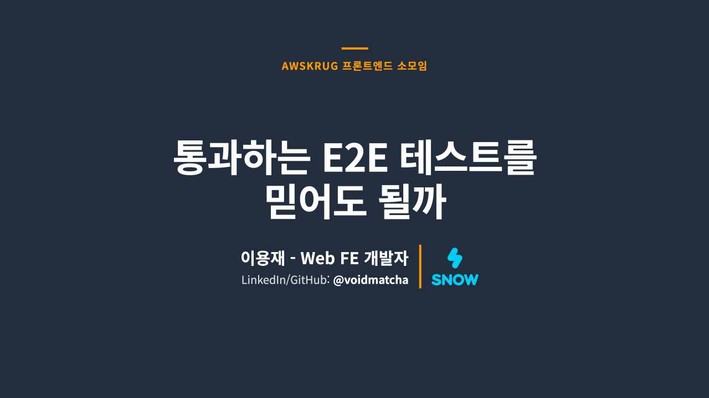

<div align="center">
  
</div>

<h1 align="center">E2E Skills</h1>

<p align="center">
  <a href="https://github.com/voidmatcha/e2e-skills"></a>
  <a href="https://claude.com/product/claude-code"></a>
  <a href="https://github.com/openai/codex"></a>
  <a href="https://playwright.dev"></a>
  <a href="#merged-upstream-fixes"></a>
  <a href="https://github.com/vercel-labs/skills#supported-agents"></a>
  <a href="https://skills.sh/voidmatcha/e2e-skills"></a>
  <a href="https://www.kimi.ai/resources/software-testing-skills"></a>
  <a href="./LICENSE"></a>
</p>

<p align="center">
<a href="README.md">English</a> | <strong>한국어</strong> | <a href="README.ja.md">日本語</a> | <a href="README.zh-cn.md">简体中文</a>
</p>

<!-- README-CANONICAL-REVISION: sha256=225a1cbe0244551e913b5c882036e5def4958425264aa6c857b9621b11d16eaf; bytes=exact-README.md-UTF-8; translation-quality=not-attested -->

`e2e-skills`는 Claude Code, Codex 등 AI coding agent에서 사용하는 Playwright와 Cypress E2E 테스트용 오픈소스 skill 모음입니다. 네 종류의 skill로 Playwright 테스트를 생성하고, Playwright/Cypress 테스트와 PR을 리뷰하며, 실패 원인을 분석합니다.

<p align="center">
  <a href="https://www.kimi.ai/ko/resources/software-testing-skills">
    
  </a>
  <br />
  <sub><a href="https://www.kimi.ai/ko/resources/software-testing-skills">Kimi 공식 사이트의 "더 스마트한 QA 자동화를 위한 AI 소프트웨어 테스트 skill"에 소개되었습니다.</a></sub>
</p>

테스트가 통과해도 제품에 버그가 남아 있을 수 있습니다. `e2e-skills`는 테스트가 시나리오에 적힌 동작을 제대로 확인하는지 살펴보도록 돕습니다.

`e2e-reviewer`는 코드 scanner로 의심되는 부분을 찾고, 테스트와 연관된 코드를 읽어 실제 문제인지 판단합니다. 테스트가 실패하는지 확인할 수 있도록 assertion mutation이나 원본과 분리한 프로젝트 복사본의 fault injection도 제안합니다. 실행에는 신뢰할 수 있는 로컬 환경과 명령 승인이 필요합니다. 이미 승인한 범위에서는 다시 승인받지 않습니다.

`e2e-reviewer`가 찾은 문제를 고친 [upstream PR 15건이 merge되었습니다](#merged-upstream-fixes).

| 필요 | skill | 결과 |
| --- | --- | --- |
| 새 Playwright 테스트 생성 | [`playwright-test-generator`](skills/playwright-test-generator/SKILL.md) | 실제 화면을 살펴보고 작성한 테스트와 scanner 검사 및 실행 결과 |
| Playwright/Cypress 테스트 또는 PR/diff 변경 사항 리뷰 | [`e2e-reviewer`](skills/e2e-reviewer/SKILL.md) | 문제 등급별 목록과 판단 근거, 수정안, 변경 사항별 구분(신규 문제, 악화된 문제, 기존 문제) |
| 실패한 Playwright 실행 분석 | [`playwright-debugger`](skills/playwright-debugger/SKILL.md) | 추정 원인, 판단 근거, 구체적인 수정안 |
| 실패한 Cypress 실행 분석 | [`cypress-debugger`](skills/cypress-debugger/SKILL.md) | 추정 원인, 판단 근거, 구체적인 수정안 |
| 로컬 규칙 검사 | `skills/e2e-reviewer/scripts/scan.sh` | 대상 프로젝트의 패키지 설치 없이 찾은 문제 후보 |

리뷰 결과는 P0/P1/P2로 문제 등급을 구분합니다. P0는 기능이 제대로 동작하지 않아도 테스트가 통과하는 문제, P1은 안정성이나 원인 파악을 어렵게 하는 문제, P2는 유지보수 개선 사항을 뜻합니다. debugger의 F1–F15는 타이밍, selector, 인증 등 실패 원인 15개의 분류 코드입니다.

**테스트 생성:** 설치를 마쳤다면 agent에게 어느 로컬 프로젝트의 테스트를 만들지 알려주세요. 설정이 누락되어 있다면 agent를 통해 설정할 수 있습니다.

<a id="merged-upstream-fixes"></a>

## upstream에 merge된 수정 사례

`e2e-reviewer`가 찾은 문제를 고친 PR **15건이 upstream에 merge되었습니다**. 아래 표에서 각각의 변경 사항을 확인할 수 있습니다.

아래 저장소의 GitHub star 합계는 **496,650개**입니다. 2026-10-20 GitHub API 확인 기준입니다.

| 저장소 | GitHub Stars | PR | 수정한 패턴 |
| --- | ---: | --- | --- |
| Storybook | ★91.3k | [storybookjs/storybook#34141](https://github.com/storybookjs/storybook/pull/34141) | Playwright 동작 호출의 `await` 누락, 화면 표시 여부를 조회한 뒤 결과를 확인하지 않음 |
| code-server | ★79.7k | [coder/code-server#7845](https://github.com/coder/code-server/pull/7845) | focused test 유출, matcher 없는 `expect`, 화면 표시 여부를 조회한 뒤 결과를 사용하지 않음 |
| Strapi | ★73.3k | [strapi/strapi#26630](https://github.com/strapi/strapi/pull/26630) | 사용하지 않는 탐색 및 상태 확인 |
| Ghost | ★55.6k | [TryGhost/Ghost#28712](https://github.com/TryGhost/Ghost/pull/28712) | 비활성화 상태를 확인하면서 Promise의 결과를 기다리지 않음 |
| Cal.com | ★49.2k | [calcom/cal.diy#28486](https://github.com/calcom/cal.diy/pull/28486) | E2E 흐름의 약한 검증 패턴 |
| Bruno | ★47.7k | [usebruno/bruno#8317](https://github.com/usebruno/bruno/pull/8317) | 검증과 대기의 안정성 문제 |
| Qwik | ★22.1k | [QwikDev/qwik#8777](https://github.com/QwikDev/qwik/pull/8777) | Locator/handle 존재 여부만 확인 |
| SvelteKit | ★20.9k | [sveltejs/kit#16068](https://github.com/sveltejs/kit/pull/16068) | `await` 없는 Playwright assertion |
| Element Web | ★13.6k | [element-hq/element-web#32801](https://github.com/element-hq/element-web/pull/32801) | Locator가 null이 아닌지만 확인 |
| FiftyOne | ★11.2k | [voxel51/fiftyone#7851](https://github.com/voxel51/fiftyone/pull/7851) | Locator 객체의 존재 여부 대신 화면에 중복 이름 오류가 표시되는지 확인 |
| Carbon Design System | ★9.6k | [carbon-design-system/carbon#22564](https://github.com/carbon-design-system/carbon/pull/22564) | Locator의 true/false 판정을 web-first assertion으로 교체 |
| Rancher Desktop | ★7.4k | [rancher-sandbox/rancher-desktop#10557](https://github.com/rancher-sandbox/rancher-desktop/pull/10557) | Locator의 `not.toBeNull()` 확인 대신 화면에 WSL 통합 이름이 표시되는지 확인 |
| Apache Zeppelin | ★6.7k | [apache/zeppelin#5180](https://github.com/apache/zeppelin/pull/5180) | 항상 true인 assertion과 조용히 건너뛰던 가드 검사 |
| MUI X | ★5.9k | [mui/mui-x#22982](https://github.com/mui/mui-x/pull/22982) | UI handle 확인을 상태 검증으로 교체 |
| module-federation/core | ★2.7k | [module-federation/core#4826](https://github.com/module-federation/core/pull/4826) | Cypress 테스트에서 `uncaught:exception` 오류를 무조건 무시하는 처리 |

## false-green 테스트 살펴보기

**false-green**은 테스트로 확인하려던 기능이 제대로 동작하지 않는데도 테스트가 통과하는 상태입니다. 아래 수정은 Locator 객체가 만들어졌는지만 확인하던 코드를, 실제 화면에 메시지가 보이는지 확인하도록 바꿉니다.

```diff
- expect(page.getByText('Welcome back')).toBeDefined()
+ await expect(page.getByText('Welcome back')).toBeVisible()
```

<details>
<summary>전체 예시와 scanner 출력</summary>

이 Playwright 테스트는 그럴듯해 보이지만 `Locator` 객체가 만들어졌는지만 확인합니다.

```typescript
import { expect, test } from '@playwright/test';

test('shows the welcome message', async ({ page }) => {
  await page.goto('/dashboard');
  expect(page.getByText('Welcome back')).toBeDefined();
  expect(page.locator('.user-badge')).not.toBeNull();
});
```

함께 제공되는 scanner는 별도 설정 없이, 실제 결과를 확인하지 않고도 통과하는 테스트 코드를 찾아냅니다. 아래는 관련 부분만 추린 출력입니다.

```console
$ /bin/bash -p skills/e2e-reviewer/scripts/scan.sh tests/

[P0][CONFIRMED] #4f Static finding (2 hits)
  "login.spec.ts":5: #4f
  "login.spec.ts":6: #4f

AST-origin total: 2 hit(s); retained findings, not ast-grep execution.

Summary: 2 total hit(s), 2 P0, 0 P1/P2 heuristic, 0 LLM-triage, 0 P0 candidate; 2 AST-origin hit(s), canonical retained findings.
```

이 실행은 P0 문제를 보고하므로 `scan.sh`는 exit 1로 종료됩니다.

`eslint-plugin-playwright`도 `no-unnecessary-assertions` 규칙으로 이런 문제를 찾습니다. 커밋 시점의 lint가 잡을 수 있는 문제는 이 규칙에 맡기고, 나머지는 scanner로 보완하세요.

**실행 예제:** [React optimistic-write 검증](examples/react-optimistic-write/README.md)에서는 화면이 바뀌었다고 해서 서버에 요청이 전송되고 데이터가 저장됐다고 볼 수 없는 이유를 보여줍니다.

</details>

## 발표자료: 통과하는 E2E 테스트를 믿어도 될까요?

버그가 있어도 테스트가 통과하는 사례에서 출발해, lint와 LLM 리뷰를 결합한 과정, mutation과 fault injection을 통한 검증 방법, 벤치마크 결과와 오픈소스 기여 성과를 정리해두었습니다.

<p align="center">
<a href="https://voidmatcha.art/talks/awskrug-e2e-2026-ko">
  
</a>
</p>

<p align="center">
  <a href="https://voidmatcha.art/talks/awskrug-e2e-2026-ko">발표자료 보기</a>
</p>

## 설치하고 사용해 보기

### agent에게 설치 맡기기 (권장)

Claude Code 또는 Codex에 아래 프롬프트를 붙여 넣어주세요. 테스트 생성까지 쓰려면 기존 로컬 Playwright 프로젝트를 알려주고, 리뷰와 실패 분석만 쓰려면 프로젝트 설정 없이 설치하면 됩니다.

```text
Install e2e-skills for my current host and Playwright project with `npx --yes --package=@voidmatcha/e2e-skills-scanner@3.3.0 e2e-skills install --host <codex|claude> --project <path>`, previewing it with `--dry-run` first. If I only want review or debugging, omit `--project`. Then run `e2e-skills doctor` with the same arguments and `--check-server` when authorized for that exact command, and verify generator_write_test is available in this session. If a restart is needed, tell me how to resume verification afterward. Report installation, server tools, session tools, and approval separately; do not claim readiness until the required session tools are visible. Respect host trust and tool permissions; do not edit global configuration or restart the host automatically.
```

agent는 `e2e-skills` 설치기를 실행해 skill 4개와 전용 agent 2개를 설치하고, 프로젝트를 지정하면 공식 Playwright test agent와 프로젝트 MCP 설정까지 준비합니다. 다시 시작이 필요하면 agent를 직접 다시 시작하고 프로젝트의 MCP 서버를 승인해주세요. 현재 세션에서 `generator_write_test`가 보이면 테스트 생성을 시작할 수 있습니다. Cursor나 Gemini CLI 같은 다른 agent를 쓴다면 아래 skills.sh로 skill을 설치해주세요.

<details>
<summary>다른 설치 방법: skills.sh, CLI, plugin</summary>

하려는 일에 따라 설치 방법을 고르세요. 리뷰와 실패 분석은 어떤 agent에서도 동작합니다. 테스트 생성에는 공식 Playwright test agent와 프로젝트 MCP 서버가 추가로 필요하며, 설치기가 Claude Code와 Codex에서 이를 준비합니다.

| 하려는 일 | agent | 설치 방법 | 설치되는 것 | 포함되지 않는 것 |
| --- | --- | --- | --- | --- |
| 기존 Playwright/Cypress 테스트 리뷰와 실패 분석 | [지원되는 모든 agent](https://github.com/vercel-labs/skills#supported-agents) | 아래 skills.sh 설치 | skill 4개 | 전용 agent 2개(선택 사항이며, 없어도 skill이 같은 판정을 냅니다)와 generator 설정 |
| 새 Playwright 테스트 생성까지 | Claude Code, Codex | 아래 e2e-skills 설치기 | skill 4개, 전용 agent 2개, 공식 Playwright test agent와 프로젝트 MCP 설정 | 생성에 필요한 것은 모두 포함 |

### 리뷰와 실패 분석: skill 설치

[skills.sh](https://skills.sh/voidmatcha/e2e-skills)로 skill 4개를 설치합니다.

```bash
npx --yes skills@1.5.21 add voidmatcha/e2e-skills -g --all
```

특정 agent에만 설치하려면 `--all`을 [지원 목록](https://github.com/vercel-labs/skills#supported-agents)의 `-a <agent>`로 바꾸세요. CLI 버전은 고정되어 있습니다. skill 4개만 설치됩니다. 설치를 확인하려면 agent의 skill 목록(Claude Code에서는 `/skills`)에서 `e2e-reviewer`, `playwright-debugger`, `cypress-debugger`, `playwright-test-generator`가 보이는지 확인해주세요.

### 테스트 생성: Claude Code와 Codex

어느 디렉터리에서든 실행할 수 있고, 기존 로컬 Playwright 프로젝트 경로를 지정합니다. Claude Code에서는 `codex`를 `claude`로 바꿔주세요. 설치기는 Node.js 22.20 이상이 필요합니다.

```bash
npx --yes --package=@voidmatcha/e2e-skills-scanner@3.3.0 e2e-skills install --host codex --project /path/to/playwright-project --dry-run
npx --yes --package=@voidmatcha/e2e-skills-scanner@3.3.0 e2e-skills install --host codex --project /path/to/playwright-project
npx --yes --package=@voidmatcha/e2e-skills-scanner@3.3.0 e2e-skills doctor --host codex --project /path/to/playwright-project
```

`--project`를 지정하면 해당 프로젝트에 공식 `playwright init-agents --loop=codex`(또는 `--loop=claude`) 설정을 실행하고 MCP 설정을 기록합니다. Playwright를 업그레이드한 뒤에는 설치를 다시 실행해주세요. `--project` 없이 실행하면 skill 4개와 전용 agent 2개만 설치합니다. 신뢰하는 프로젝트라면 `doctor`에 `--check-server`를 추가해 설정된 MCP 서버를 시작하고 `initialize`와 `tools/list`를 확인할 수 있습니다. 이 확인은 프로젝트 코드를 실행하지만 tool call, 브라우저 실행, 테스트 실행은 하지 않으며, 서버만 확인합니다. 필요하면 agent를 직접 다시 시작하고 프로젝트의 MCP 서버를 승인해주세요. 현재 세션에서 `generator_write_test`가 보이면 테스트 생성을 시작할 수 있습니다.

준비 조건, 설정 충돌, 수동 설정은 [설치 안내](docs/installation.md)를 참고해주세요.

### Claude Code

skill 4개와 전용 agent 2개를 포함한 plugin으로도 설치할 수 있습니다.

```text
/plugin marketplace add voidmatcha/e2e-skills
/plugin install e2e-skills@voidmatcha
```

생성 기능은 위 설치기를 이용하거나 [설정 안내](docs/installation.md)를 따라 준비해주세요.

### Codex

plugin marketplace로도 skill 4개를 설치할 수 있습니다.

```text
codex plugin marketplace add voidmatcha/e2e-skills
codex plugin add e2e-skills@voidmatcha
```

plugin은 전용 agent 2개를 설치하지 않습니다. 전용 agent도 설치하려면 이 저장소를 clone한 뒤 `bash scripts/dev/install-codex-agents.sh`를 실행해주세요. 리뷰와 실패 분석은 전용 agent 없이도 현재 세션에서 동작합니다.

생성 기능은 위 설치기를 이용하거나 [설정 안내](docs/installation.md#codex)를 따라 준비해주세요.

</details>

### 첫 요청

```text
Review my Playwright tests in tests/e2e with e2e-reviewer.
If useful, offer an assertion mutation or app-fault probe as a follow-up.
```

```text
Generate Playwright E2E coverage for apps/web/e2e.
```

```text
Debug the failed Playwright report in playwright-report/.
Debug the failed Cypress report in cypress/reports/.
```

## 지원 환경

<details>
<summary>지원 환경과 실행 조건 보기</summary>

프로젝트의 E2E 테스트를 작성하고 리뷰하며, 실패 원인을 분석할 때 사용하세요. 리뷰와 실패 분석은 Playwright와 Cypress를, 생성은 Playwright만 지원합니다.

함께 제공되는 shell script와 artifact 리더는 일반적인 macOS/Linux 환경을 지원하며, `/bin/bash`와 launcher에 지정된 시스템 실행 파일 경로를 사용합니다. Windows에서는 호환되는 WSL 배포판을 사용하고 artifact도 WSL 파일 시스템에 두세요. 네이티브 Windows는 지원하지 않습니다. NixOS, 그리고 Nix, pyenv, Conda, nvm으로만 설치한 tool은 모두 자동으로 찾을 수 있는 것은 아닙니다. 신뢰할 수 있는 tool이 없으면 중단합니다. `PATH`에서 다른 실행 파일을 찾아 우회하지 마세요. skill 리소스는 추측한 홈 디렉터리가 아니라, plugin 캐시와 사용자 지정 설치를 포함해 host가 실제로 제공한 skill 위치에서 찾으세요.

generator는 `thin-rules.md`와 작업 범위 및 실행 조건을 공식 planner와 generator에 전달한 뒤, reviewer scanner와 새 테스트를 실행합니다. 아무것도 설치하지 않고 agent와 MCP 설정을 바꾸지 않으며, CLI 대체 경로나 healer를 사용하지 않습니다. 설정이 없으면 필요한 설정을 안내합니다.

생성에는 로컬 개발에서 흔히 쓰는 loopback 주소(`localhost`, `127.0.0.1`, `::1`)를 사용합니다. 승인된 개발 서버와 기존 테스트용 backend 또는 mock을 재사용합니다. 브라우저 작업 전에는 시나리오에서 사용하는 서비스만 확인합니다. 쓰기 작업에는 격리된 테스트 데이터와 정리 또는 초기화 방법이 필요합니다. 읽기 전용 시나리오에는 초기화가 필요하지 않습니다. 새 mock 서버나 배포 환경을 만들 필요도 없습니다. 사용하지 않는 API나 데이터베이스는 N/A로 표시하며, 공유 데이터나 운영 데이터에는 접근하지 않습니다. 실제로 탐색하거나 요청을 보내는 주소는 승인된 origin과 scheme, hostname, 유효 포트가 같아야 합니다. 별도로 승인된 loopback API 주소에도 요청을 보낼 수 있습니다. 승인되지 않은 주소나 확인할 수 없는 주소로의 접근은 BLOCKED로 보고합니다. 주소를 확인해도 브라우저가 다른 origin에 접근하는 것까지 차단하지는 않습니다.

테스트를 생성하는 과정에서 생긴 오류로 확인된 경우에만 부모 agent가 최대 두 번 수정할 수 있습니다. 요구된 결과와 기댓값을 유지하고, 쓰기 작업을 반복하기 전에 테스트 데이터를 안전하게 정리하거나 초기화하며, 같은 승인된 실행 방식으로 origin 확인과 scanner 검사를 반복합니다. 프로젝트 버그이거나 실패 원인이 불확실한 경우, 수정 후에도 실패가 남은 경우에는 BLOCKED로 보고합니다. 전체 절차는 [generator 계약](skills/playwright-test-generator/SKILL.md)을 참고해주세요.

debugger와 probe 실행에는 프로젝트를 신뢰하고 환경 변수와 플래그를 포함한 정확한 명령을 승인해야 합니다. 보고서에는 스킵한 검사를 표시합니다. mutation과 fault injection probe는 필요할 때 추가로 실행하며, 실행하지 않은 결과를 측정된 것처럼 보고하지 않습니다.

버전 이력과 이전 generator 절차는 [CHANGELOG.md](CHANGELOG.md)에 정리되어 있습니다.

</details>

## 생성한 테스트가 버그를 잡는지 확인하기

공식 Playwright agent가 테스트를 생성하면, `e2e-reviewer`가 설치된 경우 generator skill이 scanner로 검사하고 P0/P1 항목을 최대 세 차례 수정합니다. 문제가 남거나 검사를 끝내지 못하면 중단하고, 그렇지 않으면 승인된 프로젝트 테스트 명령으로 새 spec만 실행합니다. reviewer가 없거나 검사 또는 실행을 스킵하면 미완료로 보고합니다. 테스트가 의도한 동작을 확인하는지까지 리뷰하려면 `e2e-reviewer`에 별도로 요청하세요.

먼저 일반적인 `e2e-reviewer` 리뷰로 테스트가 의도한 동작을 확인하는지 살펴보세요. 코드 리뷰만으로 판단하기 어려운 부분이 남으면 해당 assertion이나 동작에 probe를 추가해 실행으로 확인할 수 있습니다. mutation과 fault injection probe는 추가 토큰과 실행 시간이 드는 선택 사항이며, 매 리뷰마다 자동으로 실행하지는 않습니다.

- **assertion mutation:** 테스트 복사본에서 검증 조건을 반대로 바꿔 실제로 실패하는지 확인합니다. 프로젝트에 실제 버그가 생겼을 때도 테스트가 이를 잡는지는 별도로 확인해야 합니다.
- **fault injection:** 프로젝트 복사본에 특정 버그를 넣고, 기존 테스트를 바꾸지 않은 채 그 버그를 잡는지 확인합니다.

예를 들어 “저장 기능에 버그를 넣고 이 테스트가 실패하는지 확인해줘”라고 요청하세요. reviewer가 로컬 프로젝트를 살펴보고 검사 방법을 제안합니다. 실행에는 신뢰할 수 있는 로컬 환경과 실행 준비, 명령 승인이 필요합니다. 결과는 확인한 테스트 조건이나 넣은 버그에만 해당하며, 모든 버그를 잡는다는 뜻은 아닙니다.

자세한 내용은 [실행 절차와 준비 조건](skills/e2e-reviewer/references/runtime-probes.md), [OSS 사례 두 개의 작업 절차 검증](https://huggingface.co/datasets/voidmatcha/e2e-skills-benchmarks/blob/2992d57564bb5b0d7eae0650a64f392481211d41/snapshots/git-93afd3b105b869b15589634c88676230c7d92254/benchmarks/release-readiness-v1/README.md#portable-integration)을 참고해주세요.

선택 사항으로, agent가 테스트를 작성할 때 실패 경로도 테스트하게 하려면 [테스트 작성 메모](docs/test-authoring-memo.md)를 고치지 않은 그대로 프로젝트의 `CLAUDE.md` 또는 `AGENTS.md`에 붙여 넣어주세요. 어떤 skill도 이 메모를 불러오지 않습니다. 먼저 측정 결과와 한계를 확인해주세요. 선택 사항인 [테스트 실패 정책](docs/test-failure-policy.md)은 같은 파일에 넣는 별도 snippet으로, 근거가 되는 요구 사항을 밝히지 않고는 실패한 테스트를 고쳐 쓰지 않도록 agent에 요청합니다. 붙여 넣는 대신 `e2e-skills guidance --host claude|codex --project PATH --memo --policy`를 실행하면, 요청한 것만 고치지 않은 그대로 HTML 주석 마커 사이에 기록합니다. 자세한 내용은 [설치 안내](docs/installation.md#optional-memo-and-failure-policy)를 참고해주세요.

## 근거와 한계

[3.0.0 검증 기록](https://huggingface.co/datasets/voidmatcha/e2e-skills-benchmarks/blob/2992d57564bb5b0d7eae0650a64f392481211d41/snapshots/git-93afd3b105b869b15589634c88676230c7d92254/benchmarks/release-readiness-v1/README.md)에는 설치, scanner 동작, 실행 안전 규칙, 일부 Playwright/Cypress 실행 결과와 보존한 근거, 적용 범위가 정리되어 있습니다.

[10월 20일 검증](https://huggingface.co/datasets/voidmatcha/e2e-skills-benchmarks/blob/2992d57564bb5b0d7eae0650a64f392481211d41/snapshots/git-93afd3b105b869b15589634c88676230c7d92254/benchmarks/release-readiness-v1/README.md#october-20-successor)에서는 격리된 환경의 설치, Claude Code와 Codex에서 공식 agent/MCP로 테스트를 생성하고 실행하는 경로, 선정한 Cypress assertion mutation과 fault injection을 확인했습니다. generator의 최초 측정 결과와 이후 다시 실행한 결과는 구분해서 보고합니다.

<details>
<summary>벤치마크 측정 범위와 모델별 결과</summary>

reviewer 결과는 모델에 따라 달랐습니다. 동일한 skill 버전과 공개 개발 사례 36개를 각 arm에서 다섯 번씩 반복한 측정에서 `gpt-6-sol`은 [v22](https://huggingface.co/datasets/voidmatcha/e2e-skills-benchmarks/blob/2992d57564bb5b0d7eae0650a64f392481211d41/snapshots/git-93afd3b105b869b15589634c88676230c7d92254/benchmarks/reviewer-holdout-v22/README.md)를, `gpt-6.1-sol`은 [v24](https://huggingface.co/datasets/voidmatcha/e2e-skills-benchmarks/blob/2992d57564bb5b0d7eae0650a64f392481211d41/snapshots/git-93afd3b105b869b15589634c88676230c7d92254/benchmarks/reviewer-holdout-v24/README.md)를 통과했고, `gpt-6-luna`는 [v23](https://huggingface.co/datasets/voidmatcha/e2e-skills-benchmarks/blob/2992d57564bb5b0d7eae0650a64f392481211d41/snapshots/git-93afd3b105b869b15589634c88676230c7d92254/benchmarks/reviewer-holdout-v23/README.md)에서 실패했습니다. 각 실행 모두 540회를 완료했습니다. tool을 끈 상태에서 주어진 지침을 평가한 결과이므로 scanner의 효과나 처음 보는 프로젝트의 정확도를 보여 주지는 않습니다. 점수는 보고서에 명시된 버전의 평가 결과입니다. 모델별 점수, 프로토콜, 기대에 못 미친 결과와 이 결과로 설명할 수 있는 범위는 [벤치마크 현황](benchmarks/STATUS.md)을, 동작 변경 이력은 [CHANGELOG.md](CHANGELOG.md)를 참고해주세요.

프로토콜, 입력 자료, 요약, 원본 실행 artifact를 포함한 과거 벤치마크의 전체 보관본은 [근거 manifest](benchmarks/external-evidence.json)에 고정되어 있으며 [Hugging Face 데이터셋](https://huggingface.co/datasets/voidmatcha/e2e-skills-benchmarks)에서 받을 수 있습니다. 이전 점수를 검토하기 전 `scripts/dev/fetch-benchmark-evidence.sh --dry-run`으로 복원 계획을 확인하세요.

</details>

## E2E 리뷰 목록

Playwright/Cypress `test smell` 24개를 정리한 목록이며, 각 항목의 ID는 바꾸지 않습니다. 버그가 있어도 테스트가 통과할 수 있는 경우로는 Locator의 true/false 판정, assertion 누락, 오류 무시, focused test, 인증 누락, 네트워크 요청이 실제로 전송됐는지 확인하지 않는 `optimistic UI` 검증이 있습니다. [전체 분류와 근거](docs/e2e-test-smells.md)를 참고해주세요.

일부 패턴은 테스트뿐 아니라 프로젝트까지 리뷰해야 판단할 수 있습니다. `#22`의 `optimistic UI`가 대표적인 예입니다. 클릭으로 쓰기 요청이 실제 전송되는지는 spec만 보고 판단할 수 없습니다. 따라서 테스트만 있는 저장소에서는 추측으로 문제를 보고하지 않습니다. 오탐을 줄이기 위한 제한입니다. 실행 예제에도 컴포넌트 코드를 함께 제공합니다.

<details>
<summary>문제 등급별 패턴 24개 전체</summary>

### 24개 패턴: 문제 등급별 분류

#### P0: 반드시 수정 (문제가 있어도 통과)

기능이 제대로 동작하지 않는데도 테스트는 통과합니다.

| # | 패턴 | 수정 전 | 수정 후 |
|---|---------|--------|-------|
| 1 | **이름과 assertion 불일치** | 이름에는 "status"가 있지만 `toBeVisible()`만 확인 | 상태 내용을 검증하거나 실제 검증 내용에 맞게 이름 변경 |
| 2 | **Then 누락** | 취소한 뒤 텍스트 복원만 확인하고 입력란이 사라졌는지는 확인하지 않음 | 복원된 상태와 입력란이 닫힌 상태를 모두 검증 |
| 3 | **오류 무시** | 테스트의 `try/catch`, POM의 `.catch(() => {})` | 오류가 테스트 실패로 이어지게 하고 POM 메서드에서 실패를 가리는 catch 제거 |
| 3b | **Cypress `uncaught:exception` 억제** | `cy.on('uncaught:exception', () => false)`가 모든 프로젝트 오류를 무시하거나, 오류를 무시하는 `fail` 핸들러가 실패한 모든 테스트를 통과시킴 | 이미 알려진 특정 오류에만 핸들러를 적용하고, 그 외 오류는 그대로 전달해 테스트가 실패하게 함. `fail` 핸들러는 `throw error`로 끝냄 |
| 4 | **무의미하거나 재시도를 약화하는 assertion** (P0/P1) | P0: 항상 같은 결과를 내는 조건식과 Locator의 true/false 판정. P1: 약한 DOM 연결 확인, 한 번만 읽은 값/URL, 제한 시간 0으로 인한 재시도와 실행 종료 시점의 문제, 앞서 요소가 있었는지 확인하지 않은 채 사라졌는지만 확인, 비어 있을 수 있는 컬렉션을 도는 assertion, 약속한 접근성 이름이 빠진 ARIA 스냅샷 | 의미 있는 범위와 자동 재시도를 지원하는 web-first assertion 사용. 요소가 사라졌는지 확인하기 전에 먼저 화면에 있었는지 확인하고, 반복문을 실행하기 전에 컬렉션이 비어 있지 않은지 확인하며, 약속한 접근성 이름을 핵심 검증 조건으로 유지 |
| 5 | **우회 패턴** (5a P0, 5b P1) | `if (await el.isVisible()) { expect(...) }`, 근거 주석 없는 `{ force: true }` | 조건 없이 항상 검증. 환경 확인은 `beforeEach`로 이동하고 `force: true`에는 `// JUSTIFIED:` 추가 |
| 7 | **Focused test 유출** | `test.only(...)`가 커밋되어 CI가 테스트 하나만 실행하고 나머지는 조용히 건너뜀 | `.only` 삭제. local에서 일부만 실행할 때는 `--grep` 또는 `--spec` 사용 |
| 8 | **assertion 누락** | 사용하지 않는 locator/boolean이 시나리오의 유일한 검증이거나, `expect(x).toBeVisible;`처럼 matcher를 호출하지 않음 | `await expect(locator).toBeVisible()` 추가. 별도의 검증이나 실패 근거가 이미 있으면 8a/8b 제외 |
| 12 | **인증 설정 누락** | 로그인, `storageState`, 인증 fixture가 없어 보호된 경로의 테스트가 로그인 화면이나 엉뚱한 화면의 일반적인 요소를 보고도 통과 | `beforeEach` 로그인, `storageState` 설정, 인증 fixture 중 하나 사용. 정상적인 인증 실패를 P0으로 분류하지 않음 |

#### P1: 수정 권장 (진단 품질 저하 / CI 시간 낭비)

테스트 자체는 동작하지만 개발자가 결과를 잘못 해석하게 만들거나 CI 시간을 낭비하고, 나중에 코드를 바꾸면서 생긴 버그를 찾지 못할 수 있습니다.

| # | 패턴 | 수정 전 | 수정 후 |
|---|---------|--------|-------|
| 6 | **직접 DOM 쿼리** | `evaluate()` 안에서 `document.querySelector` 사용 | framework의 locator/query API(`locator` / `cy.get`) 사용 |
| 9 | **고정 시간 대기** | `waitForTimeout(2000)` / `cy.wait(2000)` / `waitForLoadState('networkidle')` | framework의 자동 대기를 활용하고 조건 기반 대기 사용 |
| 10 | **불안정한 테스트 패턴** | 근거 주석 없는 `items.nth(2)`, `test.describe.serial()`, 범위가 정해지지 않은 접근성 이름 부분 문자열(10c), Cypress 비동기 콜백, 변수에 할당한 `cy` 명령, 계속 이어지는 동작 체인(10d–10f) | 안정적이고 범위가 명확한 locator와 독립적인 테스트 사용. Cypress 작업은 명령 흐름 안에 유지하고 Chainable을 값으로 할당하지 않으며 동작 후 다시 쿼리 |
| 13 | **일관되지 않은 POM 사용** | 소스에서 확인된 같은 페이지의 POM 경계를 직접 동작 호출로 우회. POM이 있다는 사실만으로는 부족 | 확인된 POM 경계를 재사용. POM이 있다는 이유만으로 wrapper를 새로 만들지 않음 |
| 14 | **하드코딩된 자격 증명** | 테스트 코드에 `loginPage.login('demo-admin', '<literal-password>')` 사용 | `process.env.TEST_USER`, Playwright 설정의 secret, 테스트 데이터 fixture 사용 |
| 15 | **`expect()`의 `await` 누락** | 비동기 Locator/Page web-first matcher Promise의 실행 순서와 결과를 확인하지 않음. Promise가 실패해도 해당 assertion에서 바로 보고되지 않아 오류가 발생한 위치를 찾기 어려움 | matcher Promise를 `await`하거나 반환. 동기 값 matcher는 제외 |
| 16 | **동작의 `await` 누락** | actionability 확인, 동작 순서, 탐색이 뒤따르는 작업과 경합할 수 있음. 거부된 Promise는 대개 나중에 엉뚱한 위치의 오류로 나타남 | 동작 Promise를 `await`하거나 반환 |
| 17 | **권장하지 않는 Page selector API 직접 사용** | selector 기반 `page.click`, `page.fill`과 관련 Page 동작이 Locator 계층을 건너뜀 | 조합성, strictness, 재사용성, 명확한 실패 메시지를 위해 Locator 동작 사용 |
| 18 | **`expect.soft()`에 지나치게 의존** | 필수 조건을 엄격하게 확인하기 전에 핵심 soft assertion을 실행해 전제 조건이 깨진 뒤에도 후속 작업이 계속됨 | 핵심 상태를 먼저 일반 assertion으로 차단하고, `soft`는 서로 독립적인 세부 항목에만 사용 |
| 19 | **테스트 코드의 모듈 수준 가변 상태** | 테스트 유틸리티 파일의 최상위에 선언한 `let seq = 0;` 또는 변형되는 `const cache = new Map()`가 오래 실행되는 worker에 남아 병렬 worker 사이에서 충돌 | 카운터 삭제. `Date.now()`와 `Math.random().toString(36).slice(2, 8)`로 고유한 값을 만들거나 상태를 `test.beforeEach`로 이동 |
| 20 | **mock 없이 실제 백엔드에 데이터 쓰기** | 회원 가입/결제 테스트가 통제된 테스트 경계 없이 공유 또는 영구 상태에 접근 | 쓰기 요청을 stub 처리하거나 일회용 컨테이너, rollback fixture, 격리된 tenant/database처럼 통제된 백엔드임을 입증 |
| 22 | **`optimistic UI` 검증에 호출 근거 없음** | 좋아요 전환 테스트가 `aria-pressed` 변경만 검증. UI가 먼저 바뀌면 POST가 사라져도 통과 | UI 검증을 클릭 전에 준비한 `page.waitForRequest()` 또는 route 적중 flag와 함께 사용 |

#### P2: 개선 권장 (유지보수성 / 견고성)

오류는 아니지만 유지보수를 위해 개선할 수 있습니다. 리팩터링할 때 처리합니다.

| # | 패턴 | 수정 전 | 수정 후 |
|---|---------|--------|-------|
| 11 | **YAGNI와 더 이상 실행하지 않는 테스트** | 호출되지 않는 `clickEdit()`, 근거 없이 비어 있는 wrapper class, 다른 테스트와 완전히 중복되는 테스트, 이유가 없는 skip | 사용하지 않는 멤버와 더 이상 실행하지 않는 테스트를 삭제. skip을 유지한다면 이유를 적고, 장기 보류 시 언제 다시 검토할지 정함. 한 번만 쓰는 helper는 별도 함수로 두어 복잡해진 경우에만 호출 위치로 옮김 |
| 21 | **수동으로 캡처한 세션 파일 의존성** | 수동 캡처 script로만 만드는 `storageState: 'auth/member.json'`이 CI에는 없고 예고 없이 만료 | API 로그인 helper 또는 `setup` 프로젝트로 세션을 자동 생성. 수동 파일은 자동 생성 대체 경로가 있는 캐시로만 사용 |
| 23 | **렌더링 가드를 무시하는 fixture** | liked 탭의 fixture가 `liked: false`를 넣어 카드 컴포넌트가 모든 항목에서 `return null`을 실행. 빈 UI가 인프라 불안정처럼 보임 | 데이터를 넣기 전에 항목 컴포넌트에서 렌더링을 중단하는 조건과 필터를 읽고, 테스트할 화면의 모든 가드를 통과하도록 필드 설정 |

</details>

## 실패 debugging

`playwright-debugger`와 `cypress-debugger`는 동일한 F1–F15 근본 원인 분류를 사용합니다. Playwright 쪽은 `playwright-report/`, HTML 보고서, `trace.zip`, 스크린샷, 지정된 범위의 GitHub Actions artifacts를 입력으로 받습니다. Cypress 쪽은 mochawesome 또는 JUnit 보고서, 스크린샷, 영상, 지정된 범위의 CI artifacts를 받습니다.

<details>
<summary>실패 분류 15개 전체</summary>

| # | 범주 | 주요 신호 |
|---|----------|---------|
| F1 | **불안정성 / 타이밍** | `TimeoutError`, 재시도에서 통과 |
| F2 | **깨진 selector** | `locator not found`, strict mode 위반 |
| F3 | **네트워크 의존성** | `net::ERR_*`, 예상하지 못한 API 응답 |
| F4 | **검증값 불일치** | `Expected X to equal Y`, 실제값과 기대값의 순서 반전 |
| F5 | **Then 누락** | 동작은 끝났지만 잘못된 상태가 남음 |
| F6 | **조건 분기 누락** | 요소는 조건부로 나타나지만 assertion은 항상 실행 |
| F7 | **테스트 격리 실패** | 단독으로는 통과하지만 테스트 모음에서는 실패 |
| F8 | **환경 불일치** | CI에서만 또는 local에서만 발생. viewport, OS, timezone 차이 |
| F9 | **데이터 의존성** | seed data 누락, 하드코딩된 ID |
| F10 | **인증 / 세션** | 세션 만료, 역할별 UI가 렌더링되지 않음 |
| F11 | **비동기/명령 순서 경합** | Playwright의 `Promise.all` 순서 및 병렬 실행 경합, Cypress의 요청 이후 intercept 등록, 명령 흐름 순서 뒤바뀜, visit/request 경합 |
| F12 | **POM / Locator 불일치** | DOM 구조가 바뀌었지만 POM은 갱신되지 않음 |
| F13 | **오류 무시** | `.catch(() => {})`가 실제 실패를 숨김 |
| F14 | **애니메이션 경합** | 콘텐츠가 아직 렌더링되지 않았거나 일시적인 요소가 관찰 전에 사라짐 |
| F15 | **Hydration 경합** | 동작은 성공하지만 효과가 없음. SSR 페이지의 hydration이 끝나기 전에 다음 assertion이 실행되어 실패 |

여기서는 F11과 F12에 framework 공통 이름을 사용합니다. 분류 코드는 두 `debugger`가 공유하며, 보고서에 쓰는 분류 이름은 각 framework에 맞게 표시합니다.

</details>

두 `debugger` skill은 제품 변경으로 생긴 버그인지 쉽게 실패하는 테스트의 문제인지 구분하고, 근거와 구체적인 수정안을 제시합니다. 실패한 Playwright 또는 Cypress 테스트 artifacts가 없으면 프로젝트나 백엔드를 진단하지 않습니다.

## 독립 실행 scanner

AI agent에 요청하지 않고 코드 scanner만 직접 실행할 수 있습니다. 검토할 문제 후보를 찾는 tool이며, 테스트를 실행하거나 테스트가 의도한 동작을 검증하는지 판단하지는 않습니다.

```bash
npx --yes --package=@voidmatcha/e2e-skills-scanner@3.3.0 e2e-skills-scan --scan path/to/tests --format text
```

Node.js 22 이상이 필요하며 TypeScript 파서는 함께 제공됩니다. npx는 캐시에 없는 패키지와 의존성을 내려받습니다. scan은 테스트나 프로젝트 설정 코드를 실행하지 않습니다. 구조화된 결과는 `--format json`으로 확인하고, 전체 보고서는 `--report-file <new-file>`로 저장하세요. 기존 파일은 덮어쓰지 않습니다.

reviewer에는 오프라인으로 실행할 수 있는 scanner가 포함되어 있어 npm 설치가 필요하지 않습니다. 기본 설정에서는 tool을 내려받거나 프로젝트 설정 코드를 실행하지 않습니다. skill 설치본이나 소스 checkout에서는 다음 명령을 사용하세요.

```bash
/bin/bash -p skills/e2e-reviewer/scripts/scan.sh path/to/tests
```

scan만으로 assertion mutation이나 fault injection을 실행하지는 않습니다. 이 검사를 실행하려면 신뢰하고 준비를 마친 프로젝트가 필요합니다. 자세한 내용은 [CLI와 probe 가이드](packages/scanner/README.md)를 참고해주세요.

<details>
<summary>scanner 고급 옵션과 파일 읽기 범위</summary>

설치된 프로젝트 ESLint와 해당 설정을 사용하려면 체크아웃을 신뢰하고 정확한 실행 명령을 승인한 뒤 `--project-eslint --trust-project`를 추가하세요. 프로젝트가 제어하는 코드를 host 권한으로 실행하며, sandbox나 의존성 설치는 제공하지 않습니다. 번들 검사는 이 옵션 없이 실행됩니다.

> **읽기 범위.**
> <!-- README-I18N-CONTRACT:SCANNER-READ-SCOPE:START -->
> 번들 검사는 요청한 경로 안의 소스 파일에서 문제 후보를 찾아 결과로 보여줍니다. framework 출처 확인은 포함 프로젝트의 다른 위치에 있는 relative fixture/support import도 읽을 수 있습니다.
> <!-- README-I18N-CONTRACT:SCANNER-READ-SCOPE:END -->

<!-- README-CONTRACT:SCANNER-EXTENSIONS:START -->
번들 검사는 `.ts`, `.js`, `.tsx`, `.jsx`, `.mts`, `.mjs`, `.cts`, `.cjs` 소스를 읽습니다.
<!-- README-CONTRACT:SCANNER-EXTENSIONS:END -->

기본 `p0` 정책은 기계적으로 확인된 P0가 있으면 종료 코드 1을 반환합니다. P0 후보도 실행을 중단할 기준에 포함하려면 `--fail-on p0-candidate`를 사용하세요. `any`는 확인된 모든 문제를 기준으로 삼고, `none`은 문제 수와 관계없이 결과만 보여줍니다. 종료 코드 0은 선택한 기준에 걸리지 않았다는 뜻입니다. 실행이 완료되고 P0=0이어도 남은 후보와 추가 확인 항목은 리뷰해야 합니다. 입력이 없거나 소스 무결성 검사 또는 분석에 실패하면 INCOMPLETE와 종료 코드 2를 반환합니다. scanner가 모든 코드의 의미를 검증했다는 뜻은 아닙니다. 코드 실행과 네트워크 접근의 허용 범위는 [SECURITY.md](SECURITY.md)를 참고해주세요.

</details>

## ESLint plugin과의 차이

`eslint-plugin-playwright`와 `eslint-plugin-cypress`는 테스트 코드의 흔한 실수를 찾는 tool입니다. `e2e-skills` scanner도 두 plugin을 optional 검사 계층으로 활용합니다.

`eslint-plugin-playwright`의 `no-unnecessary-assertions` 규칙도 이 프로젝트에서 직접 기여해 [PR #470이 merge되었습니다](https://github.com/mskelton/eslint-plugin-playwright/pull/470). 프로젝트 상태 대신 Locator 객체가 존재하는지만 확인하는 assertion을 찾는 규칙입니다.

plugin은 사용자가 명시적으로 실행을 허용했을 때 사용하며, 기본 설정에서는 자체 검사를 실행합니다. 기존 plugin 규칙에 더해 `e2e-skills`는 다음을 제공합니다.

- plugin 규칙을 보완하는 자체 코드 검사
- 테스트 의도와 주변 코드를 함께 읽어야 판단할 수 있는 문제에 대한 리뷰

`lint` tool은 Locator의 true/false만 확인하는 assertion이나 누락된 `await`를 찾을 수 있습니다. 하지만 "shows a duplicate-name error"라는 테스트가 실제로 오류를 확인하는지, 보호된 경로의 테스트가 인증을 빠뜨렸는지, `optimistic UI` assertion이 백엔드 요청의 전송 여부까지 확인하는지는 판단할 수 없습니다. 평소 `lint` 검사에는 plugin을, 테스트 신뢰도 점검에는 `e2e-reviewer`를 사용하세요.

## 자주 묻는 질문

### 통과하지만 아무것도 테스트하지 않는 Playwright 또는 Cypress 테스트를 어떻게 찾나요?

`e2e-reviewer`에 테스트 폴더를 알려주세요. 규칙으로 찾은 후보와 테스트 의도, 주변 코드를 함께 확인해 리뷰 결과를 제시합니다.

<details>
<summary>리뷰 범위와 실행 안전 조건 자세히 보기</summary>

<!-- README-I18N-CONTRACT:CORE-SAFETY:START -->
`e2e-reviewer`는 목록에 있는 패턴 24개를 모두 리뷰합니다. 각 패턴에는 고정 ID와 P0/P1/P2 문제 등급이 지정돼 있습니다. 독립 실행 `scan.sh` scanner는 규칙만으로 판별할 수 있는 일부 항목만 다룹니다. scanner가 찾은 항목은 실제 문제인지 추가로 확인해야 합니다. 테스트 의도와 연관된 코드까지 확인한 뒤 실제 문제인지 판단합니다.

두 debugger skill은 고정된 F1–F15 분류 체계에 따라 실패를 분류합니다. 이 skill들은 저장소를 신뢰하고 환경 변수와 플래그를 포함한 정확한 명령을 승인한 뒤에만 대상 프로젝트에서 불러오는 코드를 실행합니다. generator는 자신이 작성한 테스트에 대해 reviewer scanner와 프로젝트의 테스트 명령만 실행합니다.

비공개 벤치마크 실행에서는 `--isolation-wrapper`가 필수 hook이지만, 그 자체로 실제 격리를 보장하지는 않습니다. CI는 wrapper 계약을 검증하지만 파일시스템, 프로세스, 네트워크 격리를 입증하지는 않습니다.
<!-- README-I18N-CONTRACT:CORE-SAFETY:END -->

</details>

### 이것이 Playwright 또는 Cypress 테스트 실행을 대체하나요?

아니요. 이 skill은 테스트 품질을 리뷰하고, Playwright 테스트를 작성하며, 기존 실패를 진단합니다. 테스트 실행기는 아닙니다.

### CI에서만 실패하는 테스트도 debugging할 수 있나요?

예. 로컬 artifacts나 지원되는 GitHub Actions 실행 정보를 제공하면 됩니다. `debugger`는 F1–F15 분류를 사용해 환경, 타이밍, selector, 데이터, 인증 문제와 제품 변경으로 생긴 버그를 구분합니다.

## 상세 문서

- [AI가 생성한 Playwright와 Cypress E2E 테스트를 리뷰하는 방법](docs/review-ai-generated-e2e-tests.md)
- [Playwright와 Cypress E2E `test smell` 24개](docs/e2e-test-smells.md)
- [벤치마크 현황과 실패 결과](benchmarks/STATUS.md)
- [선택 사항: 테스트 작성 메모](docs/test-authoring-memo.md)와 [근거 기록](docs/benchmarks/test-authoring-memo-v1.md)
- [선택 사항: 테스트 실패 정책](docs/test-failure-policy.md)과 [측정 요약](docs/benchmarks/test-failure-policy-v1.md)

<details>
<summary>추가 참고 자료</summary>

- [규칙 자체 감사](docs/rule-self-audit.md)
- [오픈소스 사례 연구](docs/case-studies.md)
- [과거 벤치마크 전체 보관본(Hugging Face 데이터셋)](https://huggingface.co/datasets/voidmatcha/e2e-skills-benchmarks)
- [외부 연구 근거 원장](docs/llm-generated-e2e-test-evidence.md)
- [과거 AI reviewer 벤치마크](docs/ai-reviewer-benchmark.md)
- [`debugger` 벤치마크 프로토콜](docs/debugger-benchmark/README.md)
- [지원 framework 범위](docs/framework-scope.md)
- [로컬 E2E 규칙 브리지와 권장 lint](docs/recommended-lint.md)
- [로드맵](docs/roadmap.md)
- [Reviewer evidence execution plan and optional Jev experiment](docs/plans/reviewer-evidence-next-steps.md)

</details>

## 기여

버그 제보, 오탐 방지 사례, 새로운 안티패턴, 번역 기여를 환영합니다. 설정 방법과 검증 요구사항은 [CONTRIBUTING.md](CONTRIBUTING.md)를 참고해주세요. agent가 따라야 할 유지보수 규칙은 [AGENTS.md](AGENTS.md)에 있습니다.

## 라이선스

Apache-2.0 &copy; [voidmatcha](https://github.com/voidmatcha). [LICENSE](LICENSE)를 참고해주세요.

일부 벤치마크 기록에는 Playwright 공식 agent 정의(Apache-2.0, Microsoft)가 인용되어 있습니다. 자세한 내용은 [NOTICE](NOTICE)를 참고해주세요. Playwright는 Microsoft Corporation의 상표이며, 이 프로젝트는 Microsoft와 제휴하거나 보증을 받은 관계가 아닙니다.
