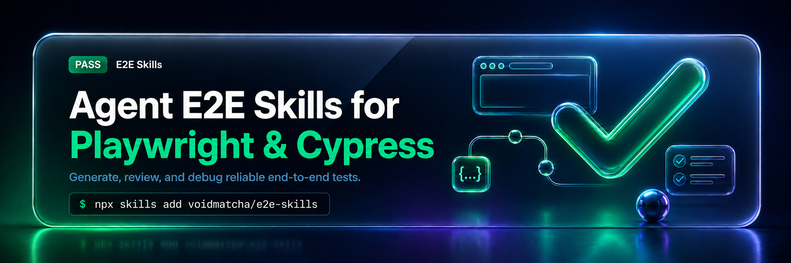
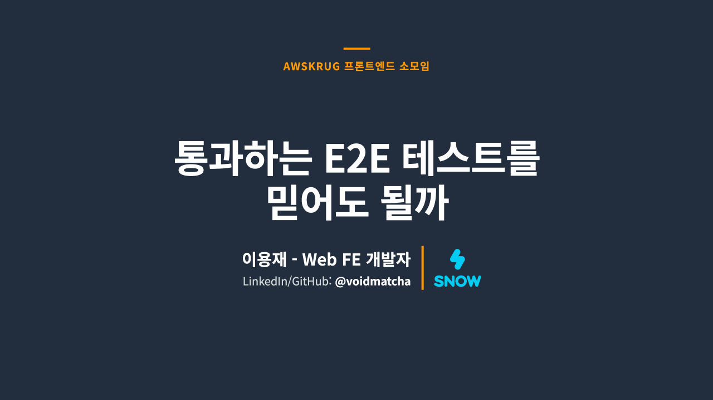

<div align="center">
  
</div>

<h1 align="center">E2E Skills</h1>

<p align="center">
  <a href="https://github.com/voidmatcha/e2e-skills"></a>
  <a href="https://claude.com/product/claude-code"></a>
  <a href="https://github.com/openai/codex"></a>
  <a href="https://playwright.dev"></a>
  <a href="#merged-upstream-fixes"></a>
  <a href="https://github.com/vercel-labs/skills#supported-agents"></a>
  <a href="https://skills.sh/voidmatcha/e2e-skills"></a>
  <a href="https://www.kimi.ai/resources/software-testing-skills"></a>
  <a href="./LICENSE"></a>
</p>

<p align="center">
<a href="README.md">English</a> | <strong>한국어</strong> | <a href="README.ja.md">日本語</a> | <a href="README.zh-cn.md">简体中文</a>
</p>

<!-- README-CANONICAL-REVISION: sha256=bbee1ffb2cf1e2805115723f817ea4928bedfd1029746102041f6be69bb6df11; bytes=exact-README.md-UTF-8; translation-quality=not-attested -->

`e2e-skills`는 Claude Code, Codex 등 AI coding agent에서 사용하는 Playwright와 Cypress E2E 테스트용 오픈소스 skill 모음입니다. 세 skill로 Playwright 테스트를 생성하고, Playwright/Cypress 테스트와 PR을 리뷰하고, 실패하는 테스트를 제품 코드를 바꾸지 않고 고칩니다.

**E2E 테스트는 통과합니다. 기능도 제대로 동작할까요?** 인기 React 저장소 200곳 중 34곳에서, 이름에 적힌 기능이 깨져도 통과할 수 있는 테스트를 찾았습니다. [범위와 한계](#근거와-한계) · [데이터](https://huggingface.co/datasets/voidmatcha/e2e-skills-benchmarks/blob/770f2de79848c65b80116219ce2d03747a3ae370/raw/oss-prevalence-and-reviewer-20261106/oss-cases/summary.md)

`e2e-skills`는 테스트가 시나리오에 적힌 동작을 제대로 확인하는지 살펴보도록 돕습니다. [설치하고 사용해 보기](#설치하고-사용해-보기)부터 시작해주세요. 무료 메모를 적용하고, skill을 설치한 뒤, 30초 정적 검사를 실행합니다.

<p align="center">
  <a href="https://www.kimi.ai/ko/resources/software-testing-skills">
    
  </a>
  <br />
  <sub><a href="https://www.kimi.ai/ko/resources/software-testing-skills">Kimi 공식 사이트의 "더 스마트한 QA 자동화를 위한 AI 소프트웨어 테스트 skill"에 소개되었습니다.</a></sub>
</p>

`e2e-reviewer`는 코드 scanner로 의심되는 부분을 찾고, 테스트와 연관된 코드를 읽어 실제 문제인지 판단합니다. [실험적 런타임 probe](#실험적-런타임-검증명시적-요청-시에만)는 명시적으로 요청할 때만 사용할 수 있습니다.

| 필요 | skill | 결과 |
| --- | --- | --- |
| 새 Playwright 테스트 생성 | [`playwright-test-generator`](skills/playwright-test-generator/SKILL.md) | 실제 화면을 살펴보고 작성한 테스트와 scanner 검사 및 실행 결과 |
| Playwright/Cypress 테스트 또는 PR/diff 변경 사항 리뷰 | [`e2e-reviewer`](skills/e2e-reviewer/SKILL.md) | 문제 등급별 목록과 판단 근거, 수정안, 변경 사항별 구분(신규 문제, 악화된 문제, 기존 문제) |
| 실패하는 Playwright/Cypress 테스트 디버깅과 수정 | [`e2e-debugger`](skills/e2e-debugger/SKILL.md) | 근거와 함께 원인을 FLAKY, APP-REGRESSION, TEST-DEFECT-FIXED, ENV, UNCLEAR 중 하나로 분류. 안전한 테스트 파일 수정만 하고 제품 코드는 바꾸지 않음 |
| 로컬 규칙 검사 | `e2e-skills scan` | 대상 프로젝트의 패키지 설치 없이 찾은 문제 후보 |

리뷰 결과는 P0/P1/P2로 문제 등급을 구분합니다. P0는 기능이 제대로 동작하지 않아도 테스트가 통과하는 문제, P1은 안정성이나 원인 파악을 어렵게 하는 문제, P2는 유지보수 개선 사항을 뜻합니다.

**테스트 생성:** 설치를 마쳤다면 agent에게 어느 로컬 프로젝트의 테스트를 만들지 알려주세요. 설정이 누락되어 있다면 agent를 통해 설정할 수 있습니다.

https://github.com/user-attachments/assets/4457b99a-f6f4-4023-94d3-cbf3a48387d6

<p align="center">
  <sub>리팩터링으로 POST /api/like 호출이 빠집니다. 화면에 Liked가 표시되므로 UI만 확인하는 Playwright 테스트는 그대로 통과하고, 요청을 확인하는 테스트는 POST가 전송되지 않아 실패합니다. examples/optimistic-like-demo의 실행 가능한 예제로 녹화했습니다.<br /><a href="docs/assets/demo.mp4">MP4</a>나 <a href="docs/assets/demo.gif">GIF</a>로 받거나 <a href="examples/optimistic-like-demo/README.md">직접 실행해 보세요</a>.</sub>
</p>

<a id="merged-upstream-fixes"></a>

## upstream에 merge된 수정 사례

`e2e-reviewer`가 찾은 문제를 고친 PR **15건이 upstream에 merge되었습니다**. 아래 표에서 각각의 변경 사항을 확인할 수 있습니다.

아래 저장소의 GitHub star 합계는 **496,650개**입니다. 2026-10-20 GitHub API 확인 기준입니다.

| 저장소 | GitHub Stars | PR | 수정한 패턴 |
| --- | ---: | --- | --- |
| Storybook | ★91.3k | [storybookjs/storybook#34141](https://github.com/storybookjs/storybook/pull/34141) | Playwright 동작 호출의 `await` 누락, 화면 표시 여부를 조회한 뒤 결과를 확인하지 않음 |
| code-server | ★79.7k | [coder/code-server#7845](https://github.com/coder/code-server/pull/7845) | focused test 유출, matcher 없는 `expect`, 화면 표시 여부를 조회한 뒤 결과를 사용하지 않음 |
| Strapi | ★73.3k | [strapi/strapi#26630](https://github.com/strapi/strapi/pull/26630) | 사용하지 않는 탐색 및 상태 확인 |
| Ghost | ★55.6k | [TryGhost/Ghost#28712](https://github.com/TryGhost/Ghost/pull/28712) | 비활성화 상태를 확인하면서 Promise의 결과를 기다리지 않음 |
| Cal.com | ★49.2k | [calcom/cal.diy#28486](https://github.com/calcom/cal.diy/pull/28486) | E2E 흐름의 약한 검증 패턴 |
| Bruno | ★47.7k | [usebruno/bruno#8317](https://github.com/usebruno/bruno/pull/8317) | 검증과 대기의 안정성 문제 |
| Qwik | ★22.1k | [QwikDev/qwik#8777](https://github.com/QwikDev/qwik/pull/8777) | Locator/handle 존재 여부만 확인 |
| SvelteKit | ★20.9k | [sveltejs/kit#16068](https://github.com/sveltejs/kit/pull/16068) | `await` 없는 Playwright assertion |
| Element Web | ★13.6k | [element-hq/element-web#32801](https://github.com/element-hq/element-web/pull/32801) | Locator가 null이 아닌지만 확인 |
| FiftyOne | ★11.2k | [voxel51/fiftyone#7851](https://github.com/voxel51/fiftyone/pull/7851) | Locator 객체의 존재 여부 대신 화면에 중복 이름 오류가 표시되는지 확인 |
| Carbon Design System | ★9.6k | [carbon-design-system/carbon#22564](https://github.com/carbon-design-system/carbon/pull/22564) | Locator의 true/false 판정을 web-first assertion으로 교체 |
| Rancher Desktop | ★7.4k | [rancher-sandbox/rancher-desktop#10557](https://github.com/rancher-sandbox/rancher-desktop/pull/10557) | Locator의 `not.toBeNull()` 확인 대신 화면에 WSL 통합 이름이 표시되는지 확인 |
| Apache Zeppelin | ★6.7k | [apache/zeppelin#5180](https://github.com/apache/zeppelin/pull/5180) | 항상 true인 assertion과 조용히 건너뛰던 가드 검사 |
| MUI X | ★5.9k | [mui/mui-x#22982](https://github.com/mui/mui-x/pull/22982) | UI handle 확인을 상태 검증으로 교체 |
| module-federation/core | ★2.7k | [module-federation/core#4826](https://github.com/module-federation/core/pull/4826) | Cypress 테스트에서 `uncaught:exception` 오류를 무조건 무시하는 처리 |

## false-green 테스트 살펴보기

**false-green**은 테스트로 확인하려던 기능이 제대로 동작하지 않는데도 테스트가 통과하는 상태입니다. 아래 수정은 Locator 객체가 만들어졌는지만 확인하던 코드를, 실제 화면에 메시지가 보이는지 확인하도록 바꿉니다.

```diff
- expect(page.getByText('Welcome back')).toBeDefined()
+ await expect(page.getByText('Welcome back')).toBeVisible()
```

<details>
<summary>전체 예시와 scanner 출력</summary>

이 Playwright 테스트는 그럴듯해 보이지만 `Locator` 객체가 만들어졌는지만 확인합니다.

```typescript
import { expect, test } from '@playwright/test';

test('shows the welcome message', async ({ page }) => {
  await page.goto('/dashboard');
  expect(page.getByText('Welcome back')).toBeDefined();
  expect(page.locator('.user-badge')).not.toBeNull();
});
```

함께 제공되는 scanner는 별도 설정 없이, 실제 결과를 확인하지 않고도 통과하는 테스트 코드를 찾아냅니다. 아래는 텍스트 보고서입니다(`--format text`를 빼면 같은 결과를 JSON으로 출력합니다).

```console
$ npx --yes --package=@voidmatcha/e2e-skills-scanner@3.7.0 e2e-skills scan tests/ --format text
Node source scan (canonical report view)
Status: COMPLETE; confirmed P0: 2, P0 candidates: 0, unresolved locations: 0.
Next:
  - Fix 2 confirmed P0 finding(s) ([P0][CONFIRMED] below).
Terms: https://github.com/voidmatcha/e2e-skills/blob/main/docs/scanner-cli.md#glossary

Coverage: BOUNDED; discovery: COMPLETE.
Semantic review: no LLM-triage candidates or source-linked analysis tasks; compatibility contract: DEVELOPMENT.
Review obligations: 0 unresolved location(s) covered by reviewing a retained candidate.
Unresolved analysis: 0 location(s) in 0 file(s), not findings; 0 of them are source-linked review tasks; execution status unchanged.
Project configuration: UNAVAILABLE; declared settings only, runner selection unchanged.
Configuration files: 0; unresolved configuration observations: 1.
Project ESLint effective rule states: NOT EXECUTED; static declarations do not establish active rules.

[P0][CONFIRMED] #4f Static finding (2 hits)
  "login.spec.ts":5: #4f
  "login.spec.ts":6: #4f

AST-origin total: 2 hit(s); retained findings, not ast-grep execution.

Summary: 2 total hit(s), 2 P0, 0 P1/P2 heuristic, 0 LLM-triage, 0 P0 candidate; 2 AST-origin hit(s), canonical retained findings.
```

이 실행은 P0 문제를 보고하므로 `e2e-skills scan`는 exit 1로 종료됩니다.

`eslint-plugin-playwright`도 `no-unnecessary-assertions` 규칙으로 이런 문제를 찾습니다. 커밋 시점의 lint가 잡을 수 있는 문제는 이 규칙에 맡기고, 나머지는 scanner로 보완하세요.

**실행 예제:** [React optimistic-write 검증](examples/react-optimistic-write/README.md)에서는 화면이 바뀌었다고 해서 서버에 요청이 전송되고 데이터가 저장됐다고 볼 수 없는 이유를 보여줍니다.

**발표 데모:** [Optimistic Like 데모](examples/optimistic-like-demo/README.md)는 결함 두 가지를 넣어 볼 수 있는 실행 가능한 앱으로, UI만 확인하는 테스트가 통과해도 쓰기 요청이 증명되지 않음을 보여줍니다.

</details>

## 발표자료

<table align="center">
<tr>
<td align="center" valign="top" width="50%">
<a href="https://voidmatcha.art/talks/awskrug-e2e-2026-ko"></a>
<p><b>통과하는 E2E 테스트를 믿어도 될까요?</b><br />AWSKRUG Frontend Meetup</p>
<p align="left">버그가 있어도 테스트가 통과하는 사례에서 출발해, lint와 LLM 리뷰를 결합한 과정, mutation과 fault injection을 통한 검증 방법, 벤치마크 결과와 오픈소스 기여 성과를 정리했습니다.</p>
<p><a href="https://voidmatcha.art/talks/awskrug-e2e-2026-ko">발표자료 보기</a></p>
</td>
<td align="center" valign="top" width="50%">
<a href="https://voidmatcha.art/talks/react-day-berlin-2026-en"></a>
<p><b>Green Isn’t Proof: Verifying AI-Generated React E2E Tests</b><br />React Day Berlin 2026</p>
<p align="left">초록색 통과가 테스트가 이름 붙인 동작을 지킨다는 증거가 아닌 이유를, merge된 오픈소스 수정 사례, 실행 가능한 낙관적 UI 데모, 사람과 AI가 쓴 테스트 모두에 쓰는 세 단계 리뷰 방법으로 설명합니다.</p>
<p><a href="https://voidmatcha.art/talks/react-day-berlin-2026-en">발표자료 보기 (영어)</a></p>
</td>
</tr>
</table>

## 설치하고 사용해 보기

### 1. 무료 메모 적용하기

[메모 본문](docs/test-authoring-memo.md#the-memo)을 프로젝트의 `AGENTS.md`(Codex)나 `CLAUDE.md`(Claude Code)에 복사하되 기존 지침은 유지해주세요. 프로젝트 디렉터리에서 CLI로 넣을 수도 있습니다(Node.js 22+ 필요). `CLAUDE.md`에 넣으려면 `--host claude`를, 미리 보려면 `--dry-run`을 쓰세요. 이 명령은 skill 설치 없이 메모만 넣습니다:

```bash
npx --yes --package=@voidmatcha/e2e-skills-scanner@3.7.0 e2e-skills guidance --host codex --project . --memo
```

### 2. skill 설치하기

이 명령 하나로 Claude Code와 Codex를 포함한 모든 [지원 agent](https://github.com/vercel-labs/skills#supported-agents)에 세 skill을 전역 설치합니다. CLI 버전은 고정되어 있습니다. 한 agent에만 설치하려면 `npx --yes skills@1.5.21 add voidmatcha/e2e-skills --skill '*' -g -a <agent>`를 사용해주세요(예: `-a claude-code`, `-a codex`). 새 agent 세션을 시작한 뒤 skill 목록(예: Claude Code의 `/skills`)에 `e2e-reviewer`, `e2e-debugger`, `playwright-test-generator`가 보이는지 확인해주세요.

```bash
npx --yes skills@1.5.21 add voidmatcha/e2e-skills -g --all
```

리뷰와 디버깅은 바로 쓸 수 있습니다. 테스트 생성에는 Playwright 공식 test agents와 `playwright-test` MCP 서버가 더 필요하며, 프로젝트마다 한 번 `npx playwright init-agents`로 설정합니다. [한 번만 하는 프로젝트 설정](#테스트-생성-한-번만-하는-프로젝트-설정)을 참고하세요.

### 3. 테스트 스캔하기

일반적인 테스트 디렉터리라면 정적 검사에 약 30초가 걸립니다(Node.js 22+ 필요):

```bash
npx --yes --package=@voidmatcha/e2e-skills-scanner@3.7.0 e2e-skills scan tests/ --format text --fail-on p0 --allow-incomplete
```

보고서의 `INCOMPLETE`는 일부 코드를 분석하지 못했다는 뜻이므로, 종료 코드 0이어도 깨끗한 결과가 아닙니다([용어](docs/scanner-cli.md#glossary)).

### 사용하기

agent에게 평소 말투로 요청하면 됩니다.

```text
Review my Playwright tests in tests/e2e with e2e-reviewer.
If useful, offer an assertion mutation or app-fault probe as a follow-up.
```

```text
Generate Playwright E2E coverage for apps/web/e2e.
```

```text
This test is failing, fix it.
```

리뷰와 실패 테스트 수정은 바로 동작합니다. 테스트 생성에는 아래의 한 번만 하는 프로젝트 설정이 필요합니다.

### 테스트 생성: 한 번만 하는 프로젝트 설정

`playwright-test-generator`는 `playwright-test` MCP server를 통해 Playwright 공식 test agent를 사용합니다. 처음 사용할 때 이 agent가 없으면 생성을 멈추고 Playwright 프로젝트 루트에서 실행할 명령 하나를 알려줍니다. 이 명령을 skill이 직접 실행하지는 않습니다.

```bash
npx --no-install playwright init-agents --loop=claude   # Claude Code
npx --no-install playwright init-agents --loop=codex    # Codex
```

`--no-install`은 프로젝트에 이미 설치된 Playwright를 사용합니다. 이 명령은 agent 정의, MCP 설정과 seed 파일을 쓸 수 있으므로 [설치 가이드](docs/installation.md#manual-generator-setup)에서 변경 사항을 확인해주세요. 그런 다음 agent를 다시 시작하고 프로젝트의 `playwright-test` MCP server를 승인해주세요. Codex에서는 신뢰한 프로젝트의 `.codex/config.toml`에 세션 전체에서 쓸 항목도 필요합니다([설정](docs/installation.md#codex)). 세션에 `generator_write_test` tool이 보이면 생성을 시작할 수 있습니다.

instruction 파일 위치, optional 메모와 측정 결과의 한계는 [테스트 작성 메모](docs/test-authoring-memo.md)와 [설치 안내](docs/installation.md#optional-memo-and-failure-policy)를 참고해주세요.

### 설치 없이 CI에서 스캔하기

scanner는 skill을 설치하지 않아도 실행되므로 로컬이나 CI에서 바로 쓸 수 있습니다.

```bash
npx --yes --package=@voidmatcha/e2e-skills-scanner@3.7.0 e2e-skills scan path/to/tests --format text
```

`INCOMPLETE`는 일부 코드를 분석하지 못했다는 뜻이며, 테스트가 실패했다는 뜻은 아닙니다. 종료 코드, 보고서 용어, CI 옵션과 설치 문제 해결은 [scanner 가이드](docs/scanner-cli.md)를 참고해주세요. 판단이 남은 후보는 `e2e-reviewer`에 리뷰를 요청하세요.

### 다른 설치 방법과 문제 해결

skills CLI 대신 같은 세 skill을 plugin으로 설치할 수도 있습니다. 둘 중 하나만 사용해주세요. plugin skill은 namespace가 붙기 때문에 둘 다 설치하면 모든 skill이 두 번 로드됩니다.

```text
/plugin marketplace add voidmatcha/e2e-skills
/plugin install e2e-skills@voidmatcha
```

```text
codex plugin marketplace add voidmatcha/e2e-skills
codex plugin add e2e-skills@voidmatcha
```

첫 번째는 Claude Code용, 두 번째는 Codex용입니다. 테스트 생성에는 여전히 위의 프로젝트 설정이 필요합니다.

skill이 보이지 않거나 생성이 계속 준비되지 않으면 설치된 skill, 공식 agent와 MCP 설정을 확인하는 읽기 전용 진단을 실행해주세요.

```bash
npx --yes --package=@voidmatcha/e2e-skills-scanner@3.7.0 e2e-skills doctor --host claude --project /path/to/playwright-project
```

Codex에서는 `--host codex`를 사용해주세요. 사전 요구 사항, 프로젝트 설정까지 준비하는 installer, 수동 설정은 [설치 가이드](docs/installation.md)를 참고해주세요.

## 지원 환경

<details>
<summary>지원 환경과 실행 조건 보기</summary>

프로젝트의 E2E 테스트를 작성하고 리뷰할 때 사용하세요. 리뷰와 실패 테스트 수정은 Playwright와 Cypress를, 생성은 Playwright만 지원합니다.

함께 제공되는 shell script는 일반적인 macOS/Linux 환경을 지원하며, `/bin/bash`와 launcher에 지정된 시스템 실행 파일 경로를 사용합니다. Windows에서는 호환되는 WSL 배포판을 사용하고 프로젝트도 WSL 파일 시스템에 두세요. 네이티브 Windows는 지원하지 않습니다. NixOS, 그리고 Nix, pyenv, Conda, nvm으로만 설치한 tool은 모두 자동으로 찾을 수 있는 것은 아닙니다. 신뢰할 수 있는 tool이 없으면 중단합니다. `PATH`에서 다른 실행 파일을 찾아 우회하지 마세요. skill 리소스는 추측한 홈 디렉터리가 아니라, plugin 캐시와 사용자 지정 설치를 포함해 host가 실제로 제공한 skill 위치에서 찾으세요.

generator는 공식 Playwright agent를 사용한 뒤 reviewer scanner와 새 테스트를 실행합니다. 아무것도 설치하지 않고 agent와 MCP 설정을 바꾸지 않습니다. 설정이 없으면 필요한 설정과 읽기 전용 `e2e-skills doctor`를 안내합니다.

생성에는 로컬 개발에서 흔히 쓰는 loopback 주소(`localhost`, `127.0.0.1`, `::1`)를 사용합니다. 승인된 개발 서버와 기존 테스트용 backend 또는 mock을 재사용합니다. 브라우저 작업 전에는 시나리오에서 사용하는 서비스만 확인합니다. 쓰기 작업에는 격리된 테스트 데이터와 정리 또는 초기화 방법이 필요합니다. 읽기 전용 시나리오에는 초기화가 필요하지 않습니다. 새 mock 서버나 배포 환경을 만들 필요도 없습니다. 사용하지 않는 API나 데이터베이스는 N/A로 표시하며, 공유 데이터나 운영 데이터에는 접근하지 않습니다. 실제로 탐색하거나 요청을 보내는 주소는 승인된 origin과 scheme, hostname, 유효 포트가 같아야 합니다. 별도로 승인된 loopback API 주소에도 요청을 보낼 수 있습니다. 승인되지 않은 주소나 확인할 수 없는 주소로의 접근은 BLOCKED로 보고합니다. 주소를 확인해도 브라우저가 다른 origin에 접근하는 것까지 차단하지는 않습니다.

[generator 계약](skills/playwright-test-generator/SKILL.md)에 수정 규칙과 실행 안전 조건이 정의되어 있습니다. 프로젝트 버그이거나 실패 원인이 불확실한 경우, 수정 후에도 실패가 남은 경우에는 BLOCKED로 보고합니다.

probe 실행에는 프로젝트를 신뢰하고 환경 변수와 플래그를 포함한 정확한 명령을 승인해야 합니다. 보고서에는 스킵한 검사를 표시합니다. mutation과 fault injection probe는 필요할 때 추가로 실행하며, 실행하지 않은 결과를 측정된 것처럼 보고하지 않습니다.

버전 이력은 [CHANGELOG.md](CHANGELOG.md)에 정리되어 있습니다.

</details>

## 생성한 테스트가 버그를 잡는지 확인하기

공식 Playwright agent가 테스트를 생성하면, `e2e-reviewer`가 설치된 경우 generator skill이 scanner로 검사하고 P0/P1 항목을 최대 세 차례 수정합니다. 문제가 남거나 검사를 끝내지 못하면 중단합니다. 통과하면 승인된 프로젝트 테스트 명령으로, 승인된 프로젝트나 하나뿐임을 확인한 프로젝트에서 새 spec만 실행하고 테스트 실행 결과의 passed/failed/skipped 수를 보고합니다. 승인된 테스트 명령이 없으면 테스트를 실행하지 않았다고 보고합니다. reviewer가 없거나 검사 또는 실행을 스킵하면 미완료로 보고합니다. 테스트가 의도한 동작을 확인하는지까지 리뷰하려면 `e2e-reviewer`에 별도로 요청하세요.

generator는 reviewer scanner와 승인된 새 spec을 실행합니다. scanner 결과만으로 동작을 얼마나 검증하는지 입증할 수는 없습니다. 테스트가 의도한 동작을 확인하는지 리뷰하려면 `e2e-reviewer`에 요청하세요. 특정 동작을 실행으로 입증해야 한다고 명시적으로 요청하려면 [실험적 런타임 검증](#실험적-런타임-검증명시적-요청-시에만)을 참고해주세요. 실패 경로 테스트 작성은 optional [메모](docs/test-authoring-memo.md)와 [실패 정책](docs/test-failure-policy.md)을 참고해주세요.

## 근거와 한계

발생 비율: Claude 코드 검토에서 34/200개 저장소(17.0%, 95% CI 12.4–22.8%)를 확인했고, Claude와 Codex가 같은 위치의 문제를 함께 확인한 저장소는 32/200개였습니다. 수치는 [timeout 재검토 결과](CHANGELOG.md#swallowed-wait-re-audit)를 반영했습니다. 링크한 HF 스냅샷에는 정정 전 수치가 남아 있습니다. [범위와 방법](https://huggingface.co/datasets/voidmatcha/e2e-skills-benchmarks/blob/770f2de79848c65b80116219ce2d03747a3ae370/raw/oss-prevalence-and-reviewer-20261106/oss-cases/summary.md) · [결과](https://huggingface.co/datasets/voidmatcha/e2e-skills-benchmarks/blob/770f2de79848c65b80116219ce2d03747a3ae370/raw/oss-prevalence-and-reviewer-20261106/oss-cases/CODEX-EXPANDED-REPORT.md)

메모와 healer: 준비된 regression 16건에서 프로젝트 코드 수정이 136단어 memo를 썼을 때 10/16건, memo v5를 썼을 때 0/16건이었습니다. Claude와 Codex에서 각각 같은 결과가 나왔습니다. 측정 때처럼 사용하려면 프로젝트 지침 파일에 메모가 있어야 합니다. [실험 조건과 한계](https://huggingface.co/datasets/voidmatcha/e2e-skills-benchmarks/blob/5ba1d3e97f9dd810cf03ebc3b01dca54b12b4c6f/raw/evidence-20261106b/healer-memo-v5/tab2-results/memov5-heal-20261106.md) 개발용 데이터에서 얻은 결과이며, 개발에 쓰지 않고 따로 남겨 둔 데이터로 평가한 결과는 아닙니다. [별도의 개발 단계 반복 실험](docs/test-authoring-memo.md#failure-handling)에서는 메모가 없을 때 두 모델 각각 16/16건, 메모가 있을 때 Claude 0/16건, Codex 1/16건이었습니다. 서로 다른 실험 결과입니다.

리뷰 비용: Claude `claude-sonnet-5-5`, high effort 실행에서 저장소당 약 $1–2였습니다(추가 표본 범위 $0.58–1.96). [비용표](https://huggingface.co/datasets/voidmatcha/e2e-skills-benchmarks/blob/770f2de79848c65b80116219ce2d03747a3ae370/raw/oss-prevalence-and-reviewer-20261106/reviewer-cost-table.md)

이 수치는 해당 조건에서 관찰한 결과입니다. 코드 판정이 실제 실행을 입증하지는 않으며, 무작위 표본이 아니고, 리뷰 결과는 모델과 프로젝트에 따라 다릅니다. [데이터와 범위](https://huggingface.co/datasets/voidmatcha/e2e-skills-benchmarks/tree/770f2de79848c65b80116219ce2d03747a3ae370/raw/oss-prevalence-and-reviewer-20261106)

<details>
<summary>벤치마크 측정 범위와 모델별 결과</summary>

[3.0.0 검증 기록](https://huggingface.co/datasets/voidmatcha/e2e-skills-benchmarks/blob/2992d57564bb5b0d7eae0650a64f392481211d41/snapshots/git-93afd3b105b869b15589634c88676230c7d92254/benchmarks/release-readiness-v1/README.md)에는 설치, scanner 동작, 실행 안전 규칙, 일부 Playwright/Cypress 실행 결과와 보존한 근거, 적용 범위가 정리되어 있습니다.

[10월 20일 검증](https://huggingface.co/datasets/voidmatcha/e2e-skills-benchmarks/blob/2992d57564bb5b0d7eae0650a64f392481211d41/snapshots/git-93afd3b105b869b15589634c88676230c7d92254/benchmarks/release-readiness-v1/README.md#october-20-successor)에서는 격리된 환경의 설치, Claude Code와 Codex에서 공식 agent/MCP로 테스트를 생성하고 실행하는 경로, 선정한 Cypress assertion mutation과 fault injection을 확인했습니다. generator의 최초 측정 결과와 이후 다시 실행한 결과는 구분해서 보고합니다.

reviewer의 개발 단계 결과는 모델마다 다르며, scanner의 효과나 처음 보는 프로젝트의 정확도를 입증하지 않습니다. 모델별 결과와 한계는 [벤치마크 현황](benchmarks/STATUS.md)을 참고해주세요.

프로토콜, 입력 자료, 요약, 원본 실행 artifact를 포함한 과거 벤치마크의 전체 보관본은 [근거 manifest](benchmarks/external-evidence.json)에 고정되어 있으며 [Hugging Face 데이터셋](https://huggingface.co/datasets/voidmatcha/e2e-skills-benchmarks)에서 받을 수 있습니다. 이전 점수를 검토하기 전 `scripts/dev/fetch-benchmark-evidence.sh --dry-run`으로 복원 계획을 확인하세요.

</details>

## E2E 리뷰 목록

Playwright/Cypress `test smell` 24개를 정리한 목록이며, 각 항목의 ID는 바꾸지 않습니다. 버그가 있어도 테스트가 통과할 수 있는 경우로는 Locator의 true/false 판정, assertion 누락, 오류 무시, focused test, 인증 누락, 네트워크 요청이 실제로 전송됐는지 확인하지 않는 `optimistic UI` 검증이 있습니다. [전체 분류와 근거](docs/e2e-test-smells.md)를 참고해주세요.

일부 패턴은 테스트뿐 아니라 프로젝트 코드도 있어야 판단할 수 있습니다. `#22` optimistic UI를 리뷰하려면 쓰기를 약속하는 테스트나 acceptance 기준과 관련 프로젝트 코드가 필요합니다. spec만 보고 요청이 빠졌다고 추론하지 않습니다. [패턴 설명](docs/e2e-test-smells.md)을 참고해주세요.

<details>
<summary>문제 등급별 패턴 24개 전체</summary>

### 24개 패턴: 문제 등급별 분류

#### P0: 반드시 수정 (문제가 있어도 통과)

기능이 제대로 동작하지 않는데도 테스트는 통과합니다.

| # | 패턴 | 수정 전 | 수정 후 |
|---|---------|--------|-------|
| 1 | **이름과 assertion 불일치** | 이름에는 "status"가 있지만 `toBeVisible()`만 확인 | 상태 내용을 검증하거나 실제 검증 내용에 맞게 이름 변경 |
| 2 | **Then 누락** | 취소한 뒤 텍스트 복원만 확인하고 입력란이 사라졌는지는 확인하지 않음 | 복원된 상태와 입력란이 닫힌 상태를 모두 검증 |
| 3 | **오류 무시** | 테스트의 `try/catch`, POM의 `.catch(() => {})` | 오류가 테스트 실패로 이어지게 하고 POM 메서드에서 실패를 가리는 catch 제거 |
| 3b | **Cypress `uncaught:exception` 억제** | `cy.on('uncaught:exception', () => false)`가 모든 프로젝트 오류를 무시하거나, 오류를 무시하는 `fail` 핸들러가 실패한 모든 테스트를 통과시킴 | 이미 알려진 특정 오류에만 핸들러를 적용하고, 그 외 오류는 그대로 전달해 테스트가 실패하게 함. `fail` 핸들러는 `throw error`로 끝냄 |
| 4 | **무의미하거나 재시도를 약화하는 assertion** (P0/P1) | P0: 항상 같은 결과를 내는 조건식과 Locator의 true/false 판정. P1: 약한 DOM 연결 확인, 한 번만 읽은 값/URL, 제한 시간 0으로 인한 재시도와 실행 종료 시점의 문제, selector나 상태 근거 없이 요소가 없다고 판단, 비어 있을 수 있는 컬렉션을 도는 assertion, 약속한 접근성 이름이 빠진 ARIA 스냅샷 | 의미 있는 범위와 자동 재시도를 지원하는 web-first assertion 사용. 같은 locator의 근거나 정확한 selector/fixture 매핑과 관련 상태의 positive assertion으로 요소가 없다는 판단을 뒷받침하고, 시나리오를 유지하며, 반복문을 실행하기 전에 컬렉션이 비어 있지 않은지 확인하며, 약속한 접근성 이름을 핵심 검증 조건으로 유지 |
| 5 | **우회 패턴** (5a P0, 5b P1) | `if (await el.isVisible()) { expect(...) }`, 근거 주석 없는 `{ force: true }` | 조건 없이 항상 검증. 환경 확인은 `beforeEach`로 이동하고 `force: true`에는 `// JUSTIFIED:` 추가 |
| 7 | **Focused test 유출** | `test.only(...)`가 커밋되어 CI가 테스트 하나만 실행하고 나머지는 조용히 건너뜀 | `.only` 삭제. local에서 일부만 실행할 때는 `--grep` 또는 `--spec` 사용 |
| 8 | **assertion 누락** | 사용하지 않는 locator/boolean이 시나리오의 유일한 검증이거나, `expect(x).toBeVisible;`처럼 matcher를 호출하지 않음 | `await expect(locator).toBeVisible()` 추가. 별도의 검증이나 실패 근거가 이미 있으면 8a/8b 제외 |
| 12 | **인증 설정 누락** | 로그인, `storageState`, 인증 fixture가 없어 보호된 경로의 테스트가 로그인 화면이나 엉뚱한 화면의 일반적인 요소를 보고도 통과 | `beforeEach` 로그인, `storageState` 설정, 인증 fixture 중 하나 사용. 정상적인 인증 실패를 P0으로 분류하지 않음 |

#### P1: 수정 권장 (진단 품질 저하 / CI 시간 낭비)

테스트 자체는 동작하지만 개발자가 결과를 잘못 해석하게 만들거나 CI 시간을 낭비하고, 나중에 코드를 바꾸면서 생긴 버그를 찾지 못할 수 있습니다.

| # | 패턴 | 수정 전 | 수정 후 |
|---|---------|--------|-------|
| 6 | **직접 DOM 쿼리** | `evaluate()` 안에서 `document.querySelector` 사용 | framework의 locator/query API(`locator` / `cy.get`) 사용 |
| 9 | **고정 시간 대기** | `waitForTimeout(2000)` / `cy.wait(2000)` / `waitForLoadState('networkidle')` | framework의 자동 대기를 활용하고 조건 기반 대기 사용 |
| 10 | **불안정한 테스트 패턴** | 근거 주석 없는 `items.nth(2)`, `test.describe.serial()`, 범위가 정해지지 않은 접근성 이름 부분 문자열(10c), Cypress 비동기 콜백, 변수에 할당한 `cy` 명령, 계속 이어지는 동작 체인(10d–10f) | 안정적이고 범위가 명확한 locator와 독립적인 테스트 사용. Cypress 작업은 명령 흐름 안에 유지하고 Chainable을 값으로 할당하지 않으며 동작 후 다시 쿼리 |
| 13 | **일관되지 않은 POM 사용** | 소스에서 확인된 같은 페이지의 POM 경계를 직접 동작 호출로 우회. POM이 있다는 사실만으로는 부족 | 확인된 POM 경계를 재사용. POM이 있다는 이유만으로 wrapper를 새로 만들지 않음 |
| 14 | **하드코딩된 자격 증명** | 테스트 코드에 `loginPage.login('demo-admin', '<literal-password>')` 사용 | `process.env.TEST_USER`, Playwright 설정의 secret, 테스트 데이터 fixture 사용 |
| 15 | **`expect()`의 `await` 누락** | 비동기 Locator/Page web-first matcher Promise의 실행 순서와 결과를 확인하지 않음. Promise가 실패해도 해당 assertion에서 바로 보고되지 않아 오류가 발생한 위치를 찾기 어려움 | matcher Promise를 `await`하거나 반환. 동기 값 matcher는 제외 |
| 16 | **동작의 `await` 누락** | actionability 확인, 동작 순서, 탐색이 뒤따르는 작업과 경합할 수 있음. 거부된 Promise는 대개 나중에 엉뚱한 위치의 오류로 나타남 | 동작 Promise를 `await`하거나 반환 |
| 17 | **권장하지 않는 Page selector API 직접 사용** | selector 기반 `page.click`, `page.fill`과 관련 Page 동작이 Locator 계층을 건너뜀 | 조합성, strictness, 재사용성, 명확한 실패 메시지를 위해 Locator 동작 사용 |
| 18 | **`expect.soft()`에 지나치게 의존** | 필수 조건을 엄격하게 확인하기 전에 핵심 soft assertion을 실행해 전제 조건이 깨진 뒤에도 후속 작업이 계속됨 | 핵심 상태를 먼저 일반 assertion으로 차단하고, `soft`는 서로 독립적인 세부 항목에만 사용 |
| 19 | **테스트 코드의 모듈 수준 가변 상태** | 테스트 유틸리티 파일의 최상위에 선언한 `let seq = 0;` 또는 변형되는 `const cache = new Map()`가 오래 실행되는 worker에 남아 병렬 worker 사이에서 충돌 | 카운터 삭제. `Date.now()`와 `Math.random().toString(36).slice(2, 8)`로 고유한 값을 만들거나 상태를 `test.beforeEach`로 이동 |
| 20 | **mock 없이 실제 백엔드에 데이터 쓰기** | 회원 가입/결제 테스트가 통제된 테스트 경계 없이 공유 또는 영구 상태에 접근 | 쓰기 요청을 stub 처리하거나 일회용 컨테이너, rollback fixture, 격리된 tenant/database처럼 통제된 백엔드임을 입증 |
| 22 | **`optimistic UI` 검증에 호출 근거 없음** | 좋아요 전환 테스트가 `aria-pressed` 변경만 검증. UI가 먼저 바뀌면 POST가 사라져도 통과 | UI 검증을 클릭 전에 준비한 `page.waitForRequest()` 또는 route 적중 flag와 함께 사용 |

#### P2: 개선 권장 (유지보수성 / 견고성)

오류는 아니지만 유지보수를 위해 개선할 수 있습니다. 리팩터링할 때 처리합니다.

| # | 패턴 | 수정 전 | 수정 후 |
|---|---------|--------|-------|
| 11 | **YAGNI와 더 이상 실행하지 않는 테스트** | 호출되지 않는 `clickEdit()`, 근거 없이 비어 있는 wrapper class, 다른 테스트와 완전히 중복되는 테스트, 이유가 없는 skip | 사용하지 않는 멤버와 더 이상 실행하지 않는 테스트를 삭제. skip을 유지한다면 이유를 적고, 장기 보류 시 언제 다시 검토할지 정함. 한 번만 쓰는 helper는 별도 함수로 두어 복잡해진 경우에만 호출 위치로 옮김 |
| 21 | **수동으로 캡처한 세션 파일 의존성** | 수동 캡처 script로만 만드는 `storageState: 'auth/member.json'`이 CI에는 없고 예고 없이 만료 | API 로그인 helper 또는 `setup` 프로젝트로 세션을 자동 생성. 수동 파일은 자동 생성 대체 경로가 있는 캐시로만 사용 |
| 23 | **렌더링 가드를 무시하는 fixture** | liked 탭의 fixture가 `liked: false`를 넣어 카드 컴포넌트가 모든 항목에서 `return null`을 실행. 빈 UI가 인프라 불안정처럼 보임 | 데이터를 넣기 전에 항목 컴포넌트에서 렌더링을 중단하는 조건과 필터를 읽고, 테스트할 화면의 모든 가드를 통과하도록 필드 설정 |

</details>

## 실패 debugging

평소 말투로("This test is failing, fix it.") 요청하면 [`e2e-debugger`](skills/e2e-debugger/SKILL.md)를 사용할 수 있습니다. 선택한 테스트를 retry 없이 세 번 다시 실행해 결과가 섞이면 FLAKY로 보고합니다. 프로젝트 regression이 의심되면 제품 코드를 바꾸지 않고 보고하며, 테스트 defect이 입증된 경우에만 assertion을 약하게 만들지 않고 고칩니다. 바뀐 spec은 scanner 검사와 세 번의 재실행을 통과해야 합니다. 규칙과 근거는 [실패 처리 메모](docs/test-authoring-memo.md#failure-handling)를 참고해주세요. assertion을 약하게 만들어 통과시킨 테스트는 `e2e-reviewer`로 확인하세요.

## 실험적 런타임 검증(명시적 요청 시에만)

`e2e-reviewer`는 정적 리뷰로 시작합니다. 명시적으로 요청하지 않으면 런타임 검증을 제안하거나 실행하지 않습니다. 예를 들어 통과하는 특정 테스트가 저장 기능의 버그를 잡는지 요청할 수 있습니다. 이 실험적 절차는 버릴 수 있는 복사본에서 assertion mutation이나 근거가 있는 프로젝트 fault를 준비할 수 있습니다. 여러 probe도 명시적인 요청이 있어야 한 묶음으로 제안합니다. 대상 코드를 실행하려면 체크아웃을 신뢰하고 정확한 명령을 승인해야 합니다. 결과는 선택한 테스트와 fault에만 적용되며, 전체 테스트 모음에 적용되지 않습니다. 실제 프로젝트에서 어디까지 실행할 수 있는지와 정적 리뷰 대비 효과는 아직 입증하지 못했습니다. [런타임 절차](skills/e2e-reviewer/references/runtime-probes.md)와 [Release 안내](RELEASE-NOTES-3.7.0.md#experimental-reviewer-runtime-proof)를 참고해주세요.

## 독립 실행 scanner

AI agent 없이 검사하려면 [위의 설치 없이 실행하는 명령](#설치-없이-ci에서-스캔하기)을 사용하세요. 후보를 보고하며, 테스트를 실행하거나 의도한 동작을 검증하는지 판단하지는 않습니다. reviewer에도 같은 scanner가 포함되어 있습니다. TypeScript 파서는 함께 제공됩니다. 실행 조건, 보고서 형식과 옵션은 [scanner 가이드](docs/scanner-cli.md)를 참고해주세요.

기본 설정에서 함께 제공되는 scanner는 도구를 다운로드하거나 프로젝트 설정을 불러오지 않습니다. JSON 보고서는 `--format json`, 비공개 텍스트 보고서는 `--report-file <new-file>`을 사용하세요. 남은 후보는 Phase 2에서 리뷰해야 하며, `P0=0`만으로 검사가 끝나지 않습니다. `INCOMPLETE`의 기본 종료 코드는 2입니다. `--fail-on p0-candidate`와 선택적 `--project-eslint --trust-project` 조합은 [scanner 가이드](docs/scanner-cli.md)를 참고해주세요.

<details>
<summary>scanner 고급 옵션과 파일 읽기 범위</summary>

프로젝트 ESLint를 실행하려면 체크아웃에 대한 명시적 신뢰와 명령 승인이 필요합니다. [프로젝트 ESLint](docs/scanner-cli.md#optional-local-project-eslint)를 참고해주세요.

> **읽기 범위.**
> <!-- README-I18N-CONTRACT:SCANNER-READ-SCOPE:START -->
> 번들 검사는 요청한 경로 안의 소스 파일에서 문제 후보를 찾아 결과로 보여줍니다. framework 출처 확인은 포함 프로젝트의 다른 위치에 있는 relative fixture/support import도 읽을 수 있습니다.
> <!-- README-I18N-CONTRACT:SCANNER-READ-SCOPE:END -->

<!-- README-CONTRACT:SCANNER-EXTENSIONS:START -->
번들 검사는 `.ts`, `.js`, `.tsx`, `.jsx`, `.mts`, `.mjs`, `.cts`, `.cjs` 소스를 읽습니다.
<!-- README-CONTRACT:SCANNER-EXTENSIONS:END -->

`--fail-on`, `--allow-incomplete`, `--trust-module`, 종료 코드와 검사 범위의 한계는 [scanner 가이드](docs/scanner-cli.md)를, 실행 허용 범위는 [SECURITY.md](SECURITY.md)를 참고해주세요.

</details>

## ESLint plugin과의 차이

`eslint-plugin-playwright`와 `eslint-plugin-cypress`는 테스트 코드의 흔한 실수를 찾는 tool입니다. `e2e-skills` scanner도 두 plugin을 optional 검사 계층으로 활용합니다.

`eslint-plugin-playwright`의 `no-unnecessary-assertions` 규칙도 이 프로젝트에서 직접 기여해 [PR #470이 merge되었습니다](https://github.com/mskelton/eslint-plugin-playwright/pull/470). 프로젝트 상태 대신 Locator 객체가 존재하는지만 확인하는 assertion을 찾는 규칙입니다. 같은 이름의 Cypress 규칙도 `eslint-plugin-cypress` 7.2.0에 들어갔습니다([PR #400 merge](https://github.com/cypress-io/eslint-plugin-cypress/pull/400)). `expect(cy.get('.badge')).to.exist`처럼 실행 대기 중인 Cypress 체인에 바깥 Chai assertion을 거는 코드를 찾습니다. 대기 중인 명령은 요소가 없으면 여전히 실패하므로, 항상 통과하는 테스트가 아니라 assertion 명확성 문제를 다루는 규칙입니다.

plugin은 사용자가 명시적으로 실행을 허용했을 때 사용하며, 기본 설정에서는 자체 검사를 실행합니다. 기존 plugin 규칙에 더해 `e2e-skills`는 다음을 제공합니다.

- plugin 규칙을 보완하는 자체 코드 검사
- 테스트 의도와 주변 코드를 함께 읽어야 판단할 수 있는 문제에 대한 리뷰

`lint` tool은 Locator의 true/false만 확인하는 assertion이나 누락된 `await`를 찾을 수 있습니다. 하지만 "shows a duplicate-name error"라는 테스트가 실제로 오류를 확인하는지, 보호된 경로의 테스트가 인증을 빠뜨렸는지, `optimistic UI` assertion이 백엔드 요청의 전송 여부까지 확인하는지는 판단할 수 없습니다. 평소 `lint` 검사에는 plugin을, 테스트 신뢰도 점검에는 `e2e-reviewer`를 사용하세요.

## 자주 묻는 질문

### 통과하지만 아무것도 테스트하지 않는 Playwright 또는 Cypress 테스트를 어떻게 찾나요?

`e2e-reviewer`에 테스트 폴더를 알려주세요. 규칙으로 찾은 후보와 테스트 의도, 주변 코드를 함께 확인해 리뷰 결과를 제시합니다.

<details>
<summary>리뷰 범위와 실행 안전 조건 자세히 보기</summary>

<!-- README-I18N-CONTRACT:CORE-SAFETY:START -->
`e2e-reviewer`는 목록에 있는 패턴 24개를 모두 리뷰합니다. 각 패턴에는 고정 ID와 P0/P1/P2 문제 등급이 지정돼 있습니다. 독립 실행 `e2e-skills scan` scanner는 규칙만으로 판별할 수 있는 일부 항목만 다룹니다. scanner가 찾은 항목은 실제 문제인지 추가로 확인해야 합니다. 테스트 의도와 연관된 코드까지 확인한 뒤 실제 문제인지 판단합니다.

assertion mutation과 앱 fault probe는 저장소를 신뢰하고 환경 변수와 플래그를 포함한 정확한 명령을 승인한 뒤에만 대상 프로젝트에서 불러오는 코드를 실행합니다. generator는 reviewer scanner로 검사한 뒤 승인된 프로젝트 테스트 명령으로 자신이 작성한 spec만 실행합니다.

<!-- README-I18N-CONTRACT:CORE-SAFETY:END -->

</details>

### 이것이 Playwright 또는 Cypress 테스트 실행을 대체하나요?

아니요. 이 skill은 테스트 품질을 리뷰하고, Playwright 테스트를 작성하고, 승인된 테스트 명령으로 실패하는 테스트를 고칩니다. 테스트 실행기는 아닙니다.

## GitHub Actions에 정적 검사 추가하기

기본 설정에서는 후보를 job summary에 표시하고, 확정된 P0가 있을 때 실패합니다. 검사 대상 프로젝트를 실행하지 않습니다. [입력과 동작](docs/github-action.md)을 참고해주세요.

```yaml
permissions:
  contents: read
jobs:
  e2e-review:
    runs-on: ubuntu-latest
    steps:
      - uses: actions/checkout@v4
      - uses: actions/setup-node@v4
        with:
          node-version: '22'
      - uses: voidmatcha/e2e-skills@v3
        with:
          path: tests/
          fail-on: p0
          allow-incomplete: 'true'
          format: text
```

이 Action은 GitHub Marketplace에도 [E2E Skills static scan](https://github.com/marketplace/actions/e2e-skills-static-scan)으로 등록되어 있습니다.

## 상세 문서

- [AI가 생성한 Playwright와 Cypress E2E 테스트를 리뷰하는 방법](docs/review-ai-generated-e2e-tests.md)
- [Playwright와 Cypress E2E `test smell` 24개](docs/e2e-test-smells.md)
- [벤치마크 현황과 실패 결과](benchmarks/STATUS.md)
- [선택 사항: 테스트 작성 메모](docs/test-authoring-memo.md)와 [근거 기록](docs/benchmarks/test-authoring-memo-v1.md)
- [선택 사항: 테스트 실패 정책](docs/test-failure-policy.md)과 [측정 요약](docs/benchmarks/test-failure-policy-v1.md)

<details>
<summary>추가 참고 자료</summary>

- [규칙 자체 감사](docs/rule-self-audit.md)
- [오픈소스 사례 연구](docs/case-studies.md)
- [과거 벤치마크 전체 보관본(Hugging Face 데이터셋)](https://huggingface.co/datasets/voidmatcha/e2e-skills-benchmarks)
- [외부 연구 근거 원장](docs/llm-generated-e2e-test-evidence.md)
- [과거 AI reviewer 벤치마크](docs/ai-reviewer-benchmark.md)
- [지원 framework 범위](docs/framework-scope.md)
- [로컬 E2E 규칙 브리지와 권장 lint](docs/installation.md#optional-project-lint)
- [로드맵](docs/roadmap.md)
- [Archived reviewer evidence plan](https://huggingface.co/datasets/voidmatcha/e2e-skills-benchmarks/blob/a8279e972f2ae5b7628ac9ec8ccfc4cdac380a1d/releases/v3.3.1/docs-archive-20261028/README.md)

</details>

## 기여

버그 제보, 오탐 방지 사례, 새로운 안티패턴, 번역 기여를 환영합니다. 설정 방법과 검증 요구사항은 [CONTRIBUTING.md](CONTRIBUTING.md)를 참고해주세요. agent가 따라야 할 유지보수 규칙은 [AGENTS.md](AGENTS.md)에 있습니다.

## 라이선스

Apache-2.0 &copy; [voidmatcha](https://github.com/voidmatcha). [LICENSE](LICENSE)를 참고해주세요.

일부 벤치마크 기록에는 Playwright 공식 agent 정의(Apache-2.0, Microsoft)가 인용되어 있습니다. 자세한 내용은 [NOTICE](NOTICE)를 참고해주세요. Playwright는 Microsoft Corporation의 상표이며, 이 프로젝트는 Microsoft와 제휴하거나 보증을 받은 관계가 아닙니다.
