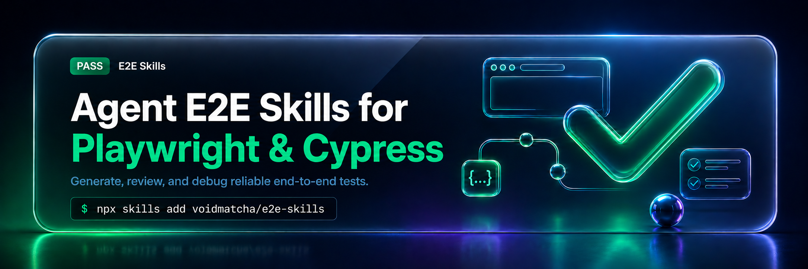
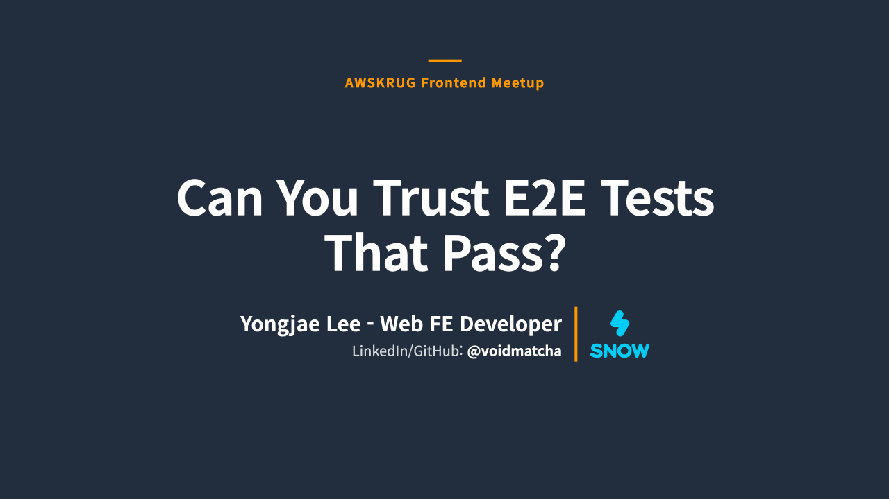

<div align="center">
  
</div>

<h1 align="center">E2E Skills</h1>

<p align="center">
  <a href="https://github.com/voidmatcha/e2e-skills"></a>
  <a href="https://claude.com/product/claude-code"></a>
  <a href="https://github.com/openai/codex"></a>
  <a href="https://playwright.dev"></a>
  <a href="#merged-upstream-fixes"></a>
  <a href="https://github.com/vercel-labs/skills#supported-agents"></a>
  <a href="https://www.skills.sh/voidmatcha/e2e-skills"></a>
  <a href="https://www.kimi.ai/resources/software-testing-skills"></a>
  <a href="./LICENSE"></a>
</p>

<p align="center">
<a href="README.md">English</a> | <a href="README.ko.md">한국어</a> | <a href="README.ja.md">日本語</a> | <strong>简体中文</strong>
</p>
<!-- README-CANONICAL-REVISION: sha256=a7803374d293beda48ce641f314235f195db1d50204caf70582f24e1a65eb9a0; bytes=exact-README.md-UTF-8; translation-quality=not-attested -->

`e2e-skills` 为 AI 编程 agent 提供四个 skill，用于生成、审查 Playwright/Cypress E2E 测试并诊断失败。skill 是 agent 执行任务时遵循的一组指令。

<p align="center">
  <a href="https://www.kimi.ai/resources/software-testing-skills">
    
  </a>
  <br />
  <sub><a href="https://www.kimi.ai/resources/software-testing-skills">已收录于 Kimi 官方网站的《AI Software Testing Skills for Smarter QA Automation》。</a></sub>
</p>

测试通过也可能漏掉产品缺陷。`e2e-skills` 帮助检查测试是否真正验证了名称所描述的行为。

`e2e-reviewer` 用代码扫描器查找候选问题，再阅读测试和周边代码，判断是否确实存在问题。需要时，它还会建议修改断言条件或在与原应用分开的副本中加入缺陷，检查测试是否失败。审查者可以主动提出这些额外验证；执行需要可信的本地环境和命令批准。同一范围内已有的批准继续有效。

`e2e-reviewer` 发现的问题促成了 [15 个合入上游的 PR](#merged-upstream-fixes)。下面列出实际修复案例。

| 需求 | Skill | 结果 |
| --- | --- | --- |
| 生成新的 Playwright 覆盖 | `playwright-test-generator` | 根据实际页面编写的测试，以及扫描器检查和执行结果 |
| 审查 Playwright/Cypress 测试或 PR/diff 变更 | `e2e-reviewer` | 按严重程度排列的问题、判断依据和修复建议；对变更区分新增、恶化和已有问题 |
| 调试失败的 Playwright 运行 | `playwright-debugger` | 推测原因、判断依据和具体修复建议 |
| 调试失败的 Cypress 运行 | `cypress-debugger` | 推测原因、判断依据和具体修复建议 |
| 运行确定性本地扫描 | `skills/e2e-reviewer/scripts/scan.sh` | 无需安装目标项目 package 即可发现的候选问题 |

P0/P1/P2 表示审查的严重程度：P0 是功能损坏仍通过的问题，P1 影响可靠性或诊断，P2 涉及维护改进。debugger 的 F1–F15 是时序、selector、认证等 15 类失败原因的分类代码。

**测试生成：** 安装后，告诉 agent 要测试哪个本地项目。它会检查所需配置，并说明还需要哪些准备。

<a id="merged-upstream-fixes"></a>

## 已合入上游的修复

`e2e-reviewer` 发现的问题促成了 **15 个合入上游的 PR**。下表链接了每个补丁。

以下仓库的 GitHub star 合计 **496,650**，数据来自 2026-10-20 的 GitHub API 快照。

| 仓库 | GitHub Stars | PR | 已修复模式 |
| --- | ---: | --- | --- |
| Storybook | ★91.3k | [storybookjs/storybook#34141](https://github.com/storybookjs/storybook/pull/34141) | Playwright 断言缺失 `await` |
| code-server | ★79.7k | [coder/code-server#7845](https://github.com/coder/code-server/pull/7845) | Focused test 泄漏、没有 matcher 的 `expect`、被丢弃的可见性读取 |
| Strapi | ★73.3k | [strapi/strapi#26630](https://github.com/strapi/strapi/pull/26630) | 被丢弃的导航/状态检查 |
| Ghost | ★55.6k | [TryGhost/Ghost#28712](https://github.com/TryGhost/Ghost/pull/28712) | Promise 值的禁用状态断言 |
| Cal.com | ★49.2k | [calcom/cal.diy#28486](https://github.com/calcom/cal.diy/pull/28486) | E2E 流程中的弱断言模式 |
| Bruno | ★47.7k | [usebruno/bruno#8317](https://github.com/usebruno/bruno/pull/8317) | 断言与等待可靠性修复 |
| Qwik | ★22.1k | [QwikDev/qwik#8777](https://github.com/QwikDev/qwik/pull/8777) | Locator/handle 存在性检查 |
| SvelteKit | ★20.9k | [sveltejs/kit#16068](https://github.com/sveltejs/kit/pull/16068) | 未等待的 Playwright 断言 |
| Element Web | ★13.6k | [element-hq/element-web#32801](https://github.com/element-hq/element-web/pull/32801) | Locator null-check 风格断言 |
| FiftyOne | ★11.2k | [voxel51/fiftyone#7851](https://github.com/voxel51/fiftyone/pull/7851) | Locator 定义检查改为可见的 duplicate-name 错误断言 |
| Carbon Design System | ★9.6k | [carbon-design-system/carbon#22564](https://github.com/carbon-design-system/carbon/pull/22564) | Locator 真值判断改为 web-first 断言 |
| Rancher Desktop | ★7.4k | [rancher-sandbox/rancher-desktop#10557](https://github.com/rancher-sandbox/rancher-desktop/pull/10557) | `not.toBeNull()` Locator 检查改为可见的 WSL integration-name 断言 |
| Apache Zeppelin | ★6.7k | [apache/zeppelin#5180](https://github.com/apache/zeppelin/pull/5180) | 恒为真的断言与静默跳过的守卫检查 |
| MUI X | ★5.9k | [mui/mui-x#22982](https://github.com/mui/mui-x/pull/22982) | UI handle 检查改为状态断言 |
| module-federation/core | ★2.7k | [module-federation/core#4826](https://github.com/module-federation/core/pull/4826) | Cypress spec 中冗余的 blanket `uncaught:exception` 抑制 |

## 看一个 false-green 测试

**false-green** 指要检查的行为已经损坏，测试却仍然通过。下面的修改检查消息是否真的显示在页面上，而不只是检查 Locator 对象是否存在。

```diff
- expect(page.getByText('Welcome back')).toBeDefined()
+ await expect(page.getByText('Welcome back')).toBeVisible()
```

<details>
<summary>完整示例和 scanner 输出</summary>

这个 Playwright 测试看起来合理，但它只证明 `Locator` 对象被创建了：

```typescript
import { expect, test } from '@playwright/test';

test('shows the welcome message', async ({ page }) => {
  await page.goto('/dashboard');
  expect(page.getByText('Welcome back')).toBeDefined();
  expect(page.locator('.user-badge')).not.toBeNull();
});
```

内置扫描器无需项目配置即可捕获这些 false-green 断言。下面摘录相关输出：

```console
$ /bin/bash -p skills/e2e-reviewer/scripts/scan.sh tests/

[P0] #4f Locator always-true assertion (truthy/defined/not-null) (2 hits)
  .../tests/login.spec.ts:5:  expect(page.getByText('Welcome back')).toBeDefined();
  .../tests/login.spec.ts:6:  expect(page.locator('.user-badge')).not.toBeNull();

Summary: 2 total hit(s), 2 P0
```

由于这次运行报告了 P0 发现，`scan.sh` 会以 exit 1 结束。

`eslint-plugin-playwright` 也会通过 `no-unnecessary-assertions` 标记这种写法。请启用该规则，让提交时的 lint 负责它能捕获的问题，其余由扫描器补充。

**可执行示例：** [React 乐观写入证明](examples/react-optimistic-write/README.md) 展示了为什么乐观 UI 需要请求和持久化证明，而不只是可见状态。

</details>

## 演示文稿：通过的 E2E 测试值得信任吗？

从通过却漏掉缺陷的测试案例出发，介绍结合 lint 与 LLM 审查的过程、通过 mutation 和应用缺陷注入进行验证的方法、基准测试结果，以及已合并的开源修复。点击封面即可阅读演示文稿。

<p align="center">
<a href="assets/talks/awskrug-e2e-2026-en.pdf">
  
</a>
</p>

<p align="center">
  <a href="assets/talks/awskrug-e2e-2026-en.pdf">查看演示文稿（英文 PDF）</a>
</p>

## 安装并试用

### 让编程 agent 安装（推荐）

如需同时使用测试生成，请在 Claude Code 或 Codex 中输入以下提示，并告知要使用的现有本地 Playwright 项目：

```text
Install https://github.com/voidmatcha/e2e-skills using its install.sh for my current host and Playwright project.
```

1. 告诉 agent 要使用哪个现有本地 Playwright 项目。安装程序会准备技能、专用 agent、官方 Playwright agent 和项目 MCP 配置。
2. 重启所用的编程 agent，并批准 MCP 工具。这些工具让 agent 操作浏览器并编写 Playwright 测试。
3. 请求生成测试。agent 会检查准备状态，并说明缺少的内容。

通过此方式完成设置后，无需重复手动安装步骤。[详细安装指南](docs/installation.md)用于检查前提条件、解决冲突或手动设置。

**只需要审查或失败分析？** 请让 agent 仅安装技能和专用 agent，不配置 Playwright generator。官方 Playwright agent 和 `playwright-test` MCP 是生成功能所需，审查或诊断现有 Playwright/Cypress 测试不需要这些设置。

官方 agent 负责规划和编写测试；本项目的 generator 添加规则、scanner 检查和测试执行。

<details>
<summary>其他安装方式：skills.sh 和插件</summary>

### 通过 skills.sh 安装技能

使用一条命令，在 [skills.sh](https://skills.sh/voidmatcha/e2e-skills) 支持的所有 host 中安装 4 个技能：

```bash
npx --yes skills@1.5.21 add voidmatcha/e2e-skills -g --all
```

此方式仅安装技能；专用代理和 Playwright generator 需要单独设置。仅安装到某个 host 时，将 `--all` 替换为[支持列表](https://github.com/vercel-labs/skills#supported-agents)中的 `-a <agent>`。CLI 版本已固定。

### Claude Code

也可安装包含 4 个技能和 2 个专用代理的插件：

```text
/plugin marketplace add voidmatcha/e2e-skills
/plugin install e2e-skills@voidmatcha
```

生成测试可使用上方的 All-in-one 安装，或按照[配置指南](docs/installation.md)准备。

### Codex

也可通过插件市场安装 4 个技能：

```text
codex plugin marketplace add voidmatcha/e2e-skills
codex plugin add e2e-skills@voidmatcha
```

插件不会安装 2 个专用代理。如需安装，在本仓库中运行 `bash scripts/dev/install-codex-agents.sh`。审查和失败分析在没有专用代理时也可内联执行。

生成测试可使用上方的 All-in-one 安装，或按照[配置指南](docs/installation.md#codex)准备。

</details>

### 首次提示词

```text
Review my Playwright tests in tests/e2e with e2e-reviewer.
If useful, offer an assertion mutation or app-fault probe as a follow-up.
```

```text
Generate Playwright E2E coverage for apps/web/e2e.
```

```text
Debug the failed Playwright report in playwright-report/.
Debug the failed Cypress report in cypress/reports/.
```

## 支持环境

<details>
<summary>查看支持环境和执行条件</summary>

请用这些 skill 补充真实应用及其 E2E suite。审查和诊断支持 Playwright/Cypress，生成仅支持 Playwright。

随附的 shell 脚本和 artifact 读取器面向常规的 macOS/Linux 布局，使用 `/bin/bash` 以及启动器所需的固定系统可执行文件路径。Windows 用户需要兼容的 WSL 发行版，并把 artifact 放在 WSL 文件系统内；不支持原生 Windows。NixOS，以及仅通过 Nix、pyenv、Conda 或 nvm 安装的工具，并不都能被自动发现。审查器的扫描器支持经过验证的绝对路径 `E2E_SMELL_*_BIN` 覆盖，但这并不意味着调试器的启动器也有相同的覆盖。缺少受信任的工具时，相关操作会停止；不要通过环境中的 `PATH` 查找绕过这一边界。请从宿主实际提供的 Skill 位置解析 Skill 资源，包括插件缓存和自定义安装位置，而不是猜测的主目录。

generator 将 `thin-rules.md` 和安全指令附加到官方 planner 与 generator 后委派，再运行 reviewer scanner 和新测试。它不安装任何内容，不修改 agent 或 MCP 设置，不使用 CLI fallback 或 healer。缺少设置时会提供指南。

生成使用本地开发中常见的 loopback 地址（`localhost`、`127.0.0.1`、`::1`）。包括读取在内的 browser 操作前，frontend、API、database 和整个环境必须组成已命名且可丢弃的栈。实际 navigation 和 request 目的地必须与获批 origin 的 scheme、hostname 和有效 port 一致；允许单独获批的 loopback API 目的地。其他或无法解析的目的地均为 BLOCKED。这些检查不提供 browser 全局 origin 隔离。

仅在证实为生成错误时，父 agent 才能最多修复两次。必须保留要求的结果和预期值，安全重置写入，并使用相同的获批执行方式重复 origin 和 scanner 检查。产品缺陷、原因不明和剩余失败均保持 BLOCKED。完整流程见 [generator 约定](skills/playwright-test-generator/SKILL.md)。

debugger 和 probe 执行需要可信项目，以及对包括环境变量和 flag 在内的确切命令的批准。报告注明跳过的检查。mutation 和应用 fault probe 是可选后续操作；未执行的结果不会报告为已测量。

版本历史和旧 generator 流程见 [CHANGELOG.md](CHANGELOG.md)。

</details>

## 检查生成的测试能否发现缺陷

生成由官方 Playwright agent 负责。之后，generator skill 会在安装了 `e2e-reviewer` 时运行扫描器，最多三轮修复 P0/P1 项，然后运行项目测试。缺失或跳过的检查会报告为未完成。需要审查生成测试是否真正验证了预期行为时，请另行请求 `e2e-reviewer`。

先用常规的 `e2e-reviewer` 审查确认测试是否检查了预期行为。如果某个问题需要运行证据，再只针对该断言或行为添加 probe。你可以选择在哪里投入额外的 token 和执行时间；mutation 与应用 fault probe 不会在每次审查中自动运行。

- **断言 mutation：** 在测试副本中反转断言条件，检查它是否真的失败。这只确认断言能否失败，并不证明原测试能发现应用缺陷。
- **应用缺陷注入：** 在应用副本中加入一个特定缺陷，检查未经修改的原测试能否发现它。

例如：“检查保存功能出错时，这个测试能否发现。”reviewer 会查看本地项目并提出检查方案。执行需要可信且准备好的本地环境，以及你对命令的批准。结果仅适用于选定的断言或缺陷，不代表能发现所有缺陷。

详情请参阅[执行步骤和准备条件](skills/e2e-reviewer/references/runtime-probes.md)及[两个 OSS 工作流程验证案例](benchmarks/release-readiness-v1/README.md#portable-integration)。

## 证据与限制

3.0.0 的检查涵盖安装、扫描器行为、执行安全规则，以及部分 Playwright/Cypress 验证运行。[验证记录](benchmarks/release-readiness-v1/README.md)列出了已执行的流程、保留的证据和各项结果的适用范围。

[10 月 20 日的验证](benchmarks/release-readiness-v1/README.md#october-20-successor)检查了隔离环境中的安装、Claude Code 和 Codex 通过官方 agent/MCP 生成并运行测试的流程，以及选定的 Cypress 断言 mutation 和应用故障注入。generator 的原始测量与后续重跑结果继续分别报告。

<details>
<summary>基准测量范围与模型结果</summary>

reviewer 的结果取决于模型：在相同的冻结 snapshot 和 36 个公开开发案例上，每个 arm 重复五次，`gpt-6-sol` 通过了 [v22](benchmarks/reviewer-holdout-v22/README.md)，`gpt-6.1-sol` 通过了 [v24](benchmarks/reviewer-holdout-v24/README.md)，而 `gpt-6-luna` 未通过 [v23](benchmarks/reviewer-holdout-v23/README.md)。每次运行均完成了全部 540 次调用。这些禁用工具的测量评估了提供的指令，不能说明扫描器的效果或在未见项目上的准确率。模型分数和 snapshot 的适用范围见[基准状态](benchmarks/STATUS.md)。

历史分数仅适用于各报告指定的 snapshot，不会自动适用于当前的全部指令。[基准状态](benchmarks/STATUS.md)保留了协议、结果、负面发现和主张边界；[CHANGELOG.md](CHANGELOG.md)记录行为变更。

历史运行原始资料由[证据 manifest](benchmarks/external-evidence.json)固定，可从 [Hugging Face 数据集](https://huggingface.co/datasets/voidmatcha/e2e-skills-benchmarks)获取。审计旧分数前，使用 `scripts/dev/fetch-benchmark-evidence.sh --dry-run` 查看恢复计划。

</details>

## E2E 审查目录

该目录包含 24 个稳定的 Playwright/Cypress 测试异味。最常见的 false-green 形态包括 Locator 真值判断、缺失断言、吞掉错误、focused tests、缺失认证，以及没有网络调用证明的乐观 UI 检查。参见 [完整分类与依据](docs/e2e-test-smells.md)。

有些模式需要应用代码在审查范围内，而不仅仅是测试。`#22` 乐观 UI 是最明显的例子：点击是否真的发出 mutation，无法仅从 spec 判断，因此在只有测试的仓库中，审查不会猜测，而是不报告。这是有意的误报控制，也是可执行示例附带组件的原因。

<details>
<summary>按严重程度查看全部 24 个模式</summary>

### 检测到的 24 个模式：按严重程度分组

#### P0：必须修复（静默恒绿）

功能损坏时测试仍会通过，因为没有发生真实验证。

| # | 模式 | 修改前 | 修改后 |
|---|---------|--------|-------|
| 1 | **名称与断言不匹配** | 名称说的是 "status"，但只检查 `toBeVisible()` | 添加 status 内容断言，或重命名为匹配实际检查 |
| 2 | **Then 缺失** | 执行 cancel action，验证文本已恢复，但输入框仍然可见？ | 同时验证已恢复状态和已关闭状态 |
| 3 | **吞掉错误** | spec 中的 `try/catch`，POM 中的 `.catch(() => {})` | 让错误导致失败；从 POM methods 中移除 silent catch |
| 3b | **Cypress `uncaught:exception` 抑制** | `cy.on('uncaught:exception', () => false)` 会忽略所有应用错误；不重新抛出错误的 `fail` handler 也会让失败的测试通过 | 将 handler 限定到特定已知错误；重新抛出未知错误；`fail` handler 必须以 `throw error` 结束 |
| 4 | **空洞或削弱重试的断言** (P0/P1) | P0：不变量谓词和 Locator 真值判断。P1：较弱的挂载证明；一次性读取的值/URL；zero-timeout 重试/截止时间风险；未证明的缺失状态；可能为空的集合上的断言循环；遗漏已承诺 accessible name 的 ARIA snapshots | 使用有意义的边界和 web-first 自动重试断言；先证明存在，再证明不存在，在断言循环前证明集合非空，并让已承诺的 accessible names 保持 load-bearing |
| 5 | **绕过模式** (5a P0, 5b P1) | `if (await el.isVisible()) { expect(...) }`；没有注释的 `{ force: true }` | 始终断言；把环境检查移到 `beforeEach`；给 force:true 添加 `// JUSTIFIED:` |
| 7 | **Focused test 泄漏** | 提交了 `test.only(...)`: CI 只运行一个测试，默默跳过其余测试 | 删除 `.only`；使用 `--grep` 或 `--spec` 做本地聚焦 |
| 8 | **断言缺失** | 被丢弃的 locator/boolean 是该场景唯一的验证，或像 `expect(x).toBeVisible;` 一样未调用 matcher | 添加 `await expect(locator).toBeVisible()`；当独立 verification/failure evidence 已存在时，仅排除 8a/8b |
| 12 | **认证设置缺失** | 缺少 login/`storageState`/auth fixture 时，protected-route spec 会通过，因为泛化断言也匹配 login/wrong surface | 添加 `beforeEach` login，配置 `storageState`，或使用 auth fixture；不要把正常的 auth-caused failure 归类为 P0 |

#### P1：应修复（诊断质量差 / 浪费 CI 时间）

测试能运行，但会误导开发者、浪费 CI 时间，或埋下未来回归。

| # | 模式 | 修改前 | 修改后 |
|---|---------|--------|-------|
| 6 | **直接 DOM 查询** | `evaluate()` 中的 `document.querySelector` | 使用框架的 locator/query API（`locator` / `cy.get`） |
| 9 | **硬编码等待** | `waitForTimeout(2000)` / `cy.wait(2000)` / `waitForLoadState('networkidle')` | 依赖框架自动等待；使用基于条件的等待 |
| 10 | **不稳定测试模式** | 没有注释的 `items.nth(2)`；`test.describe.serial()`；未限定作用域的 accessible-name substring（10c）；Cypress async callbacks、被赋值的 `cy` commands，或继续串接的 action chains（10d–10f） | 使用稳定且限定作用域的 locators 和自包含测试；让 Cypress 工作留在其 command chain 中，不要把 Chainables 赋值为普通值，并在 actions 后重新查询 |
| 13 | **POM 使用不一致** | Raw actions bypass a source-established same-page POM boundary; existence alone is insufficient | Reuse the proven boundary; do not invent a wrapper merely because a POM exists |
| 14 | **硬编码凭据** | 测试代码中的 `loginPage.login('demo-admin', '<literal-password>')` | 使用 `process.env.TEST_USER`、Playwright config secrets 或 test data fixtures |
| 15 | **`expect()` 缺失 `await`** | Async Locator/Page web-first matcher Promise 没有被排序或观察；rejection 通常稍后才暴露，归因更差 | `await` 或 return matcher Promise；sync value matchers 被排除 |
| 16 | **action 缺失 `await`** | Actionability、action ordering 或 navigation 可能与后续工作竞态；rejection 通常稍后才暴露，归因更差 | `await` 或 return action Promise |
| 17 | **不建议直接使用 Page selector API** | 基于 selector 的 `page.click`、`page.fill` 及相关 Page actions 跳过 Locator 层 | 使用 Locator actions，以获得组合性、strictness、复用和更清晰的 failure |
| 18 | **过度使用 `expect.soft()`** | 关键 soft assertions 在 hard scenario gate 之前运行，因此前置条件损坏后 dependent work 仍会继续 | 先对主要状态做 hard-gate；仅对独立细节使用 `soft` |
| 19 | **测试代码中的模块级可变状态** | 测试工具中第 0 列的 `let seq = 0;` 或被修改的 `const cache = new Map()`，它会在长生命周期 worker 中跨测试保留，并在并行 workers 间冲突 | 删除 counter；从 `Date.now()` + `Math.random().toString(36).slice(2, 8)` 派生唯一性，或把状态移入 `test.beforeEach` |
| 20 | **未 mock 的真实后端写入** | Signup/checkout spec 触达共享或持久状态，却没有受控测试边界 | Stub 该写入，或证明存在 disposable container、rollback fixture、isolated tenant/database 或等价的受控 backend |
| 22 | **乐观 UI 缺少调用证明** | Like-toggle test 断言 `aria-pressed` 翻转: UI 乐观更新，POST 被删除时仍会通过 | 将 UI assertion 与 `page.waitForRequest()`（点击前 armed）或 route-hit flag 配对 |

#### P2：可择机修复（维护性 / 鲁棒性）

弱但不一定错误；重构时处理。

| # | 模式 | 修改前 | 修改后 |
|---|---------|--------|-------|
| 11 | **YAGNI + Zombie Specs** | `clickEdit()` 从未被调用；无理由的空 wrapper class；整个 spec 被另一个 spec 重复；没有理由的 skip | 删除未使用成员和 zombie specs；为保留的 skip 说明理由，并建议为长期跳过项设置复查节点；只有在确实能移除无意义间接层时，才内联 single-use helpers |
| 21 | **手动捕获的 session 文件依赖** | `storageState: 'auth/member.json'` 只由手动 capture script 生成；CI 上会缺失，也会悄悄过期 | 以编程方式重新生成 session（API-login helper 或 `setup` project）；manual files 只作为带 programmatic fallback 的 cache |
| 23 | **Fixture 忽略渲染保护条件** | Liked-tab fixture seed 了 `liked: false`；card component 对每个 item 都 `return null`，让空 UI 看起来像 infra flake | 在 seeding 前读取 item component 的 early returns/filters；seed fields 以通过被测 view 的每个 guard |

</details>

## 失败调试

两个调试器使用同一套稳定的 F1–F15 根本原因分类。Playwright 接受 `playwright-report/`、HTML reports、`trace.zip`、screenshots 和有界的 GitHub Actions artifacts。Cypress 接受 mochawesome 或 JUnit reports、screenshots、videos 和有界 CI artifacts。

<details>
<summary>全部 15 个失败分类</summary>

| # | 类别 | 信号 |
|---|----------|---------|
| F1 | **不稳定 / 时序** | `TimeoutError`，重试后通过 |
| F2 | **Selector 失效** | `locator not found`，strict mode violation |
| F3 | **网络依赖** | `net::ERR_*`，意外的 API 响应 |
| F4 | **断言不匹配** | `Expected X to equal Y`，实际值/期望值反置 |
| F5 | **Then 缺失** | 动作已完成，但错误状态仍然存在 |
| F6 | **条件分支缺失** | 元素有条件出现，但断言总是运行 |
| F7 | **测试隔离失败** | 单独运行通过，suite 中失败 |
| F8 | **环境不匹配** | 只在 CI vs local 出现；viewport、OS、timezone |
| F9 | **数据依赖** | 缺失 seed data，hardcoded IDs |
| F10 | **认证 / Session** | 会话过期，role-based UI 未渲染 |
| F11 | **异步/命令顺序竞态** | Playwright 的 `Promise.all` 顺序或并行竞态；Cypress 在请求发出后注册 intercept、命令链顺序颠倒或 visit/request 竞态 |
| F12 | **POM / Locator 漂移** | DOM 结构已变化，POM 未更新 |
| F13 | **吞掉错误** | `.catch(() => {})` 隐藏实际 failure |
| F14 | **动画竞态** | 内容尚未渲染，或 transient element 在被观察前移除 |
| F15 | **Hydration 竞态** | Action 成功但没有效果：SSR page 尚未 hydrated；在下一个 assertion 失败 |

这里的 F11 和 F12 使用跨框架的统一名称。每个 `debugger` 会为同一个稳定代码报告对应框架的专用名称。

</details>

调试器会把产品回归与脆弱测试分开分类，并返回证据和具体修复。没有失败的 Playwright 或 Cypress 测试 artifact 时，它们不会诊断应用或 backend。

## 独立扫描器

无需请求 AI agent，即可直接运行代码扫描器。它查找待审查的候选问题，不会执行测试，也不会判断测试是否证明了预期行为。

```bash
/bin/bash -p skills/e2e-reviewer/scripts/scan.sh path/to/tests
```

需要 Python 3 和支持 PCRE2 的 ripgrep (`rg`)。默认不执行目标项目的 ESLint 代码，也不下载工具。缺少必需工具或无法读取文件时会报告错误，而不是报告没有问题。

<details>
<summary>扫描器高级选项和文件读取范围</summary>

扫描器需要支持 PCRE2 的 `rg` 和 Python 3。Python 会创建并校验 NUL-safe 候选标识记录，因此候选漂移或损坏的记录会 fail closed；这项必需的记录工作与可选的 Tier 2 AST 工具无关。默认情况下，它不会执行目标项目控制的 ESLint binaries、plugins、parsers 或 configuration，也不会下载工具。`E2E_SMELL_ALLOW_PROJECT_ESLINT=1` 会让可信 checkout 进入项目 ESLint 执行；`E2E_SMELL_NO_ESLINT_DOWNLOAD=0` 和 `E2E_SMELL_NO_AST_GREP_DOWNLOAD=0` 会分别选择启用 pinned downloads。当 portability check 必须忽略 host 预装 binaries 时，设置 `E2E_SMELL_DISABLE_AST_GREP=1`。

> **读取边界。**
> <!-- README-I18N-CONTRACT:SCANNER-READ-SCOPE:START -->
> Bundled checks 会报告请求路径下的 source。Framework provenance resolution 也可能读取同一项目其他位置的相对 fixture/support imports。
> <!-- README-I18N-CONTRACT:SCANNER-READ-SCOPE:END -->

<!-- README-CONTRACT:SCANNER-EXTENSIONS:START -->
内置检查读取 `.ts`、`.js`、`.tsx`、`.jsx`、`.mts`、`.mjs`、`.cts`、`.cjs` 源文件。
<!-- README-CONTRACT:SCANNER-EXTENSIONS:END -->

Tier 3 是内置 fallback。可选的 ESLint 和 ast-grep tiers 会提高精度，但不会替代语义审查。扫描器遇到基础设施或文件系统错误时会以 2 退出，而不是报告虚假的 clean 结果。参见 [SECURITY.md](SECURITY.md) 了解 trust 和 network boundary。

</details>

## 它与 ESLint plugins 有何不同

`eslint-plugin-playwright` 和 `eslint-plugin-cypress` 用于发现测试代码中的常见错误。`e2e-skills` 扫描器也将这两个插件用作可选检查层。

执行插件需要用户明确许可；未获许可时仍运行内置检查。在现有插件规则之外，`e2e-skills` 还提供：

- 补充插件规则的自有代码检查
- 针对需要结合测试意图和周边代码判断的问题进行审查

linter 可以捕获直接的 Locator 真值断言或缺失的 `await`。它无法判断名为"shows a duplicate-name error"的测试是否真的检查了该错误，protected-route test 是否忘了认证，或乐观 UI 断言是否证明了 backend request 发生。用 plugins 做持续 linting，用 `e2e-reviewer` 判断测试可信度。

## 常见问题

### 如何找到那些能通过但什么也没测的 Playwright 或 Cypress 测试？

将 `e2e-reviewer` 指向相关 spec directory。它会结合确定性候选项与语义审查，再返回发现。

<details>
<summary>审查范围和执行安全条件详情</summary>

<!-- README-I18N-CONTRACT:CORE-SAFETY:START -->
`e2e-reviewer` Skill 会用稳定 IDs 和 P0/P1/P2 severity 审查目录中的全部 24 个模式。它的独立 `scan.sh` 扫描器只覆盖确定性的机械子集。扫描器命中是候选项，不是最终发现；该 Skill 会先检查意图和周边代码，再报告 verdict。

debuggers 会按稳定的 F1–F15 taxonomy 对 failures 分类。只有在你信任该仓库并批准精确命令（包括其 environment 和 flags）之后，它们才会执行 target-controlled code。generator 只会对自己写的 spec 运行审查器扫描器和项目自己的测试命令。

对于非公开 benchmark runs，`--isolation-wrapper` 是必需 hook，而不是 isolation proof。Continuous integration (CI) 会验证 wrapper contract，但不会证明 filesystem、process 或 network isolation。
<!-- README-I18N-CONTRACT:CORE-SAFETY:END -->

</details>

### 这会替代 Playwright 或 Cypress 测试执行吗？

不会。每次修改后都要运行应用及其真实 E2E suite。这套 bundle 用于审查测试质量、生成 Playwright 覆盖，并诊断已有失败；它不是 test runner。

### 如何在合并前审查 AI 生成的 Playwright 或 Cypress 测试？

合并前，将生成的 spec 交给 `e2e-reviewer`。它会检查每个测试是否真正证明了名称所描述的用户可见结果，捕捉 false-green 风险，并区分确定性的扫描候选项和需要结合上下文判断的发现。

### 它是否同时支持 Cypress 和 Playwright？

审查和失败调试支持两个框架。新测试生成目前只支持 Playwright。Cypress 调试器接受 mochawesome 和 JUnit reports。

### 它能调试只在 CI 中失败的测试吗？

可以，前提是你提供本地 report artifacts 或受支持的 GitHub Actions run。调试器会使用 F1–F15 taxonomy 区分 environment、timing、selector、data、authentication 和 product-regression causes。

### 支持哪些 AI 编程代理？

Claude Code、Codex，以及 `skills` CLI 支持的 55+ 宿主都可以加载公开的 `SKILL.md` contracts。可选的 host-specific agent files 会在可用时改善委派；即使没有这些文件，公开 Skills 仍然可用。

## 详细文档

- [如何审查 AI 生成的 Playwright 和 Cypress E2E 测试](docs/review-ai-generated-e2e-tests.md)
- [24 个 Playwright 和 Cypress E2E 测试异味](docs/e2e-test-smells.md)
- [基准状态与负面结果](benchmarks/STATUS.md)

<details>
<summary>更多参考资料</summary>

- [规则自审](docs/rule-self-audit.md)
- [开源案例研究](docs/case-studies.md)
- [原始基准运行产物（Hugging Face 数据集）](https://huggingface.co/datasets/voidmatcha/e2e-skills-benchmarks)
- [外部证据台账](docs/llm-generated-e2e-test-evidence.md)
- [历史 AI 审查器基准](docs/ai-reviewer-benchmark.md)
- [调试器基准协议](docs/debugger-benchmark/README.md)
- [框架范围](docs/framework-scope.md)
- [本地 E2E 规则桥接与推荐 lint](docs/recommended-lint.md)
- [路线图](docs/roadmap.md)
- [Reviewer evidence execution plan and optional Jev experiment](docs/plans/reviewer-evidence-next-steps.md)

</details>

## 贡献

欢迎提交 bug reports、误报防护、新 anti-patterns 和 translations。请从 [CONTRIBUTING.md](CONTRIBUTING.md) 开始了解 setup 和 verification requirements。跨代理维护契约位于 [AGENTS.md](AGENTS.md)。

## 许可证

Apache-2.0 &copy; [voidmatcha](https://github.com/voidmatcha)。参见 [LICENSE](LICENSE)。

部分基准测试记录引用了 Playwright 官方代理定义（Apache-2.0，Microsoft），详见 [NOTICE](NOTICE)。Playwright 是 Microsoft Corporation 的商标，本项目与 Microsoft 没有关联，也未获其认可。
