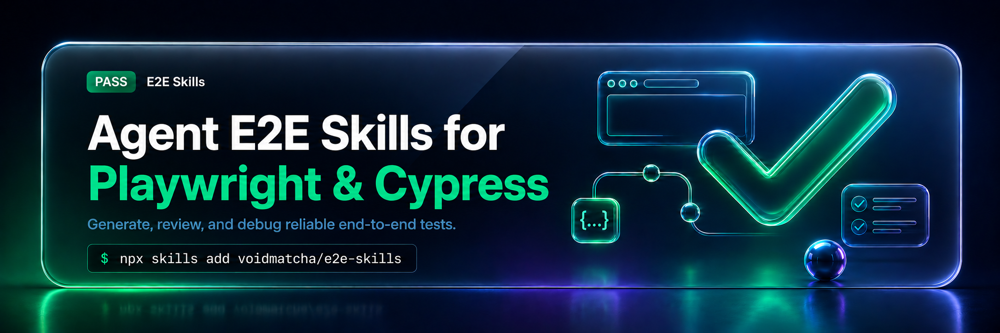
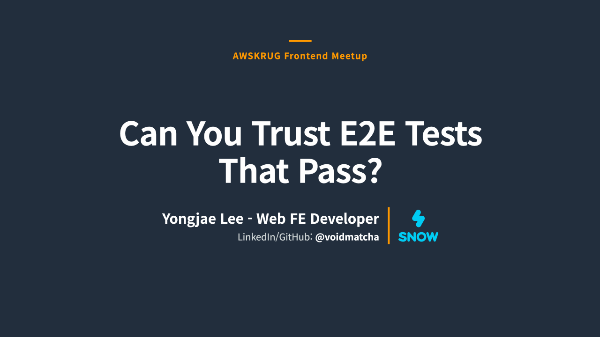

<div align="center">
  
</div>

<h1 align="center">E2E Skills</h1>

<p align="center">
  <a href="https://github.com/voidmatcha/e2e-skills"></a>
  <a href="https://claude.com/product/claude-code"></a>
  <a href="https://github.com/openai/codex"></a>
  <a href="https://playwright.dev"></a>
  <a href="#merged-upstream-fixes"></a>
  <a href="https://github.com/vercel-labs/skills#supported-agents"></a>
  <a href="https://skills.sh/voidmatcha/e2e-skills"></a>
  <a href="https://www.kimi.ai/resources/software-testing-skills"></a>
  <a href="./LICENSE"></a>
</p>

<p align="center">
<a href="README.md">English</a> | <a href="README.ko.md">한국어</a> | <a href="README.ja.md">日本語</a> | <strong>简体中文</strong>
</p>
<!-- README-CANONICAL-REVISION: sha256=809efdd0fad163dfb7eb8375f246931675107e7f51ee5531f12ed5066c9133d7; bytes=exact-README.md-UTF-8; translation-quality=not-attested -->

`e2e-skills` 是面向 Claude Code、Codex 等兼容 AI 编程 agent 的开源 Playwright 和 Cypress E2E 测试 skill 集。三个 skill 分别用于生成 Playwright 测试、审查已有的 Playwright/Cypress 测试与 PR，以及在不改产品代码的前提下修复失败的测试。

**E2E 测试通过了，功能真的正常吗？** 在 200 个热门 React 仓库中，有 34 个存在这样的测试：它所命名的功能已经损坏，测试却仍可能通过。[范围与局限](#证据与限制) · [数据](https://huggingface.co/datasets/voidmatcha/e2e-skills-benchmarks/blob/770f2de79848c65b80116219ce2d03747a3ae370/raw/oss-prevalence-and-reviewer-20261106/oss-cases/summary.md)

`e2e-skills` 帮助检查测试是否真正验证了名称所描述的行为。请先从[安装并试用](#安装并试用)开始：添加免费备忘录，安装 skill，然后运行 30 秒扫描。

<!-- Hero GIF placement: docs/assets/hero.gif (provided separately). -->

<p align="center">
  <a href="https://www.kimi.ai/resources/software-testing-skills">
    
  </a>
  <br />
  <sub><a href="https://www.kimi.ai/resources/software-testing-skills">已收录于 Kimi 官方网站的《AI Software Testing Skills for Smarter QA Automation》。</a></sub>
</p>

`e2e-reviewer` 用代码扫描器查找候选问题，再阅读测试和周边代码，判断是否确实存在问题。需要时，它还会建议修改断言条件或在与原应用分开的副本中加入缺陷，检查测试是否失败。审查者可以主动提出这些额外验证；执行需要可信的本地环境和命令批准。同一范围内已有的批准继续有效。

`e2e-reviewer` 发现的问题促成了 [15 个合入上游的 PR](#merged-upstream-fixes)。

| 需求 | Skill | 结果 |
| --- | --- | --- |
| 生成新的 Playwright 覆盖 | [`playwright-test-generator`](skills/playwright-test-generator/SKILL.md) | 根据实际页面编写的测试，以及扫描器检查和执行结果 |
| 审查 Playwright/Cypress 测试或 PR/diff 变更 | [`e2e-reviewer`](skills/e2e-reviewer/SKILL.md) | 按严重程度排列的问题、判断依据和修复建议；对变更区分新增、恶化和已有问题 |
| 调试并修复失败的 Playwright/Cypress 测试 | [`e2e-debugger`](skills/e2e-debugger/SKILL.md) | 附证据把原因归为 FLAKY、APP-REGRESSION、TEST-DEFECT-FIXED、ENV 或 UNCLEAR；只做安全的测试文件修复，从不改产品代码 |
| 运行确定性本地扫描 | `e2e-skills scan` | 无需安装目标项目 package 即可发现的候选问题 |

P0/P1/P2 表示审查的严重程度：P0 是功能损坏仍通过的问题，P1 影响可靠性或诊断，P2 涉及维护改进。

**测试生成：** 安装后，告诉 agent 要测试哪个本地项目。它会检查所需配置，并说明还需要哪些准备。

<a id="merged-upstream-fixes"></a>

## 已合入上游的修复

`e2e-reviewer` 发现的问题促成了 **15 个合入上游的 PR**。下表链接了每个补丁。

以下仓库的 GitHub star 合计 **496,650**，数据来自 2026-10-20 的 GitHub API 快照。

| 仓库 | GitHub Stars | PR | 已修复模式 |
| --- | ---: | --- | --- |
| Storybook | ★91.3k | [storybookjs/storybook#34141](https://github.com/storybookjs/storybook/pull/34141) | Playwright 操作缺失 `await`，且未验证可见性查询的返回值 |
| code-server | ★79.7k | [coder/code-server#7845](https://github.com/coder/code-server/pull/7845) | Focused test 泄漏、没有 matcher 的 `expect`、被丢弃的可见性读取 |
| Strapi | ★73.3k | [strapi/strapi#26630](https://github.com/strapi/strapi/pull/26630) | 被丢弃的导航/状态检查 |
| Ghost | ★55.6k | [TryGhost/Ghost#28712](https://github.com/TryGhost/Ghost/pull/28712) | Promise 值的禁用状态断言 |
| Cal.com | ★49.2k | [calcom/cal.diy#28486](https://github.com/calcom/cal.diy/pull/28486) | E2E 流程中的弱断言模式 |
| Bruno | ★47.7k | [usebruno/bruno#8317](https://github.com/usebruno/bruno/pull/8317) | 断言与等待可靠性修复 |
| Qwik | ★22.1k | [QwikDev/qwik#8777](https://github.com/QwikDev/qwik/pull/8777) | Locator/handle 存在性检查 |
| SvelteKit | ★20.9k | [sveltejs/kit#16068](https://github.com/sveltejs/kit/pull/16068) | 未等待的 Playwright 断言 |
| Element Web | ★13.6k | [element-hq/element-web#32801](https://github.com/element-hq/element-web/pull/32801) | Locator null-check 风格断言 |
| FiftyOne | ★11.2k | [voxel51/fiftyone#7851](https://github.com/voxel51/fiftyone/pull/7851) | Locator 定义检查改为可见的 duplicate-name 错误断言 |
| Carbon Design System | ★9.6k | [carbon-design-system/carbon#22564](https://github.com/carbon-design-system/carbon/pull/22564) | Locator 真值判断改为 web-first 断言 |
| Rancher Desktop | ★7.4k | [rancher-sandbox/rancher-desktop#10557](https://github.com/rancher-sandbox/rancher-desktop/pull/10557) | `not.toBeNull()` Locator 检查改为可见的 WSL integration-name 断言 |
| Apache Zeppelin | ★6.7k | [apache/zeppelin#5180](https://github.com/apache/zeppelin/pull/5180) | 恒为真的断言与静默跳过的守卫检查 |
| MUI X | ★5.9k | [mui/mui-x#22982](https://github.com/mui/mui-x/pull/22982) | UI handle 检查改为状态断言 |
| module-federation/core | ★2.7k | [module-federation/core#4826](https://github.com/module-federation/core/pull/4826) | Cypress spec 中冗余的 blanket `uncaught:exception` 抑制 |

## 看一个 false-green 测试

**false-green** 指要检查的行为已经损坏，测试却仍然通过。下面的修改检查消息是否真的显示在页面上，而不只是检查 Locator 对象是否存在。

```diff
- expect(page.getByText('Welcome back')).toBeDefined()
+ await expect(page.getByText('Welcome back')).toBeVisible()
```

<details>
<summary>完整示例和 scanner 输出</summary>

这个 Playwright 测试看起来合理，但它只证明 `Locator` 对象被创建了：

```typescript
import { expect, test } from '@playwright/test';

test('shows the welcome message', async ({ page }) => {
  await page.goto('/dashboard');
  expect(page.getByText('Welcome back')).toBeDefined();
  expect(page.locator('.user-badge')).not.toBeNull();
});
```

内置扫描器无需项目配置即可捕获这些 false-green 断言。下面是文本报告（不加 `--format text` 时，扫描器以 JSON 输出相同结果）：

```console
$ npx --yes --package=@voidmatcha/e2e-skills-scanner@3.5.0 e2e-skills scan tests/ --format text
Node source scan (canonical report view)
Status: COMPLETE; confirmed P0: 2, P0 candidates: 0, unresolved locations: 0.
Next:
  - Fix 2 confirmed P0 finding(s) ([P0][CONFIRMED] below).
Terms: https://github.com/voidmatcha/e2e-skills/blob/main/docs/scanner-cli.md#glossary

Coverage: BOUNDED; discovery: COMPLETE.
Semantic review: no LLM-triage candidates or source-linked analysis tasks; compatibility contract: DEVELOPMENT.
Review obligations: 0 unresolved location(s) covered by reviewing a retained candidate.
Unresolved analysis: 0 location(s) in 0 file(s), not findings; 0 of them are source-linked review tasks; execution status unchanged.
Project configuration: UNAVAILABLE; declared settings only, runner selection unchanged.
Configuration files: 0; unresolved configuration observations: 1.
Project ESLint effective rule states: NOT EXECUTED; static declarations do not establish active rules.

[P0][CONFIRMED] #4f Static finding (2 hits)
  "login.spec.ts":5: #4f
  "login.spec.ts":6: #4f

AST-origin total: 2 hit(s); retained findings, not ast-grep execution.

Summary: 2 total hit(s), 2 P0, 0 P1/P2 heuristic, 0 LLM-triage, 0 P0 candidate; 2 AST-origin hit(s), canonical retained findings.
```

由于这次运行报告了 P0 发现，`e2e-skills scan` 会以 exit 1 结束。

`eslint-plugin-playwright` 也会通过 `no-unnecessary-assertions` 标记这种写法。请启用该规则，让提交时的 lint 负责它能捕获的问题，其余由扫描器补充。

**可执行示例：** [React 乐观写入证明](examples/react-optimistic-write/README.md) 展示了为什么乐观 UI 需要请求和持久化证明，而不只是可见状态。

</details>

## 演示文稿：通过的 E2E 测试值得信任吗？

从存在 bug 但测试仍然通过的案例出发，整理了结合 lint 与 LLM 审查的过程、通过 mutation 和应用缺陷注入进行验证的方法、基准测试结果，以及开源贡献成果。

<p align="center">
<a href="https://voidmatcha.art/talks/awskrug-e2e-2026-en">
  
</a>
</p>

<p align="center">
  <a href="https://voidmatcha.art/talks/awskrug-e2e-2026-en">查看演示文稿（英文）</a>
</p>

## 安装并试用

### 1. 添加免费备忘录

将[备忘录正文](docs/test-authoring-memo.md#the-memo)复制到项目的 `AGENTS.md`（Codex）或 `CLAUDE.md`（Claude Code），并保留现有指令；也可以在项目目录中用 CLI 写入（需要 Node.js 22+）。写入 `CLAUDE.md` 时使用 `--host claude`，添加 `--dry-run` 可预览。此命令只写入备忘录，不安装 skill：

```bash
npx --yes --package=@voidmatcha/e2e-skills-scanner@3.5.0 e2e-skills guidance --host codex --project . --memo
```

### 2. 安装 skill

这一条命令会为包括 Claude Code 和 Codex 在内的所有[支持的代理](https://github.com/vercel-labs/skills#supported-agents)全局安装三个技能。CLI 版本已固定。如果只想为一个代理安装，请使用 `npx --yes skills@1.5.21 add voidmatcha/e2e-skills --skill '*' -g -a <agent>`（例如 `-a claude-code` 或 `-a codex`）。开启一个新的代理会话，然后确认技能列表（例如 Claude Code 中的 `/skills`）里出现了 `e2e-reviewer`、`e2e-debugger` 和 `playwright-test-generator`。

```bash
npx --yes skills@1.5.21 add voidmatcha/e2e-skills -g --all
```

审查和调试可以直接使用。测试生成还需要 Playwright 官方测试 agents 及其 `playwright-test` MCP 服务器，每个项目用 `npx playwright init-agents` 设置一次；参见[一次性的项目设置](#测试生成一次性的项目设置)。

### 3. 扫描测试

对典型的测试目录，静态扫描约需 30 秒（需要 Node.js 22+）：

```bash
npx --yes --package=@voidmatcha/e2e-skills-scanner@3.5.0 e2e-skills scan tests/ --format text --fail-on p0 --allow-incomplete
```

报告中的 `INCOMPLETE` 表示有些代码未被分析，因此即使退出码为 0 也不是干净的结果（[术语](docs/scanner-cli.md#glossary)）。

### 开始使用

用日常语言向代理提出请求即可：

```text
Review my Playwright tests in tests/e2e with e2e-reviewer.
If useful, offer an assertion mutation or app-fault probe as a follow-up.
```

```text
Generate Playwright E2E coverage for apps/web/e2e.
```

```text
This test is failing, fix it.
```

审查和修复失败测试可以直接使用。测试生成需要先完成下面一次性的项目设置。

### 测试生成：一次性的项目设置

`playwright-test-generator` 通过 `playwright-test` MCP 服务器使用 Playwright 官方测试代理。首次使用时，如果缺少这些代理，它会停止生成，并告诉你在 Playwright 项目根目录中运行一条命令。技能本身从不运行这条命令：

```bash
npx --no-install playwright init-agents --loop=claude   # Claude Code
npx --no-install playwright init-agents --loop=codex    # Codex
```

`--no-install` 使用项目中已安装的 Playwright，不会下载其他版本。在 Playwright 1.62 中，该命令会先加载 `playwright.config.*`，然后写入：

- `--loop=claude`：`.claude/agents/playwright-test-planner.md`、`playwright-test-generator.md`、`playwright-test-healer.md`，以及声明 `playwright-test` 服务器（`npx playwright run-test-mcp-server`）的 `.mcp.json`。已有的 `.mcp.json` 会被替换而不是合并，请先备份。
- `--loop=codex`：`.codex/agents/playwright_test_planner.toml`、`playwright_test_generator.toml`、`playwright_test_healer.toml`，每个代理文件内部都声明了 `playwright-test` 服务器。它不会写入 `.codex/config.toml`。
- 两者都会：在没有 `specs/` 目录时创建 `specs/README.md`，在项目没有 seed 测试时在测试目录中创建 `seed.spec.ts`。

然后在项目中重启代理。在 Claude Code 中，批准项目的 `playwright-test` MCP 服务器。在 Codex 中，由于生成器需要会话级服务器，还要按照[安装指南](docs/installation.md#codex)在受信任项目的 `.codex/config.toml` 中声明 `playwright-test`。会话中出现 `generator_write_test` 工具后即可开始生成。

如果希望代理同时测试失败路径，可以把[测试编写备忘](docs/test-authoring-memo.md)添加到代理加载的指令文件中。Claude Code 使用 E2E 测试目录；Codex 使用仓库根目录，如果在 E2E 测试目录中启动 Codex，则使用该目录。可以先加上 `--dry-run` 预览：

```bash
npx --yes --package=@voidmatcha/e2e-skills-scanner@3.5.0 e2e-skills guidance --host claude --project path/to/e2e-tests --memo
npx --yes --package=@voidmatcha/e2e-skills-scanner@3.5.0 e2e-skills guidance --host codex --project path/to/repository --memo
```

在我们的开发试验中，影响最大的是备忘文件：没有它时，技能发现的失败路径 fault 更少（Claude 54 个中 42 个，Codex 54 个中 27 个），备忘位于根目录指令文件时分别为 53/54 和 45/54。

### 无需安装，在 CI 中扫描

扫描器无需安装技能即可运行，因此可以直接在本地或 CI 中使用：

```bash
npx --yes --package=@voidmatcha/e2e-skills-scanner@3.5.0 e2e-skills scan path/to/tests --format text
```

在真实仓库中，扫描经常以 `INCOMPLETE` 和退出码 2 结束：这表示有些代码无法分析，并不表示测试失败。请让代理对同一批测试运行 `e2e-reviewer` 技能；在 CI 中加上 `--allow-incomplete`，退出码就只取决于已分析的 finding。阅读报告：`P0`（`[P0][CONFIRMED]`）是经机械确认、不检查任何内容也能通过的测试；`LLM-TRIAGE` 标记尚未确认的候选，由 `e2e-reviewer` 技能确认或否定；`P0 candidate`（`[P0?]`）是一经确认即为 P0 的候选。`provenance-unsupported` 表示扫描器无法证明 `page` 等值的来源，因此没有检查那段代码。报告中的其他术语见[术语表](docs/scanner-cli.md#glossary)。

如果 `npx` 因 `ETARGET`（"No matching version found ... with a date before"）失败，说明 `.npmrc` 设置了 `min-release-age`，它会隐藏发布不足该天数的版本。不要修改 `.npmrc`，只对这一条固定版本的命令解除限制：`npm_config_min_release_age=0 npx --yes --package=@voidmatcha/e2e-skills-scanner@3.5.0 e2e-skills scan path/to/tests --format text`

### 其他安装方式与故障排查

除了 skills CLI，也可以把同样的三个技能作为插件安装。两种方式只选一种：插件技能带有命名空间，同时安装会让每个技能加载两次。

```text
/plugin marketplace add voidmatcha/e2e-skills
/plugin install e2e-skills@voidmatcha
```

```text
codex plugin marketplace add voidmatcha/e2e-skills
codex plugin add e2e-skills@voidmatcha
```

第一组用于 Claude Code，第二组用于 Codex。测试生成仍然需要上面的项目设置。

如果技能没有出现，或生成一直未就绪，请运行只读诊断。它会报告已安装的技能副本（包括过期的重复副本，以及已移除的 debugger 技能遗留的副本）、官方代理和 MCP 配置以及后续步骤，不做任何更改：

```bash
npx --yes --package=@voidmatcha/e2e-skills-scanner@3.5.0 e2e-skills doctor --host claude --project /path/to/playwright-project
```

Codex 请使用 `--host codex`。前提条件、可同时完成项目设置的安装器以及手动设置，请参阅[安装指南](docs/installation.md)。

## 支持环境

<details>
<summary>查看支持环境和执行条件</summary>

请用这些 skill 补充真实应用及其 E2E suite。审查和修复失败测试支持 Playwright/Cypress，生成仅支持 Playwright。

随附的 shell 脚本面向常规的 macOS/Linux 布局，使用 `/bin/bash` 以及启动器所需的固定系统可执行文件路径。Windows 用户需要兼容的 WSL 发行版，并把项目放在 WSL 文件系统内；不支持原生 Windows。NixOS，以及仅通过 Nix、pyenv、Conda 或 nvm 安装的工具，并不都能被自动发现。缺少受信任的工具时，相关操作会停止；不要通过环境中的 `PATH` 查找绕过这一边界。请从宿主实际提供的 Skill 位置解析 Skill 资源，包括插件缓存和自定义安装位置，而不是猜测的主目录。

generator 将 `thin-rules.md`、测试编写备忘和安全指令附加到官方 planner 与 generator 后委派，再运行 reviewer scanner 和新测试。它不安装任何内容，不修改 agent 或 MCP 设置，不使用 CLI fallback 或 healer。缺少设置时会提供指南和只读的 `e2e-skills doctor`。doctor 还会报告 monorepo 中 Playwright config 所属的包、未安装的 `e2e-reviewer` 和可选的 lint。

生成使用本地开发中常见的 loopback 地址（`localhost`、`127.0.0.1`、`::1`）。复用已获批的开发服务器及其现有测试 backend 或 mock。browser 操作前只确认场景使用的服务。写入需要隔离的测试数据及清理或重置方法；只读场景不需要重置。无需创建新的 mock 服务器或部署环境。未使用的 API 或 database 标为 N/A；共享数据或生产数据仍不适用。实际 navigation 和 request 目的地必须与获批 origin 的 scheme、hostname 和有效 port 一致；允许单独获批的 loopback API 目的地。其他或无法解析的目的地均为 BLOCKED。这些检查不提供 browser 全局 origin 隔离。

仅在证实为生成错误时，父 agent 才能最多修复两次。必须保留要求的结果和预期值，重复写入前安全清理或重置测试数据，并使用相同的获批执行方式重复 origin 和 scanner 检查。产品缺陷、原因不明和剩余失败均保持 BLOCKED。完整流程见 [generator 约定](skills/playwright-test-generator/SKILL.md)。

probe 执行需要可信项目，以及对包括环境变量和 flag 在内的确切命令的批准。报告注明跳过的检查。mutation 和应用 fault probe 是可选后续操作；未执行的结果不会报告为已测量。

版本历史和旧 generator 流程见 [CHANGELOG.md](CHANGELOG.md)。

</details>

## 检查生成的测试能否发现缺陷

生成由官方 Playwright agent 负责。之后，generator skill 会在安装了 `e2e-reviewer` 时运行扫描器，最多三轮修复 P0/P1 项。如果仍有问题或扫描未完成，则停止；通过后，仅用已获批准的项目测试命令，在已批准的项目或确认唯一的项目中运行新 spec，并报告测试运行原生的 passed/failed/skipped 数量。没有已批准的测试命令时，报告测试未运行。缺失或跳过的检查会报告为未完成。需要审查生成测试是否真正验证了预期行为时，请另行请求 `e2e-reviewer`。

先用常规的 `e2e-reviewer` 审查确认测试是否检查了预期行为。如果某个问题需要运行证据，再只针对该断言或行为添加 probe。你可以选择在哪里投入额外的 token 和执行时间；mutation 与应用 fault probe 不会在每次审查中自动运行。

- **断言 mutation：** 在测试副本中反转断言条件，检查它是否真的失败。这只确认断言能否失败，并不证明原测试能发现应用缺陷。
- **应用缺陷注入：** 在应用副本中加入一个特定缺陷，检查未经修改的原测试能否发现它。

例如：“检查保存功能出错时，这个测试能否发现。”reviewer 会查看本地项目并提出检查方案。执行需要可信且准备好的本地环境，以及你对命令的批准。结果仅适用于选定的断言或缺陷，不代表能发现所有缺陷。

详情请参阅[执行步骤和准备条件](skills/e2e-reviewer/references/runtime-probes.md)及[两个 OSS 工作流程验证案例](https://huggingface.co/datasets/voidmatcha/e2e-skills-benchmarks/blob/2992d57564bb5b0d7eae0650a64f392481211d41/snapshots/git-93afd3b105b869b15589634c88676230c7d92254/benchmarks/release-readiness-v1/README.md#portable-integration)。

可选：如果希望代理编写测试时也覆盖失败路径，请将[测试编写备忘](docs/test-authoring-memo.md)原样粘贴到项目的 `CLAUDE.md` 或 `AGENTS.md` 中。始终加载的这个文件是备忘的放置位置。在某些宿主上子代理不会继承该文件，因此 generator 技能也会把备忘传给它委派的官方代理；文件中缺少备忘时，它会提示下方的 `guidance` 命令，未经你同意不会写入任何内容。其他技能不会加载它；请先阅读其测量结果和局限。可选的[测试失败策略](docs/test-failure-policy.md)是放入同一文件的另一段片段，要求代理在说不出依据的需求时不要改写失败的测试。也可以不手动粘贴，运行 `e2e-skills guidance --host claude|codex --project PATH --memo --policy`：仅在明确指定时，才会将其中一项或两项原样写入 HTML 注释标记之间。详见[安装说明](docs/installation.md#optional-memo-and-failure-policy)。

## 证据与限制

出现比例：Claude 源码审查确认了 34/200 个仓库（17.0%，95% CI 12.4–22.8%）；Claude 和 Codex 在同一位置均确认问题的仓库为 32/200 个。这些数字已反映 [timeout 复核更正](CHANGELOG.md#swallowed-wait-re-audit)；链接的 HF 快照仍保留原始数字。[范围与方法](https://huggingface.co/datasets/voidmatcha/e2e-skills-benchmarks/blob/770f2de79848c65b80116219ce2d03747a3ae370/raw/oss-prevalence-and-reviewer-20261106/oss-cases/summary.md) · [结果](https://huggingface.co/datasets/voidmatcha/e2e-skills-benchmarks/blob/770f2de79848c65b80116219ce2d03747a3ae370/raw/oss-prevalence-and-reviewer-20261106/oss-cases/CODEX-EXPANDED-REPORT.md)

备忘录与 healer：在准备好的 16 个 regression 案例中，使用 136 词 memo 时有 10/16 次修改应用代码，使用 memo v5 时为 0/16 次。Claude 和 Codex 分别测量，结果相同。测量时的配置要求项目指令文件中包含备忘录。[实验条件与局限](https://huggingface.co/datasets/voidmatcha/e2e-skills-benchmarks/blob/5ba1d3e97f9dd810cf03ebc3b01dca54b12b4c6f/raw/evidence-20261106b/healer-memo-v5/tab2-results/memov5-heal-20261106.md)

审查费用：记录中的 Claude `claude-sonnet-5-5`、high effort 运行每个仓库约 $1–2（扩展样本范围 $0.58–1.96）。[费用表](https://huggingface.co/datasets/voidmatcha/e2e-skills-benchmarks/blob/770f2de79848c65b80116219ce2d03747a3ae370/raw/oss-prevalence-and-reviewer-20261106/reviewer-cost-table.md)

这些数据仅代表所述条件下的观察。源码判断不是实际运行证明，样本并非随机，审查结果取决于模型和项目。[数据与范围](https://huggingface.co/datasets/voidmatcha/e2e-skills-benchmarks/tree/770f2de79848c65b80116219ce2d03747a3ae370/raw/oss-prevalence-and-reviewer-20261106)

[3.0.0 验证记录](https://huggingface.co/datasets/voidmatcha/e2e-skills-benchmarks/blob/2992d57564bb5b0d7eae0650a64f392481211d41/snapshots/git-93afd3b105b869b15589634c88676230c7d92254/benchmarks/release-readiness-v1/README.md)涵盖安装、扫描器行为、安全规则和部分 Playwright/Cypress 运行，并列出保留的证据和结果的适用范围。

[10 月 20 日的验证](https://huggingface.co/datasets/voidmatcha/e2e-skills-benchmarks/blob/2992d57564bb5b0d7eae0650a64f392481211d41/snapshots/git-93afd3b105b869b15589634c88676230c7d92254/benchmarks/release-readiness-v1/README.md#october-20-successor)检查了隔离环境中的安装、Claude Code 和 Codex 通过官方 agent/MCP 生成并运行测试的流程，以及选定的 Cypress 断言 mutation 和应用故障注入。generator 的原始测量与后续重跑结果继续分别报告。

<details>
<summary>基准测量范围与模型结果</summary>

reviewer 的结果取决于模型：在相同的冻结 snapshot 和 36 个公开开发案例上，每个 arm 重复五次，`gpt-6-sol` 通过了 [v22](https://huggingface.co/datasets/voidmatcha/e2e-skills-benchmarks/blob/2992d57564bb5b0d7eae0650a64f392481211d41/snapshots/git-93afd3b105b869b15589634c88676230c7d92254/benchmarks/reviewer-holdout-v22/README.md)，`gpt-6.1-sol` 通过了 [v24](https://huggingface.co/datasets/voidmatcha/e2e-skills-benchmarks/blob/2992d57564bb5b0d7eae0650a64f392481211d41/snapshots/git-93afd3b105b869b15589634c88676230c7d92254/benchmarks/reviewer-holdout-v24/README.md)，而 `gpt-6-luna` 未通过 [v23](https://huggingface.co/datasets/voidmatcha/e2e-skills-benchmarks/blob/2992d57564bb5b0d7eae0650a64f392481211d41/snapshots/git-93afd3b105b869b15589634c88676230c7d92254/benchmarks/reviewer-holdout-v23/README.md)。每次运行均完成了全部 540 次调用。这些禁用工具的测量评估了提供的指令，不能说明扫描器的效果或在未见项目上的准确率。分数仅适用于各报告指定的 snapshot。模型分数、协议、负面发现和主张边界见[基准状态](benchmarks/STATUS.md)，行为变更见 [CHANGELOG.md](CHANGELOG.md)。

包含协议、输入资料、摘要和原始运行资料的完整历史基准冻结 snapshot 由[证据 manifest](benchmarks/external-evidence.json)固定，可从 [Hugging Face 数据集](https://huggingface.co/datasets/voidmatcha/e2e-skills-benchmarks)获取。审计旧分数前，使用 `scripts/dev/fetch-benchmark-evidence.sh --dry-run` 查看恢复计划。

</details>

## E2E 审查目录

该目录包含 24 个稳定的 Playwright/Cypress 测试异味。最常见的 false-green 形态包括 Locator 真值判断、缺失断言、吞掉错误、focused tests、缺失认证，以及没有网络调用证明的乐观 UI 检查。参见 [完整分类与依据](docs/e2e-test-smells.md)。

有些模式需要应用代码在审查范围内，而不仅仅是测试。`#22` 乐观 UI 是最明显的例子：点击是否真的发出 mutation，无法仅从 spec 判断，因此在只有测试的仓库中，审查不会猜测，而是不报告。这是有意的误报控制，也是可执行示例附带组件的原因。

<details>
<summary>按严重程度查看全部 24 个模式</summary>

### 检测到的 24 个模式：按严重程度分组

#### P0：必须修复（静默恒绿）

功能损坏时测试仍会通过，因为没有发生真实验证。

| # | 模式 | 修改前 | 修改后 |
|---|---------|--------|-------|
| 1 | **名称与断言不匹配** | 名称说的是 "status"，但只检查 `toBeVisible()` | 添加 status 内容断言，或重命名为匹配实际检查 |
| 2 | **Then 缺失** | 执行 cancel action，验证文本已恢复，但输入框仍然可见？ | 同时验证已恢复状态和已关闭状态 |
| 3 | **吞掉错误** | spec 中的 `try/catch`，POM 中的 `.catch(() => {})` | 让错误导致失败；从 POM methods 中移除 silent catch |
| 3b | **Cypress `uncaught:exception` 抑制** | `cy.on('uncaught:exception', () => false)` 会忽略所有应用错误；不重新抛出错误的 `fail` handler 也会让失败的测试通过 | 将 handler 限定到特定已知错误；重新抛出未知错误；`fail` handler 必须以 `throw error` 结束 |
| 4 | **空洞或削弱重试的断言** (P0/P1) | P0：不变量谓词和 Locator 真值判断。P1：较弱的挂载证明；一次性读取的值/URL；zero-timeout 重试/截止时间风险；未证明的缺失状态；可能为空的集合上的断言循环；遗漏已承诺 accessible name 的 ARIA snapshots | 使用有意义的边界和 web-first 自动重试断言；通过同一 locator 的证据，或精确的 selector/fixture 映射及相关状态的正向断言验证缺失状态，保持原场景，在断言循环前证明集合非空，并让已承诺的 accessible names 保持 load-bearing |
| 5 | **绕过模式** (5a P0, 5b P1) | `if (await el.isVisible()) { expect(...) }`；没有注释的 `{ force: true }` | 始终断言；把环境检查移到 `beforeEach`；给 force:true 添加 `// JUSTIFIED:` |
| 7 | **Focused test 泄漏** | 提交了 `test.only(...)`: CI 只运行一个测试，默默跳过其余测试 | 删除 `.only`；使用 `--grep` 或 `--spec` 做本地聚焦 |
| 8 | **断言缺失** | 被丢弃的 locator/boolean 是该场景唯一的验证，或像 `expect(x).toBeVisible;` 一样未调用 matcher | 添加 `await expect(locator).toBeVisible()`；当独立 verification/failure evidence 已存在时，仅排除 8a/8b |
| 12 | **认证设置缺失** | 缺少 login/`storageState`/auth fixture 时，protected-route spec 会通过，因为泛化断言也匹配 login/wrong surface | 添加 `beforeEach` login，配置 `storageState`，或使用 auth fixture；不要把正常的 auth-caused failure 归类为 P0 |

#### P1：应修复（诊断质量差 / 浪费 CI 时间）

测试能运行，但会误导开发者、浪费 CI 时间，或埋下未来回归。

| # | 模式 | 修改前 | 修改后 |
|---|---------|--------|-------|
| 6 | **直接 DOM 查询** | `evaluate()` 中的 `document.querySelector` | 使用框架的 locator/query API（`locator` / `cy.get`） |
| 9 | **硬编码等待** | `waitForTimeout(2000)` / `cy.wait(2000)` / `waitForLoadState('networkidle')` | 依赖框架自动等待；使用基于条件的等待 |
| 10 | **不稳定测试模式** | 没有注释的 `items.nth(2)`；`test.describe.serial()`；未限定作用域的 accessible-name substring（10c）；Cypress async callbacks、被赋值的 `cy` commands，或继续串接的 action chains（10d–10f） | 使用稳定且限定作用域的 locators 和自包含测试；让 Cypress 工作留在其 command chain 中，不要把 Chainables 赋值为普通值，并在 actions 后重新查询 |
| 13 | **POM 使用不一致** | Raw actions bypass a source-established same-page POM boundary; existence alone is insufficient | Reuse the proven boundary; do not invent a wrapper merely because a POM exists |
| 14 | **硬编码凭据** | 测试代码中的 `loginPage.login('demo-admin', '<literal-password>')` | 使用 `process.env.TEST_USER`、Playwright config secrets 或 test data fixtures |
| 15 | **`expect()` 缺失 `await`** | Async Locator/Page web-first matcher Promise 没有被排序或观察；rejection 通常稍后才暴露，归因更差 | `await` 或 return matcher Promise；sync value matchers 被排除 |
| 16 | **action 缺失 `await`** | Actionability、action ordering 或 navigation 可能与后续工作竞态；rejection 通常稍后才暴露，归因更差 | `await` 或 return action Promise |
| 17 | **不建议直接使用 Page selector API** | 基于 selector 的 `page.click`、`page.fill` 及相关 Page actions 跳过 Locator 层 | 使用 Locator actions，以获得组合性、strictness、复用和更清晰的 failure |
| 18 | **过度使用 `expect.soft()`** | 关键 soft assertions 在 hard scenario gate 之前运行，因此前置条件损坏后 dependent work 仍会继续 | 先对主要状态做 hard-gate；仅对独立细节使用 `soft` |
| 19 | **测试代码中的模块级可变状态** | 测试工具中第 0 列的 `let seq = 0;` 或被修改的 `const cache = new Map()`，它会在长生命周期 worker 中跨测试保留，并在并行 workers 间冲突 | 删除 counter；从 `Date.now()` + `Math.random().toString(36).slice(2, 8)` 派生唯一性，或把状态移入 `test.beforeEach` |
| 20 | **未 mock 的真实后端写入** | Signup/checkout spec 触达共享或持久状态，却没有受控测试边界 | Stub 该写入，或证明存在 disposable container、rollback fixture、isolated tenant/database 或等价的受控 backend |
| 22 | **乐观 UI 缺少调用证明** | Like-toggle test 断言 `aria-pressed` 翻转: UI 乐观更新，POST 被删除时仍会通过 | 将 UI assertion 与 `page.waitForRequest()`（点击前 armed）或 route-hit flag 配对 |

#### P2：可择机修复（维护性 / 鲁棒性）

弱但不一定错误；重构时处理。

| # | 模式 | 修改前 | 修改后 |
|---|---------|--------|-------|
| 11 | **YAGNI + Zombie Specs** | `clickEdit()` 从未被调用；无理由的空 wrapper class；整个 spec 被另一个 spec 重复；没有理由的 skip | 删除未使用成员和 zombie specs；为保留的 skip 说明理由，并为长期跳过项设置复查节点；只有在确实能移除无意义间接层时，才内联 single-use helpers |
| 21 | **手动捕获的 session 文件依赖** | `storageState: 'auth/member.json'` 只由手动 capture script 生成；CI 上会缺失，也会悄悄过期 | 以编程方式重新生成 session（API-login helper 或 `setup` project）；manual files 只作为带 programmatic fallback 的 cache |
| 23 | **Fixture 忽略渲染保护条件** | Liked-tab fixture seed 了 `liked: false`；card component 对每个 item 都 `return null`，让空 UI 看起来像 infra flake | 在 seeding 前读取 item component 的 early returns/filters；seed fields 以通过被测 view 的每个 guard |

</details>

## 失败调试

**3.5 起替换。** 一个精简的 `e2e-debugger` 取代了 `playwright-debugger` 和 `cypress-debugger`。在两次 Claude 测量中（各 24 个真实失败案例），旧的调试器并不比普通代理更准确（20/24 对 22/24；在 3.4.0 上 22/24 对 23/24），成本约为 1.6–1.7 倍，运行时间约为 1.8 倍。测试失败时，用日常语言提出请求（"This test is failing, fix it."），[`e2e-debugger`](skills/e2e-debugger/SKILL.md) 会在该请求中应用 [test-authoring memo](docs/test-authoring-memo.md#failure-handling) 的失败处理条目，因此无需设置 instruction 文件。它在关闭重试的情况下重跑测试三次，结果有成有败时报告 FLAKY 并停止；否则判断是应用还是测试有误：疑似应用回归时不改产品代码也不改测试，只报告；只有在证明是测试缺陷时才在不削弱测试的前提下修复，然后扫描改动的 spec 并要求连续三次通过。它也可能把修复交给官方 Playwright healer，并把同样的规则粘贴进提示。依据：在[准备好的 healer 实验](https://huggingface.co/datasets/voidmatcha/e2e-skills-benchmarks/blob/5ba1d3e97f9dd810cf03ebc3b01dca54b12b4c6f/raw/evidence-20261106b/healer-memo-v5/tab2-results/memov5-heal-20261106.md)中，Claude Sonnet 5.5 和 Codex GPT-6 Sol 各自在使用 136 词 memo 时修改了 16 个 regression 案例中 10 个的应用代码，使用 memo v5（301 词）时为 0 个。两组都把 memo 放在根目录的 instruction 文件中，每个案例运行一次。这一结果无法区分措辞与篇幅的影响。该 skill 不依赖 instruction 文件来传递失败处理指引，这种传递方式尚未测量。对于通过削弱断言而变绿的测试，请使用 `e2e-reviewer`。对于旧安装遗留的调试器副本，安装器和 `e2e-skills doctor` 只发出警告，不会删除；如果不再使用，请自行删除。

## 独立扫描器

无需请求 AI agent，即可直接运行代码扫描器。它查找待审查的候选问题，不会执行测试，也不会判断测试是否证明了预期行为。

```bash
npx --yes --package=@voidmatcha/e2e-skills-scanner@3.5.0 e2e-skills scan path/to/tests --format text
```

需要 Node.js 22 或更新版本；TypeScript parser 已随附。npx 会下载尚未缓存的 package 及其依赖。scanner 本身不会下载 tool、加载可执行的项目配置或运行测试。使用 `--format json` 获取结构化输出，或用 `--report-file <new-file>` 保存完整报告；不会覆盖已有文件。

reviewer 已内置相同的 Node scanner，无需单独通过 npm 安装。离线 launcher 和运行要求请参阅 [scanner 指南](docs/scanner-cli.md#installed-scanner)。

仅运行 scan 不会执行 assertion mutation 或 fault injection。这些检查需要可信且准备就绪的项目。详见 [CLI 与 probe 指南](docs/scanner-cli.md)。

<details>
<summary>扫描器高级选项和文件读取范围</summary>

要运行已安装的项目 ESLint 及其配置，请先明确信任 checkout 并批准准确命令，再添加 `--project-eslint --trust-project`。项目控制的代码具有 host 访问权限；不提供 sandbox，也不安装依赖。内置检查无需此选项。

> **读取边界。**
> <!-- README-I18N-CONTRACT:SCANNER-READ-SCOPE:START -->
> Bundled checks 会报告请求路径下的 source。Framework provenance resolution 也可能读取同一项目其他位置的相对 fixture/support imports。
> <!-- README-I18N-CONTRACT:SCANNER-READ-SCOPE:END -->

<!-- README-CONTRACT:SCANNER-EXTENSIONS:START -->
内置检查读取 `.ts`、`.js`、`.tsx`、`.jsx`、`.mts`、`.mjs`、`.cts`、`.cjs` 源文件。
<!-- README-CONTRACT:SCANNER-EXTENSIONS:END -->

默认 `p0` 策略在存在机械确认的 P0 时返回 exit 1。使用 `--fail-on p0-candidate` 可同时检查保留的 P0 候选；`any` 检查所有确认的发现，`none` 不根据数量判定退出状态。exit 0 只表示没有达到所选阈值，并不表示测试可靠。该门禁只在存在机械确认的发现时失败。这些发现现在包括一种狭窄的 #5a 形态（用 `if` 包住测试唯一断言的情况），以及两种狭窄的 #4a 形态（`expect(x || true)` 真值检查，以及将 Locator 的 `count()` 与 `>= 0` 或 `> -1` 比较）；其他大多数 P0 问题仍以候选形式出现，需要经过 `e2e-reviewer` 的 LLM 审查步骤。即使执行完成且 P0=0，保留的候选和待确认事项仍需审查。输入缺失、源文件完整性或分析失败会产生 INCOMPLETE 并返回 exit 2。如果不希望未解决的分析阻塞 CI，可添加 `--allow-incomplete`：退出状态只对已分析的发现应用策略，报告会说明有多少文件和位置未被分析、未被检查。输入缺失和源文件完整性失败仍返回 exit 2。如果测试从 workspace package 导入 `test` 或 `expect`，可添加 `--trust-module <package>=<scan root 内源文件入口路径>` 以跟踪该导入。这不证明已完成全部语义验证。执行与网络边界见 [SECURITY.md](SECURITY.md)。

</details>

## 它与 ESLint plugins 有何不同

`eslint-plugin-playwright` 和 `eslint-plugin-cypress` 用于发现测试代码中的常见错误。`e2e-skills` 扫描器也将这两个插件用作可选检查层。

本项目还向 `eslint-plugin-playwright` 贡献了 `no-unnecessary-assertions` 规则，[PR #470 已合并](https://github.com/mskelton/eslint-plugin-playwright/pull/470)。该规则检测仅检查 Locator 对象是否存在、而非应用状态的断言。

执行插件需要用户明确许可；未获许可时仍运行内置检查。在现有插件规则之外，`e2e-skills` 还提供：

- 补充插件规则的自有代码检查
- 针对需要结合测试意图和周边代码判断的问题进行审查

linter 可以捕获直接的 Locator 真值断言或缺失的 `await`。它无法判断名为"shows a duplicate-name error"的测试是否真的检查了该错误，protected-route test 是否忘了认证，或乐观 UI 断言是否证明了 backend request 发生。用 plugins 做持续 linting，用 `e2e-reviewer` 判断测试可信度。

## 常见问题

### 如何找到那些能通过但什么也没测的 Playwright 或 Cypress 测试？

将 `e2e-reviewer` 指向相关 spec directory。它会结合确定性候选项与语义审查，再返回发现。

<details>
<summary>审查范围和执行安全条件详情</summary>

<!-- README-I18N-CONTRACT:CORE-SAFETY:START -->
`e2e-reviewer` Skill 会用稳定 IDs 和 P0/P1/P2 severity 审查目录中的全部 24 个模式。它的独立 `e2e-skills scan` 扫描器只覆盖确定性的机械子集。扫描器命中是候选项，不是最终发现；该 Skill 会先检查意图和周边代码，再报告 verdict。

只有在你信任该仓库并批准精确命令（包括其 environment 和 flags）之后，assertion mutation 和应用 fault probe 才会执行 target-controlled code。generator 先运行审查器扫描器，再用已获批准的项目测试命令，仅执行自己写的 spec。

对于非公开 benchmark runs，`--isolation-wrapper` 是必需 hook，而不是 isolation proof。Continuous integration (CI) 会验证 wrapper contract，但不会证明 filesystem、process 或 network isolation。
<!-- README-I18N-CONTRACT:CORE-SAFETY:END -->

</details>

### 这会替代 Playwright 或 Cypress 测试执行吗？

不会。这套 bundle 用于审查测试质量、生成 Playwright 覆盖，并用你批准的测试命令修复失败的测试；它不是 test runner。

## 在 GitHub Actions 中加入静态扫描

默认将候选问题写入 job summary，仅在存在已确认的 P0 时失败。不执行被审查项目。[输入和行为](docs/github-action.md)。

```yaml
permissions:
  contents: read
jobs:
  e2e-review:
    runs-on: ubuntu-latest
    steps:
      - uses: actions/checkout@v4
      - uses: actions/setup-node@v4
        with:
          node-version: '22'
      - uses: voidmatcha/e2e-skills@v3
        with:
          path: tests/
          fail-on: p0
          allow-incomplete: 'true'
          format: text
```

运行此示例前，`v3` 标签必须指向包含此 Action 的版本。本次本地修改不创建标签。

## 详细文档

- [如何审查 AI 生成的 Playwright 和 Cypress E2E 测试](docs/review-ai-generated-e2e-tests.md)
- [24 个 Playwright 和 Cypress E2E 测试异味](docs/e2e-test-smells.md)
- [基准状态与负面结果](benchmarks/STATUS.md)
- [可选的测试编写备忘](docs/test-authoring-memo.md)及其[证据记录](docs/benchmarks/test-authoring-memo-v1.md)
- [可选的测试失败策略](docs/test-failure-policy.md)及其[测量摘要](docs/benchmarks/test-failure-policy-v1.md)

<details>
<summary>更多参考资料</summary>

- [规则自审](docs/rule-self-audit.md)
- [开源案例研究](docs/case-studies.md)
- [完整历史基准冻结 snapshot（Hugging Face 数据集）](https://huggingface.co/datasets/voidmatcha/e2e-skills-benchmarks)
- [外部证据台账](docs/llm-generated-e2e-test-evidence.md)
- [历史 AI 审查器基准](docs/ai-reviewer-benchmark.md)
- [框架范围](docs/framework-scope.md)
- [本地 E2E 规则桥接与推荐 lint](docs/installation.md#optional-project-lint)
- [路线图](docs/roadmap.md)
- [Archived reviewer evidence plan](https://huggingface.co/datasets/voidmatcha/e2e-skills-benchmarks/blob/a8279e972f2ae5b7628ac9ec8ccfc4cdac380a1d/releases/v3.3.1/docs-archive-20261028/README.md)

</details>

## 贡献

欢迎提交 bug reports、误报防护、新 anti-patterns 和 translations。请从 [CONTRIBUTING.md](CONTRIBUTING.md) 开始了解 setup 和 verification requirements。跨代理维护契约位于 [AGENTS.md](AGENTS.md)。

## 许可证

Apache-2.0 &copy; [voidmatcha](https://github.com/voidmatcha)。参见 [LICENSE](LICENSE)。

部分基准测试记录引用了 Playwright 官方代理定义（Apache-2.0，Microsoft），详见 [NOTICE](NOTICE)。Playwright 是 Microsoft Corporation 的商标，本项目与 Microsoft 没有关联，也未获其认可。
